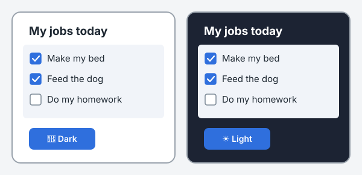

Today's prototype is a list of jobs to tick off, and a button that switches the screen between light and dark.

The ticking is built in: a **Toggle** can look like a tick box. The light and dark button you build yourself, and it needs the lesson's one big idea.



## Try the finished app

```step
stage: info
insight: "Using the working app first gives students the goal before anything is taken apart: every later step builds back towards it."
try: { playground: appbuilder, starter: "app.json#done", tab: run, level: 2, height: 600 }
check: { type: reflect, text: "I ticked and unticked the jobs, switched to dark and back, and saw which events lit up." }
```

This is the checklist you'll build, open on the **Run** tab. Tick and untick the jobs. Click **🌙 Dark** a few times: dark, then light, then dark. The event list beside the app lights up each time an event runs.

## Build 1: jobs as tick boxes

```step
stage: run
app: true
query: { code: "@app.json#start", level: 2, id: build-1 }
caption: "Look: Tick box"
clip:
  - caption: { text: "Each job is a Toggle. Select it, then Look: Tick box.", say: "Each job is a Toggle. Select it, then choose Look, Tick box." }
  - click: { selector: ".view-design [data-ab='widget:BedJob']" }
  - click: { selector: "[data-ab='prop:look']" }
  - press: ArrowDown
  - press: Enter
  - click: { selector: ".view-design [data-ab='widget:FeedJob']" }
  - click: { selector: "[data-ab='prop:look']" }
  - press: ArrowDown
  - press: Enter
  - click: { selector: ".view-design [data-ab='widget:HomeworkJob']" }
  - click: { selector: "[data-ab='prop:look']" }
  - press: ArrowDown
  - press: Enter
  - caption: { text: "Run it: each one ticks and unticks by itself.", say: "Run it. Each one ticks and unticks by itself." }
  - click: { selector: "[data-ab='tab:run']" }
  - click: { selector: ".view-run [data-ab='widget:BedJob'] .tg" }
  - wait: 600
  - click: { selector: ".view-run [data-ab='widget:BedJob'] .tg" }
  - wait: 800
insight: "A tick box that switches itself is the goal in miniature: the rest of the lesson builds the same on-and-off by hand, to see how it works."
try: { playground: appbuilder, starter: "app.json#start", keep: build, level: 2, height: 640 }
check:
  type: code
  text: "All three jobs are Toggles with the Tick box look."
  rules: { contains: ["object BedJob (toggle) text \"Make my bed\" (tick box)", "object FeedJob (toggle) text \"Feed the dog\" (tick box)", "object HomeworkJob (toggle) text \"Do my homework\" (tick box)"] }
```

The screen is made for you: a title, three jobs on a light card, and a button called *ModeButton*. Each job is a **Toggle**, an on/off switch. (You can change the jobs to your own at the end.)

1. Click *Make my bed* to select it. In **Properties**, set **Look** to **Tick box**.
2. Do the same for the other two jobs.
3. Run it and tick a job, then untick it. You didn't write an event: a Toggle switches itself.

## Build 2: a button that goes dark

```step
stage: run
app: true
query: { code: "@app.json#sol-step-2", level: 2, id: build-2 }
caption: "Click to go dark"
clip:
  - click: { selector: "[data-ab='tab:events']" }
  - caption: { text: "When ModeButton is clicked: Dark is true, and dark colours.", say: "When ModeButton is clicked, set Dark to true, and change the colours." }
  - click: { selector: ".view-events [data-ab='add-event']" }
  - click: { selector: ".view-events .ev.sel [data-ab='add-condition']" }
  - click: { selector: "[data-ab='group:object:ModeButton']" }
  - click: { selector: "[data-ab='entry:onClicked']" }
  - click: { selector: "dialog[open] [data-ab='done']" }
  - click: { selector: ".view-events .ev.sel [data-ab='add-action']" }
  - click: { selector: "[data-ab='group:Variables']" }
  - click: { selector: "[data-ab='entry:setVar']" }
  - type: { selector: "dialog[open] [data-ab='param:value']", text: "true" }
  - click: { selector: "dialog[open] [data-ab='done']" }
  - click: { selector: ".view-events .ev.sel [data-ab='add-action']" }
  - click: { selector: "[data-ab='group:Screen']" }
  - click: { selector: "[data-ab='entry:setBackground']" }
  - type: { selector: "dialog[open] [data-ab='param:value']", text: "\"#1c2333\"" }
  - click: { selector: "dialog[open] [data-ab='done']" }
  - caption: { text: "Then the title's colour, and the button's own text.", say: "Then the title's colour, and the button's own text." }
  - click: { selector: ".view-events .ev.sel [data-ab='add-action']" }
  - click: { selector: "[data-ab='group:object:Title']" }
  - click: { selector: "[data-ab='entry:setColour']" }
  - type: { selector: "dialog[open] [data-ab='param:value']", text: "\"white\"" }
  - click: { selector: "dialog[open] [data-ab='done']" }
  - click: { selector: ".view-events .ev.sel [data-ab='add-action']" }
  - click: { selector: "[data-ab='group:object:ModeButton']" }
  - click: { selector: "[data-ab='entry:setText']" }
  - type: { selector: "dialog[open] [data-ab='param:value']", text: "\"☀️ Light\"" }
  - click: { selector: "dialog[open] [data-ab='done']" }
  - wait: 600
  - click: { selector: ".view-events .preview-col [data-ab='widget:ModeButton']" }
  - expect: { selector: ".view-events .preview-col [data-ab='widget:ModeButton']", contains: "Light" }
  - caption: { text: "It goes dark. Click again: it stays dark.", say: "It goes dark. Click again, and it stays dark." }
  - wait: 1000
insight: "A switch that can't switch back is the first working piece, and it shows the next problem: clicking again should go light."
try: { playground: appbuilder, starter: "app.json#sol-step-2", keep: build, level: 2, height: 640 }
check:
  type: code
  text: "ModeButton is clicked sets Dark to true, the screen background to \"#1c2333\", Title's colour to \"white\" and its own text to \"☀️ Light\"."
  rules: { event: [["when ModeButton is clicked", "Set variable Dark to true", "Set screen background to \"#1c2333\"", "Set Title colour to \"white\"", "Set ModeButton text to \"☀️ Light\""]] }
```

The app has a variable, *Dark*, made for you on the left. It starts at `false`: the screen isn't dark yet. A variable that is only ever `true` or `false` is a **true/false** variable.

1. On the **Events** tab, choose **+ Add event**, **+ Condition**, **ModeButton**, **ModeButton is clicked**.
2. Add four actions:
   - **Variables**, **Set variable Dark to** `true`
   - **Screen**, **Set screen background to** `"#1c2333"` (a dark blue)
   - **Title**, **Set Title colour to** `"white"`
   - **ModeButton**, **Set ModeButton text to** `"☀️ Light"` (copy it from here)
3. Click the button in the preview. It goes dark. Click again: it stays dark.

## Build 3: two events (and why they cancel)

```step
stage: run
app: true
query: { code: "@app.json#flat", tab: run, level: 2, id: build-3 }
caption: "Both events run"
clip:
  - caption: { text: "Two events: go dark if Dark is false, light if it's true. Click once…", say: "Two events. Go dark if Dark is false, go light if it's true. Click once." }
  - click: { selector: ".view-run [data-ab='widget:ModeButton']" }
  - expect: { selector: ".view-run [data-ab='widget:ModeButton']", contains: "Dark" }
  - caption: { text: "Both ran, top to bottom: dark, then straight back.", say: "Both ran, top to bottom. Dark, then straight back." }
  - wait: 900
insight: "Building the obvious fix and watching it fail is the lesson's surprise: on one click, every event whose conditions are true runs."
try: { playground: appbuilder, starter: "app.json#sol-step-3", keep: build, level: 2, height: 640 }
check:
  type: code
  text: "Two separate events for ModeButton: one checks Dark = false and goes dark, one checks Dark = true and goes light."
  rules: { event: [["when ModeButton is clicked and when Variable Dark = false", "Set variable Dark to true", "Set screen background to \"#1c2333\""], ["when ModeButton is clicked and when Variable Dark = true", "Set variable Dark to false", "Set screen background to \"white\"", "Set Title colour to \"black\"", "Set ModeButton text to \"🌙 Dark\""]] }
```

1. Click the event to select it, choose **+ Condition**, **Variables**, **Variable … …**, and type `false`. Now it only goes dark when Dark is false.
2. Add a second event: **ModeButton is clicked**, and **Variable Dark =** `true`. Give it the opposite actions: Dark to `false`, background `"white"`, Title colour `"black"`, text `"🌙 Dark"`.
3. Click the button in the preview. Nothing seems to happen. Watch the events beside the preview: both light up on the one click. The first goes dark and sets Dark to true, then the second sees Dark is true and goes straight back.

## Build 4: a sub-event

```step
stage: run
app: true
query: { code: "@app.json#click-only", level: 2, id: build-4 }
caption: "Go dark only if it's light"
clip:
  - click: { selector: "[data-ab='tab:events']" }
  - caption: { text: "One click event, nothing in it yet. It needs two branches.", say: "One click event, with nothing in it yet. It needs two branches." }
  - wait: 800
  - caption: { text: "Select the event, then ⋯, Add a sub-event.", say: "Select the event, then the three dots, then Add a sub-event." }
  - click: { selector: ".view-events .ev-acts >> nth=0" }
  - click: { selector: ".view-events .ev.sel [data-ab='event-menu']" }
  - click: { selector: "[data-ab='menu:add-a-sub-event']" }
  - caption: { text: "The sub-event checks: Variable Dark = false.", say: "The sub-event checks. Is Dark false?" }
  - click: { selector: ".view-events .ev.sel [data-ab='add-condition']" }
  - click: { selector: "[data-ab='group:Variables']" }
  - click: { selector: "[data-ab='entry:compareVar']" }
  - type: { selector: "dialog[open] [data-ab='param:value']", text: "false" }
  - click: { selector: "dialog[open] [data-ab='done']" }
  - click: { selector: ".view-events .ev.sel [data-ab='add-action']" }
  - click: { selector: "[data-ab='group:Variables']" }
  - click: { selector: "[data-ab='entry:setVar']" }
  - type: { selector: "dialog[open] [data-ab='param:value']", text: "true" }
  - click: { selector: "dialog[open] [data-ab='done']" }
  - click: { selector: ".view-events .ev.sel [data-ab='add-action']" }
  - click: { selector: "[data-ab='group:Screen']" }
  - click: { selector: "[data-ab='entry:setBackground']" }
  - type: { selector: "dialog[open] [data-ab='param:value']", text: "\"#1c2333\"" }
  - click: { selector: "dialog[open] [data-ab='done']" }
  - expect: { selector: ".view-events event-sheet", contains: "#1c2333" }
  - caption: { text: "Then the other two dark actions, as before.", say: "Then the other two dark actions, as before." }
  - wait: 900
insight: "A sub-event runs only when its own condition is true, inside the one click event."
try: { playground: appbuilder, starter: "app.json#sol-step-4", keep: build, level: 2, height: 640 }
check:
  type: code
  text: "One ModeButton click event with a sub-event: if Dark = false, go dark (all four actions). The two flat events are gone."
  rules: { event: [["when ModeButton is clicked > when Variable Dark = false", "Set variable Dark to true", "Set screen background to \"#1c2333\"", "Set Title colour to \"white\"", "Set ModeButton text to \"☀️ Light\""]], lacks: ["when ModeButton is clicked and when Variable Dark"] }
```

1. Delete both events: click each, then **⋯**, **Delete this event**.
2. Add one event: **ModeButton is clicked**, with no other condition and no action.
3. With it selected, choose **⋯**, **Add a sub-event**.
4. Give the sub-event the condition **Variable Dark =** `false` and the four dark actions from Build 2.

## Build 5: an Else

```step
stage: run
app: true
query: { code: "@app.json#sol-step-5", level: 2, id: build-5 }
caption: "Otherwise, go light"
clip:
  - click: { selector: "[data-ab='tab:events']" }
  - click: { selector: ".view-events [data-ab='item:compareVar'] >> nth=0" }
  - click: { selector: "dialog[open] [data-ab='cancel']" }
  - caption: { text: "Then ⋯, Add an Else below: it sets everything back.", say: "Then the three dots, Add an Else below. It sets everything back." }
  - click: { selector: ".view-events .ev.sel [data-ab='event-menu']" }
  - click: { selector: "[data-ab='menu:add-an-else-below']" }
  - click: { selector: ".view-events .ev.sel [data-ab='add-action']" }
  - click: { selector: "[data-ab='group:Variables']" }
  - click: { selector: "[data-ab='entry:setVar']" }
  - type: { selector: "dialog[open] [data-ab='param:value']", text: "false" }
  - click: { selector: "dialog[open] [data-ab='done']" }
  - click: { selector: ".view-events .ev.sel [data-ab='add-action']" }
  - click: { selector: "[data-ab='group:Screen']" }
  - click: { selector: "[data-ab='entry:setBackground']" }
  - type: { selector: "dialog[open] [data-ab='param:value']", text: "\"white\"" }
  - click: { selector: "dialog[open] [data-ab='done']" }
  - expect: { selector: ".view-events event-sheet", contains: "Else" }
  - caption: { text: "One trigger, two branches: only one runs on each click.", say: "One trigger, two branches. Only one runs on each click." }
  - wait: 900
insight: "One trigger with a sub-event and an Else: exactly one branch runs on each click."
try: { playground: appbuilder, starter: "app.json#sol-step-5", keep: build, level: 2, height: 640 }
check:
  type: code
  text: "The click event has a sub-event (Dark = false: go dark) and an Else (go light, all four actions), and the two flat events are gone."
  rules: { event: [["when ModeButton is clicked > when Variable Dark = false", "Set variable Dark to true", "Set ModeButton text to \"☀️ Light\""], ["when ModeButton is clicked > else", "Set variable Dark to false", "Set screen background to \"white\"", "Set Title colour to \"black\"", "Set ModeButton text to \"🌙 Dark\""]], lacks: ["when ModeButton is clicked and when Variable Dark"] }
```

1. With the sub-event selected, choose **⋯**, **Add an Else below**.
2. Give the Else the four light actions: Dark to `false`, background `"white"`, Title colour `"black"`, text `"🌙 Dark"`.
3. Click to go dark, click again to go light.

Your event should look like this:

| When (condition) | Do (actions) |
|---|---|
| ⚡ ModeButton is clicked | |
| ↳ Variable Dark = false | Set Dark to true, background "#1c2333", Title colour "white", ModeButton text "☀️ Light" |
| ↳ Else | Set Dark to false, background "white", Title colour "black", ModeButton text "🌙 Dark" |

You've built a switch by hand: it remembers whether it's on (*Dark*), and one click runs one of two branches. A Toggle with the **Tick box** look is App Builder's built-in version of the same thing: `BedJob.on` is true or false, like Dark.

## Check: which branch runs?

```step
stage: investigate
insight: "Tracing which branch runs, and finding Nib's two flat events, both test the move: one trigger, then exactly one of the two branches."
tasks:
  - check:
      type: question
      q: "With the sub-event and Else, the screen is dark, so Dark is true. You click ModeButton once. What happens?"
      options: ["The Else runs, so it goes light", "The sub-event runs, so it stays dark", "Both run, so it goes light then dark", "Neither runs, as Dark isn't false"]
      answer: 0
      feedback: [null, "The sub-event only runs if Dark is false. It isn't.", "Else only runs when the condition above it was false. Only one of them can run.", "When the sub-event's condition is false, that's exactly when Else runs."]
      explain: "The click triggers the event once. Its sub-event checks Dark = false, which is false, so the Else runs instead and sets everything back to light. Exactly one branch runs per click."
  - check:
      type: bug
      code: "working.txt#nib"
      text: "Nib's dark mode button doesn't seem to do anything. Click the line where Nib first goes wrong."
      answer: 3
      fault: logic
      misconception: flat-events-cancel
      explain: "Line 3: a second separate click event also runs on the same click, straight after the first, and undoes it. The fix is one click event with a sub-event and an Else."
```

### Trace a click

### Find Nib's mistake

## Make it yours: count what's done

```step
stage: modify
insight: "Counting jobs done uses the same shape again with the tick boxes' own trigger, is switched, and condition, is on; then a checklist for a real person moves it to design."
try: { playground: appbuilder, starter: "app.json#done", keep: build, level: 2, height: 640 }
tasks:
  - check:
      type: code
      text: "Done goes up when a job is ticked and down when it's unticked, and DoneText shows it."
      rules: { contains: ["variable Done = 0"], event: [["when BedJob is switched > when BedJob is on", "Add 1 to variable Done", "Set DoneText text to"], ["when BedJob is switched > else", "Subtract 1 from variable Done", "Set DoneText text to"], ["when FeedJob is switched > when FeedJob is on", "Add 1 to variable Done"], ["when HomeworkJob is switched > else", "Subtract 1 from variable Done"]] }
  - check: { type: reflect, text: "I made a checklist for a real person (their jobs, their words), and they used it without my help." }
```

### Count what's done

Add a variable *Done* (starting at 0) and a Text called *DoneText* on the card, under the jobs. A tick box has its own trigger, **BedJob is switched**, and its own condition, **BedJob is on**. Use the same shape you just built: one event **BedJob is switched**, a sub-event **BedJob is on** that adds 1 to Done, and an Else that subtracts 1. In both branches, set DoneText to `"Done: " & Done & " of 3"`. Then do the same for the other jobs.

### A checklist for someone

Make a checklist for someone you know: a packing list, a morning routine, or jobs for a club. Use their words for each job. Add a **Reset** button that unticks every job (**Turn BedJob off**) and sets Done to 0. Then watch them use it without helping. What did they expect to happen that didn't?
