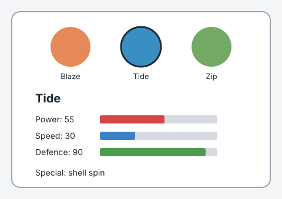

Today's prototype shows three made-up creatures: Blaze, Tide and Zip. Click one, and its name, stats and special ability appear below.

You could make three separate Images, each with its own events. Instead you'll use **one** Image object with three copies. **Object variables** belong to the object, but each copy keeps its own values: Blaze's power and Tide's power are different numbers.



## Try the finished app

```step
stage: info
insight: "Clicking each creature in the finished viewer shows the move before it's built: one event, a different result for each copy."
try: { playground: appbuilder, starter: "app.json#done", tab: run, level: 3, height: 640 }
check: { type: reflect, text: "I clicked each creature in turn. One event showed all three." }
```

This is the finished app you'll build, open on the **Run** tab. The event list under the app has only one event.

## Build 1: each creature's own values

```step
stage: run
app: true
query: { code: "@app.json#start", level: 3, id: build-1 }
caption: "Object variables"
clip:
  - caption: { text: "Click a creature. Give the object a variable: power.", say: "Click a creature. Give the object a variable, power." }
  - click: { selector: ".stage.design [data-id='k0']" }
  - type: { selector: "[data-ab='new-objvar-name']", text: "power" }
  - press: Enter
  - caption: { text: "Each copy keeps its own value: Blaze 80…", say: "Each copy keeps its own value. Blaze, eighty." }
  - type: { selector: "[data-ab='objvar:power']", text: "80" }
  - press: Tab
  - click: { selector: ".stage.design [data-id='k1']" }
  - caption: { text: "…and Tide 50.", say: "And Tide, fifty." }
  - type: { selector: "[data-ab='objvar:power']", text: "50" }
  - press: Tab
  - expect: { selector: "[data-ab='objvar:power']", contains: "" }
  - wait: 800
insight: "Adding a variable to the object once, then filling it in on each copy, is what lets one event show different values later."
try: { playground: appbuilder, starter: "app.json#start", keep: build, level: 3, height: 640 }
check:
  type: code
  text: "Creature has the object variables name, power, speed, defence and ability."
  rules: { contains: ["object variable Creature.name =", "object variable Creature.power =", "object variable Creature.speed =", "object variable Creature.defence =", "object variable Creature.ability ="] }
```

The screen is made for you: three copies of one Image called *Creature*, Texts for the stats, and three Boxes for the bars (*PowerBar*, *SpeedBar*, *DefenceBar*). Click any copy: the sidebar says *Creature*, with *3 copies*.

1. Click a creature. In Properties, under **Object variables**, add *name* and *ability* (start them empty), then *power*, *speed* and *defence* (start them at 0).
2. Click each creature in turn and fill in its own values: Blaze, Tide and Zip, numbers from 0 to 100, and an ability each. Make up the numbers, but be ready to say why each creature has them.

## Build 2: show the clicked creature

```step
stage: run
app: true
query: { code: "@app.json#walk-start", level: 3, id: build-2 }
caption: "Creature.name means the clicked copy"
clip:
  - click: { selector: "[data-ab='tab:events']" }
  - caption: { text: "One event: Creature is clicked.", say: "One event. Creature is clicked." }
  - click: { selector: ".view-events [data-ab='add-event']" }
  - click: { selector: ".view-events .ev.sel [data-ab='add-condition']" }
  - click: { selector: "[data-ab='group:object:Creature']" }
  - click: { selector: "[data-ab='entry:onClicked']" }
  - click: { selector: "dialog[open] [data-ab='done']" }
  - caption: { text: "Set NameText's text to Creature.name: the name of the copy that was clicked.", say: "Set NameText's text to Creature dot name: the clicked copy's name." }
  - click: { selector: ".view-events .ev.sel [data-ab='add-action']" }
  - click: { selector: "[data-ab='group:object:NameText']" }
  - click: { selector: "[data-ab='entry:setText']" }
  - type: { selector: "dialog[open] [data-ab='param:value']", text: "Creature.name" }
  - click: { selector: "dialog[open] [data-ab='done']" }
  - expect: { selector: ".view-events event-sheet", contains: "Creature.name" }
  - click: { selector: ".view-events .preview-col [data-ab='widget:Creature'][data-id='k2']" }
  - caption: { text: "Click Zip in the preview: NameText shows Zip.", say: "Click Zip in the preview. NameText shows Zip." }
  - wait: 900
insight: "One click event shows whichever copy was clicked: the click picks that copy, so Creature.name means its name."
try: { playground: appbuilder, starter: "app.json#sol-step-2", keep: build, level: 3, height: 640 }
check:
  type: code
  text: "Creature is clicked shows the clicked copy's name, power, speed, defence and ability."
  rules: { event: [["when Creature is clicked", "Set NameText text to Creature.name", "Set PowerText text to", "& Creature.power", "Set SpeedText text to", "& Creature.speed", "Set DefenceText text to", "& Creature.defence", "Set AbilityText text to", "& Creature.ability"]] }
```

1. On the Events tab: **Creature is clicked**.
2. Add **Set NameText text to** `Creature.name`
3. Add **Set PowerText text to** `"Power: " & Creature.power`, and the same for speed and defence.
4. Add **Set AbilityText text to** `"Special: " & Creature.ability`
5. Click each creature in the preview.

## Build 3: bars

```step
stage: run
insight: "Bars reuse the same picked values, turned into a width."
try: { playground: appbuilder, starter: "app.json#sol-step-3", keep: build, level: 3, height: 640 }
check:
  type: code
  text: "The same event sets each bar's width from the stat."
  rules: { event: [["when Creature is clicked", "Set PowerBar width to Creature.power", "Set SpeedBar width to Creature.speed", "Set DefenceBar width to Creature.defence"]] }
```

A full bar is 200 wide. In the same event, add **PowerBar**, **Set PowerBar width to** `Creature.power / 100 * 200`, and the same for the other two bars.

## Check: one event, many creatures

```step
stage: investigate
insight: "The hide question and Nib's mistake test picking from the other side: an action in a picking event touches only the picked copy, not every copy."
tasks:
  - check:
      type: question
      q: "You add one more action to the click event: Hide Creature. You click Zip. Which creatures disappear?"
      options: ["Only Zip", "All three", "The two you didn't click", "None, because Hide needs Every tick"]
      answer: 0
      feedback: [null, "The click picked one copy. Actions in this event only touch that one.", "Nothing in the event picks the others.", "Hide works in any event."]
      explain: "Creature is clicked picks the copy you clicked. Every Creature action in that event applies to the picked copy only."
  - check:
      type: bug
      code: "working.txt#nib"
      text: "Nib wanted the other two creatures to hide. Click the line where Nib's thinking goes wrong."
      answer: 3
      fault: logic
      misconception: action-hits-all
      explain: "Line 3: in this event the click has picked Tide, so Hide Creature only hides Tide. To hide the others you'd hide every creature in an event that doesn't pick, then show the clicked one."
```

### Which ones hide?

### Find Nib's mistake

## Make it yours: a fourth creature, then your own set

```step
stage: modify
insight: "Adding a creature without touching the events shows the payoff of object variables and picking; a set of their own uses the whole pattern in a new context."
try: { playground: appbuilder, starter: "app.json#done", keep: build, level: 3, height: 640 }
tasks:
  - check:
      type: code
      text: "Four copies of Creature, and still one click event."
      rules: { contains: ["copies 4"], event: [["when Creature is clicked", "Set NameText text to Creature.name"]] }
  - check: { type: reflect, text: "I made my own viewer: at least three characters (copies of one Image), at least three stats shown as bars, and an ability and a weakness for each. I can explain why each one has its numbers." }
```

### A fourth creature

Click a creature, then choose **⋯**, **Duplicate** in the sidebar to make a fourth copy. Move it into the row, choose its picture, and fill in its object variables. Then run it and click it. What did you change on the Events tab? Nothing: the click event already works for any copy.

### Your own set

Choose your own set: made-up creatures, pets, robots, plants or anything with at least three characters. Upload your own pictures if you like. Give each one at least three stats and a weakness as well as an ability. Make the numbers fair: be ready to say why the strongest one isn't the best at everything.
