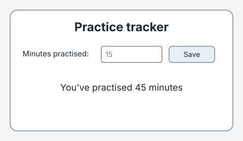

A **prototype** is an early version of an app that you can click through and test, before anyone spends weeks building the real thing. In this course you'll build prototypes with **App Builder**, which runs right here on the page.

An App Builder app has two halves:

- The **design** is the screen: the text, boxes and buttons the user sees.
- The **events** are what make it work. Each **event** is a row: on the left, *when* something happens; on the right, *what to do* then.

Today's app remembers your practice total in a **variable**: a named box that holds a number for the whole app.



## Predict: does the total change?

```step
stage: predict
insight: "Committing to an answer sets up the lesson's move: changing a variable doesn't change what's on the screen. An event has to set the text."
check:
  type: predict
  q: "The total starts at 0, and the screen says \"You've practised 0 minutes\". The only event is: when SaveButton is clicked, add 15 to Minutes. You click Save three times. What does the screen say now?"
  options: ["You've practised 0 minutes", "You've practised 45 minutes", "You've practised 15 minutes", "Nothing: the text disappears"]
  actual: "It still says 0 minutes. Minutes is now 45, but nothing told the text to change. The screen only shows a new total when an event sets the text."
```

| When (condition) | Do (actions) |
|---|---|
| SaveButton is clicked | Add 15 to variable Minutes |

## Try it: an app with no Set text

```step
stage: run
insight: "Clicking Save on a version with no Set text settles the prediction on the page: the variable changes, the screen doesn't."
try: { playground: appbuilder, starter: "app.json#nosettext", tab: run, level: 2, height: 600 }
check: { type: reflect, text: "I clicked Save three times. Minutes went up (under Watch), but the screen still said 0 minutes." }
```

This is the version from the prediction, open on the **Run** tab. Click **Save** three times. The **Watch** list beside the app shows the variable's real value; the event list under it lights up each time an event runs. You'll build the version that works.

## Watch first: adding an event

```step
stage: info
app: true
query: { code: "@app.json#sol-step-4-t1", id: walkthrough }
caption: "Add a variable, then an event"
clip:
  - caption: { text: "The screen is made. First the variable: type its name, then Enter.", say: "The screen is already made. First, the variable. Type its name, then press Enter." }
  - type: { selector: "[data-ab='new-variable-name']", text: "Minutes" }
  - press: Enter
  - click: { selector: "[data-ab='tab:events']" }
  - caption: { text: "Add an event, then its condition: SaveButton is clicked.", say: "Add an event, then its condition. SaveButton is clicked." }
  - click: { selector: ".view-events [data-ab='add-event']" }
  - click: { selector: ".view-events .ev.sel [data-ab='add-condition']" }
  - click: { selector: "[data-ab='group:object:SaveButton']" }
  - click: { selector: "[data-ab='entry:onClicked']" }
  - click: { selector: "dialog[open] [data-ab='done']" }
  - caption: { text: "Now an action on the right: add 15 to the variable Minutes.", say: "Now an action on the right. Add fifteen to the variable Minutes." }
  - click: { selector: ".view-events .ev.sel [data-ab='add-action']" }
  - click: { selector: "[data-ab='group:Variables']" }
  - click: { selector: "[data-ab='entry:addTo']" }
  - type: { selector: "dialog[open] [data-ab='param:value']", text: "15" }
  - click: { selector: "dialog[open] [data-ab='done']" }
  - expect: { selector: ".view-events event-sheet", contains: "Minutes" }
  - caption: { text: "One row: when SaveButton is clicked, add 15 to Minutes.", say: "One row. When SaveButton is clicked, add fifteen to Minutes." }
  - wait: 1600
```

The clip shows the clicks for steps 6 to 9 below. Everything you add is a click on a **+** button, then a choice from a short list.

## Build it: the practice tracker

```step
stage: run
insight: "Building the first version settles the prediction (the total changes but the screen doesn't), then adding Set text fixes it."
try: { playground: appbuilder, starter: "app.json#start", level: 2, height: 640 }
tasks:
  - check:
      type: code
      text: "The screen has a text input, a button called SaveButton and a text called TotalText."
      rules: { contains: ["(text input)", "object SaveButton (button)", "object TotalText (text)"] }
  - check:
      type: code
      text: "A variable called Minutes, and an event: when SaveButton is clicked, add to Minutes."
      rules: { contains: ["variable Minutes ="], event: [["when SaveButton is clicked", "to variable Minutes"]] }
  - check:
      type: code
      text: "The same event sets TotalText to show the total, and adds what was typed: int(TextInput.text)."
      rules: { event: [["when SaveButton is clicked", "to variable Minutes", "Set TotalText text to", "Minutes"], ["when SaveButton is clicked", "Add int(TextInput.text) to variable Minutes"]] }
```

### Make the screen

1. On the **Design** tab, choose **+ Add object**, then **Text**. In **Properties** on the right, change its text to *Practice tracker*.
2. Add a **Text input**: the box the user types in.
3. Add a **Button** and set its text to *Save*.
4. Add one more **Text** below. Set its text to *You've practised 0 minutes*.
5. Give the button and the last text proper names. In the left panel, select the button, click **⋯** beside it and choose **Rename**: call it *SaveButton*. Rename the last text *TotalText*, and the text input *TextInput*.

Drag things where you want them, or select one and use the arrow keys (Alt and the arrows change its size). Names that say what things are pay off in the next part: you'll pick them from a list, and *Text3* won't tell you which one it is.

### Make it work

6. Under **Variables** on the left, type *Minutes* in the New variable box, keep its starting value 0, and press **Enter**.
7. Open the **Events** tab and choose **+ Add event**.
8. Choose **+ Condition**, then **SaveButton**, then **SaveButton is clicked**, then **Add**.
9. Choose **+ Action**, then **Variables**, then **Add … to variable**. Type 15, check it says Minutes, and choose **Add**.
10. The preview on the right restarts by itself. Click **Save** in it a few times. Does the screen change? Open **Watch values and problems** under it to see Minutes.

### Show the total

11. Click the event, choose **+ Action**, then **TotalText**, then **Set TotalText text to …**. Type exactly: `"You've practised " & Minutes & " minutes"`
12. Click Save in the preview. Now it changes.
13. Last, use what the user typed. Click the **Add 15** action and change 15 to `int(TextInput.text)`. Type a number in the preview and click Save.

Your work is kept in this browser, in this step. **Save** at the top downloads a copy if you want one.

## Investigate: how the text is made

```step
stage: investigate
insight: "Reading the Set text expression and Nib's mistake both point at the move: the screen shows whatever the last Set text said, and only an event changes it."
tasks:
  - check:
      type: question
      q: "Minutes is 45. The Set text action says \"You've practised \" & Minutes & \" minutes\". What does the screen show?"
      options: ["You've practised 45 minutes", "You've practised Minutes minutes", "You've practised & 45 & minutes", "45"]
      answer: 0
      feedback: [null, "Minutes isn't inside the quote marks, so App Builder uses its value, not the word.", "The & signs join the pieces. They don't appear on the screen.", "The words inside the quote marks are shown too."]
      explain: "Words in quote marks are shown as they are. Minutes, outside the quotes, is replaced by its value. The & signs join the pieces into one line."
  - check:
      type: question
      q: "Why does the add action use int(TextInput.text) and not just TextInput.text?"
      options: ["A typed box holds text; int() makes it a number", "int() checks that the box isn't empty", "int() rounds the number to the nearest 10", "App Builder needs int() before any action"]
      answer: 0
      feedback: [null, "An empty box gives 0 with int(), but checking isn't its job.", "Rounding is round(). int() turns text into a whole number.", "Set text and many other actions don't need it."]
      explain: "A text input always holds text, even when you type 20. int() turns the text \"20\" into the number 20, so it can be added to Minutes. Without it, App Builder stops and says it can't add text to a number."
  - check:
      type: bug
      code: "working.txt#nib"
      text: "Nib's screen never changes from 0 minutes. Click the line that explains why."
      answer: 2
      fault: logic
      misconception: text-updates-itself
      explain: "Line 2: On start of screen runs once, when the app opens. After that nothing sets the text again, so it keeps saying 0. Nib needs a Set text action in the Save event too."
```

### Read the text

### Why int()?

### Find Nib's mistake

## Modify: a Reset button

```step
stage: modify
insight: "A Reset button needs both moves again: change the variable, then set the text. Choosing both is the check that the move has stuck."
try: { playground: appbuilder, starter: "app.json#done", level: 2, height: 640 }
tasks:
  - check:
      type: question
      q: "You add a Reset button. Which actions does its event need?"
      options: ["Set Minutes to 0, then set the text to show the total", "Set Minutes to 0, and nothing else", "Set the text to 0 minutes, and nothing else", "Delete the Minutes variable"]
      answer: 0
      feedback: [null, "Minutes would be 0, but the screen would still show the old total.", "The screen would say 0, but Minutes would still hold the old total, and the next Save would add to it.", "Variables are made on the left, not deleted by actions."]
      explain: "Reset changes the variable and the screen, so it needs both: Set variable Minutes to 0, then Set TotalText text to show the total."
  - check:
      type: code
      text: "A button called ResetButton whose event sets Minutes to 0 and sets TotalText's text."
      rules: { contains: ["object ResetButton (button)"], event: [["when ResetButton is clicked", "Set variable Minutes to 0", "Set TotalText text to"]] }
```

### Choose the actions

### Build it

This is the finished tracker. Add a **Button** with the text *Reset* and rename it *ResetButton*. On the Events tab, add an event: **ResetButton is clicked**, then the two actions. To set a variable, choose **Variables**, then **Set variable … to …**.

## Make: count the sessions

```step
stage: make
insight: "A second variable and a second Set text show that each number the app remembers needs its own variable, changed and shown by events."
try: { playground: appbuilder, starter: "app.json#sol-reset", level: 2, height: 640 }
check:
  type: code
  text: "A second variable, Sessions, goes up by 1 on each Save and is shown on the screen, and Reset sets it back to 0."
  rules: { contains: ["variable Sessions ="], event: [["when SaveButton is clicked", "Add 1 to variable Sessions", "Sessions"], ["when ResetButton is clicked", "Set variable Sessions to 0"]] }
```

This starts from the tracker with Reset. Add a second variable, *Sessions*, that goes up by 1 each time you click Save. Show it in a new Text, such as *Sessions: 3*. Make Reset clear it too.

Then show your tracker to someone. Ask them to use it without help. What did they try that you didn't expect?
