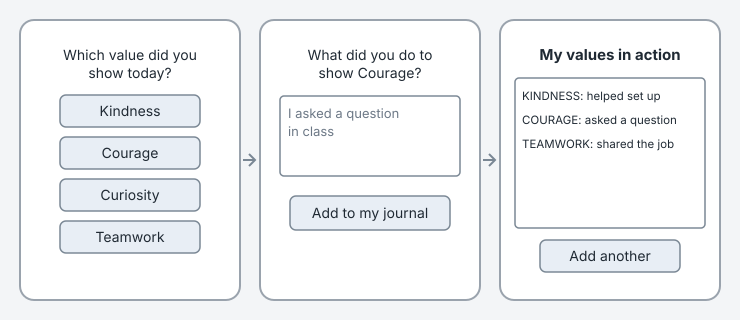

The values journal from an earlier lesson works. Inside, though, some of it is written out more than once. Today you'll **refactor** it: change how it's built without changing what it does.

1. **Spot the repetition:** jobs written out almost the same way in more than one place.
2. **Pull it into one place:** a function, or an event on All screens.
3. **Check nothing changed:** run the same journey before and after, and get the same result.



## Run it and write it down

```step
stage: info
insight: "A refactor is only safe if you can show nothing changed, so the journey and its result are written down before any tidying."
try: { playground: appbuilder, starter: "app.json#start", keep: build, tab: run, level: 4, height: 640 }
check: { type: reflect, text: "I clicked Courage, typed an entry, clicked Add, and wrote down exactly what the Journal screen showed (the entry and the count)." }
```

This is the finished values journal, open on the **Run** tab. Do this journey and write down what you see at the end:

1. On Choose, click **Courage**.
2. Type *I asked a question in class* and click **Add to my journal**.
3. On the Journal screen, write down the entry and the count exactly as they appear.

You'll do the same journey at the end. If anything is different then, the tidy-up changed what the app does.

## Spot the repetition

```step
stage: investigate
insight: "Naming what's the same and what's different in the four events is what tells you the function's actions (the same part) and its parameter (the different part)."
check:
  type: question
  q: "Open the Choose screen's Events tab. The four value buttons each have an event. What is different between them?"
  options: ["Only the value they set Chosen to", "The screen each one goes to next", "The variable each one sets", "Nothing: all four are the same"]
  answer: 0
  feedback: [null, "Look at the second action of each one: all four go to Describe.", "All four set Chosen.", "Each one sets Chosen to a different value."]
  explain: "All four set Chosen and go to Describe. Only the value changes. The same part becomes the function's actions; the part that changes becomes its parameter."
```

Open the **Choose** screen, then the **Events** tab, and read the four button events side by side.

## Tidy 1: one function, Pick

```step
stage: modify
app: true
query: { code: "@app.json#start", level: 4, id: tidy-1 }
caption: "A function with a parameter"
clip:
  - caption: { text: "In the sidebar, under Functions: + Function. Name it Pick.", say: "In the sidebar, under Functions, add a function. Name it Pick." }
  - click: { selector: "[data-ab='add-function']" }
  - type: { selector: ".side input.rename", text: "Pick" }
  - press: Enter
  - caption: { text: "+ Parameter: value. It stands for whichever value is picked.", say: "Plus Parameter. Call it value. It stands for whichever value is picked." }
  - click: { selector: "[data-ab='add-param']" }
  - type: { selector: "[data-ab='param-new']", text: "value" }
  - press: Enter
  - caption: { text: "The action the four events shared: set Chosen, but to value.", say: "Now the actions the four events shared. Set Chosen, but to value." }
  - click: { selector: ".view-events [data-ab='add-action']" }
  - click: { selector: "[data-ab='group:Variables']" }
  - click: { selector: "[data-ab='entry:setVar']" }
  - type: { selector: "dialog[open] [data-ab='param:value']", text: "value" }
  - click: { selector: "dialog[open] [data-ab='done']" }
  - expect: { selector: ".view-events event-sheet", contains: "value" }
  - caption: { text: "Then Go to screen Describe. Each button will call Pick with its own value.", say: "Then Go to screen Describe. Each button will call Pick with its own value." }
  - wait: 1200
insight: "The same actions go in the function once; the one thing that changed becomes a parameter the call fills in."
try: { playground: appbuilder, starter: "app.json#start", keep: build, level: 4, height: 640 }
check:
  type: code
  text: "A function Pick(value) sets Chosen to value and goes to Describe, and each value button just calls Pick with its value."
  rules: { contains: ["function Pick(value)"], event: [["Set variable Chosen to value", "Go to screen Describe"], ["when KindnessButton is clicked", "Call Pick with value = \"Kindness\""], ["when CourageButton is clicked", "Call Pick with value = \"Courage\""], ["when HonestyButton is clicked", "Call Pick with value = \"Honesty\""], ["when RespectButton is clicked", "Call Pick with value = \"Respect\""]], lacks: ["Set variable Chosen to \"Kindness\"", "Set variable Chosen to \"Courage\"", "Set variable Chosen to \"Honesty\"", "Set variable Chosen to \"Respect\""] }
```

1. In the sidebar, under **Functions**, click **+ Function** and name it *Pick*.
2. Click **+ Parameter** and call it *value*. Inside the function, *value* is whatever the call gives it.
3. Add the function's actions: **Variables**, **Set variable Chosen to** `value` (no quote marks: it's the parameter's name, not the word "value"), then **Screen**, **Go to screen** Describe.
4. Open the **Choose** screen's events. In **KindnessButton is clicked**, delete both actions and add **Functions**, **Call Pick** with value `"Kindness"`.
5. Do the same for the other three buttons, each with its own value.
6. Run it and click each button. Does each one still go to Describe with the right question?

Now, if every value should also play a sound, that's one change in Pick, not four.

## Find Nib's slip

```step
stage: investigate
insight: "Finding the action Nib left out shows that a refactor has to carry over everything the old events did, not just the part that changed."
check:
  type: bug
  code: "working.txt#nib"
  text: "After Nib's tidy-up, clicking a value does nothing you can see. Click the line where Nib first goes wrong."
  answer: 2
  fault: logic
  misconception: refactor-drops-action
  explain: "Line 2: Pick only sets Chosen. The old events also went to Describe, and that action didn't make it into the function, so the app quietly stays on Choose. A refactor must keep everything the old events did."
```

## Tidy 2: one Home event for every screen

```step
stage: modify
insight: "Writing the same Home event on two screens first makes the repetition real; one All screens event then replaces both, and any new screen with a HomeButton gets it for free."
try: { playground: appbuilder, starter: "app.json#sol-step-3", keep: build, level: 4, height: 640 }
tasks:
  - check:
      type: code
      text: "Describe has a HomeButton, and its own event takes you back to Choose."
      rules: { contains: ["object HomeButton (button)"], event: [["when HomeButton is clicked", "Go to screen Choose"]] }
  - check:
      type: code
      text: "AnotherButton is now called HomeButton, and one All screens event, HomeButton is clicked, goes to Choose (with no Home events left on the screens)."
      rules: { contains: ["all screens event: when HomeButton is clicked | do: Go to screen Choose"], lacks: ["AnotherButton", "Go to screen Journal event: when HomeButton is clicked", "count(Journal) event: when HomeButton is clicked"] }
```

### Add Home the old way

The Describe screen has no way back. Add one the way you know:

1. Open the **Describe** screen and add a **Button** called *HomeButton*, with the text *Home*.
2. On Describe's Events tab: **HomeButton is clicked** → **Go to screen** Choose.

Now look at the Journal screen's events too. **AnotherButton is clicked** → **Go to screen** Choose. That's the same job, written out a second time.

### Tidy them into one

1. On the Journal screen, rename *AnotherButton* to *HomeButton*. Keep its text as *Add another*: the name is for the events, the text is for the user.
2. Click **All screens** in the sidebar and add one event: **HomeButton is clicked** → **Go to screen** Choose.
3. Delete the Home events on Describe and on Journal. The All screens event does both jobs now.
4. Open the **Map** tab. The arrows back to Choose now come from one event.

An All screens event runs on every screen. On a screen with no HomeButton, such as Choose, it just never happens.

## Same journey, same result?

```step
stage: run
insight: "Running the journey from the start of the lesson is the test: the same result means the refactor changed how the app is built, not what it does."
try: { playground: appbuilder, starter: "app.json#done", keep: build, tab: run, level: 4, height: 640 }
check: { type: reflect, text: "I did the same journey as at the start and got exactly the same entry and count. I also checked that Home on Describe and Add another on Journal both go back to Choose." }
```

Open the **Choose** screen, then **Run**, and do the same journey as at the start: **Courage**, *I asked a question in class*, **Add to my journal**. Compare the Journal screen with what you wrote down.

If something is different, the tidy-up changed what the app does. Find the event or function you changed and compare it with the old one.

## Hand it in

```step
stage: modify
insight: "Sharing the working app lets the teacher run it, not just read about it."
try: { playground: appbuilder, starter: "app.json#done", keep: build, level: 4, height: 640 }
check: { type: reflect, text: "I sent my teacher a link to my tidied journal (or a saved file, if that's what my teacher asked for)." }
```

1. Click **Share** at the top of App Builder and copy the link.
2. Send it to your teacher the way your class usually hands work in. The link opens your app ready to run, with **Open a copy in App Builder** if they want to look inside.

If your teacher would rather have a file, **Save** at the top, then **Save to this computer…**, keeps a copy to upload instead.
