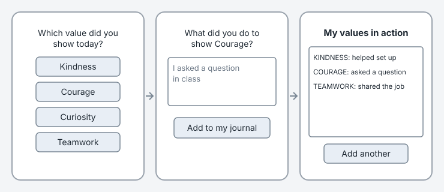

Today's prototype has three screens. Each screen has its own objects and its own events.

1. **Choose:** buttons for four values, such as Kindness, Courage, Honesty and Respect (or your school's own values).
2. **Describe:** "What did you do to show Courage?", a box to type in, and an *Add to my journal* button.
3. **Journal:** a list of every entry so far, and a button to add another.



## Predict: does the choice survive?

```step
stage: predict
insight: "Predicting whether the chosen value reaches screen 2 sets up the move: a whole-app variable keeps its value when the app goes to another screen."
check:
  type: predict
  q: "On screen 1 you click Courage. Its event sets the variable Chosen to \"Courage\", then goes to screen 2. Screen 2's On start of screen event sets its question to \"What did you do to show \" & Chosen & \"?\". What does the question say?"
  options: ["What did you do to show Courage?", "What did you do to show ?", "What did you do to show Chosen?", "Nothing: screen 2 can't see screen 1's variables"]
  actual: "It says Courage. Variables in the sidebar belong to the whole app, not one screen, so Chosen keeps its value when the app goes to another screen."
```

## Try the finished app

```step
stage: run
insight: "Using the finished three-screen app first gives a target for the long build and shows the variable carrying the choice."
try: { playground: appbuilder, starter: "app.json#try", tab: run, level: 3, height: 640 }
check: { type: reflect, text: "I added two entries with different values, and watched Chosen and Journal change in the Watch box." }
```

This is the finished app you'll build, open on the **Run** tab. The **Watch** box shows Chosen and Journal as they change.

## Watch first: a list of entries

```step
stage: info
app: true
query: { code: "@app.json#walk-start", level: 3, id: walkthrough }
caption: "Add to the end of a list"
clip:
  - caption: { text: "A list variable keeps many entries. Name it Journal.", say: "A list variable keeps many entries. Name it Journal." }
  - type: { selector: "[data-ab='new-list-name']", text: "Journal" }
  - press: Enter
  - click: { selector: "[data-ab='screen:Describe']" }
  - click: { selector: "[data-ab='tab:events']" }
  - caption: { text: "On the Describe screen: AddButton is clicked.", say: "On the Describe screen, a new event. AddButton is clicked." }
  - click: { selector: ".view-events [data-ab='add-event']" }
  - click: { selector: ".view-events .ev.sel [data-ab='add-condition']" }
  - click: { selector: "[data-ab='group:object:AddButton']" }
  - click: { selector: "[data-ab='entry:onClicked']" }
  - click: { selector: "dialog[open] [data-ab='done']" }
  - caption: { text: "Lists, Add … to the end of list: the value and what was typed.", say: "Its action is in Lists. Add to the end of list: the value, and what was typed." }
  - click: { selector: ".view-events .ev.sel [data-ab='add-action']" }
  - click: { selector: "[data-ab='group:Lists']" }
  - click: { selector: "[data-ab='entry:listAdd']" }
  - type: { selector: "dialog[open] [data-ab='param:value']", text: "uppercase(Chosen) & \": \" & TextInput.text" }
  - click: { selector: "dialog[open] [data-ab='done']" }
  - expect: { selector: ".view-events event-sheet", contains: "Journal" }
  - caption: { text: "Each click adds one entry at the end. Next: go to the Journal screen.", say: "Each click adds one entry at the end. Next, go to the Journal screen." }
  - wait: 1400
```

The clip shows steps 7 to 9 below.

## Build it: three screens

```step
stage: run
insight: "Building the events screen by screen, and seeing the chosen value appear on the next screen, settles the prediction before the list."
try: { playground: appbuilder, starter: "app.json#start", level: 3, height: 640 }
tasks:
  - check:
      type: code
      text: "A variable Chosen, and each value button sets it and goes to the Describe screen."
      rules: { contains: ["variable Chosen ="], event: [["when KindnessButton is clicked", "Set variable Chosen to \"Kindness\"", "Go to screen Describe"], ["when CourageButton is clicked", "Set variable Chosen to \"Courage\"", "Go to screen Describe"], ["when HonestyButton is clicked", "Set variable Chosen to \"Honesty\"", "Go to screen Describe"], ["when RespectButton is clicked", "Set variable Chosen to \"Respect\"", "Go to screen Describe"]] }
  - check:
      type: code
      text: "On start of the Describe screen, the question shows Chosen."
      rules: { event: [["when On start of screen", "Set Question text to", "& Chosen &"]] }
  - check:
      type: code
      text: "A list Journal; AddButton adds an entry to it and goes to the Journal screen; the List shows Journal."
      rules: { contains: ["list Journal =", "object List (list) text \"\" shows Journal"], event: [["when AddButton is clicked", "to the end of list Journal", "Go to screen Journal"]] }
  - check:
      type: code
      text: "Add another goes back to the Choose screen."
      rules: { event: [["when AnotherButton is clicked", "Go to screen Choose"]] }
```

The three screens are made for you: **Choose**, **Describe** and **Journal**. Click a screen's name in the sidebar to open it.

### Screen 1: choose

1. In the sidebar, add a variable *Chosen* with an empty starting value (delete the 0).
2. On the **Choose** screen's Events tab: **KindnessButton is clicked** → **Variables**, **Set variable Chosen to** `"Kindness"`, then **Screen**, **Go to screen** Describe.
3. Do the same for each value button.

### Screen 2: describe

4. Open the **Describe** screen. Add an event: **Screen**, **On start of screen** → **Question**, **Set Question text to** `"What did you do to show " & Chosen & "?"`
5. Run it from the Choose screen: click a value. Does the question name it?

### Keep the entries

6. In the sidebar, under the variables, add a list called *Journal*.
7. On the Describe screen, add an event: **AddButton is clicked**.
8. Add the action **Lists**, **Add … to the end of list**, list Journal, value `uppercase(Chosen) & ": " & TextInput.text`
9. Add a second action: **Go to screen** Journal.
10. Open the **Journal** screen, click the **List** object, and in Properties set **Shows** to Journal.

### Back to the start

11. On the Journal screen: **AnotherButton is clicked** → **Go to screen** Choose.
12. Run from the Choose screen and add three entries.

## Investigate: lists and loops

```step
stage: investigate
insight: "Tracing LoopIndex and finding Nib's Clear check how a list holds entries, using the whole-app variables the move depends on."
tasks:
  - check:
      type: question
      q: "Journal has 3 entries. An event For each item in list Journal runs once per item. What is LoopIndex each time?"
      options: ["1, then 2, then 3", "0, then 1, then 2", "3 each time", "1, then 2, then 3, then 4"]
      answer: 0
      feedback: [null, "Some languages count from 0. App Builder counts items from 1, so the first is item(Journal, 1).", "LoopIndex goes up by one each time round.", "That would be four times round, but there are three items."]
      explain: "For each runs once per item, and LoopIndex counts 1, 2, 3. LoopItem is that item, the same as item(Journal, LoopIndex)."
  - check:
      type: bug
      code: "working.txt#nib"
      text: "Nib's journal only ever shows the latest entry. Click the line where Nib first goes wrong."
      answer: 2
      fault: logic
      misconception: list-clear-before-add
      explain: "Line 2: Clear list Journal runs on every click, just before the new entry is added, so the list only ever holds one entry. Adding to the end is enough: the list keeps the old entries."
  - check:
      type: question
      q: "What if Chosen were an object variable on the Courage button, not a variable in the sidebar?"
      options: ["Screen 2 couldn't read it", "It would work the same way", "Screen 2 would read it faster", "It would show every value at once"]
      answer: 0
      feedback: [null, "Not quite: the button, and its variable, stay behind on screen 1.", "Speed isn't the difference here.", "A variable holds one value at a time."]
      explain: "When the app goes to the Describe screen, screen 1's objects (and their variables) aren't there. Sidebar variables belong to the whole app, so every screen can read them."
```

### Count with LoopIndex

### Find Nib's mistake

### Why the whole app?

## Modify: count the entries

```step
stage: modify
insight: "Showing the count reuses the list itself with count(), rather than a new variable, which checks students know what the list holds."
try: { playground: appbuilder, starter: "app.json#built", level: 3, height: 640 }
tasks:
  - check:
      type: question
      q: "The Journal screen should say \"Entries: 5\". Which expression gives the 5?"
      options: ["count(Journal)", "LoopIndex", "Chosen", "item(Journal, 1)"]
      answer: 0
      feedback: [null, "LoopIndex only means something inside a loop.", "Chosen is the last value picked, not a count.", "That's the first entry's text."]
      explain: "The list grows by one each time you add an entry, so count(Journal) is the number of entries."
  - check:
      type: code
      text: "When the Journal screen starts, Count shows how many entries there are."
      rules: { event: [["when On start of screen", "Set Count text to", "count(Journal)"]] }
```

### Choose the expression

### Build it

The Journal screen has an empty Text called *Count*. Add an event: **On start of screen** → **Set Count text to** `"Entries: " & count(Journal)`

## Make: test the flow

```step
stage: make
check: { type: reflect, text: "Someone used my journal without help. I wrote down one place they got stuck, and I changed the app to fix it." }
insight: "Watching a user move through three screens is the design half of a prototype: the flow that made sense to the builder isn't always clear to someone else."
try: { playground: appbuilder, starter: "app.json#done", level: 3, height: 640 }
```

Change the values to your school's own, or to four that matter to you. Then ask someone to add an entry without any help from you. Write down one place they paused or got stuck, and change the app so the next person doesn't.
