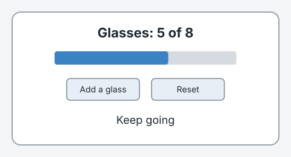

In the practice tracker, the Save event changed the total *and* set the text. That works with one button, but with three or four buttons you'd need a Set text in every one, and it's easy to miss one.

This time you'll use **Every tick**. App Builder checks the events over and over, about 60 times a second. An Every tick event runs on each of those checks, so it can keep the screen in step with the variables, whatever changed them.



## Predict: who sets the text?

```step
stage: predict
insight: "Predicting whether the count changes with no Set text in the button's event sets up the move: Every tick keeps the display in step on its own."
check:
  type: predict
  q: "The Add button's event only adds 1 to Glasses. It has no Set text. You click Add. Does the count on the screen change?"
  options: ["Yes, straight away", "No, the screen stays at 0", "Only after the next click", "Only after you press Reset"]
  actual: "Yes. The Every tick event sets the text again about 60 times a second, so as soon as Glasses changes, the screen shows it."
```

| When (condition) | Do (actions) |
|---|---|
| Every tick | Set GlassText text to "Glasses: " & Glasses & " of " & Goal |
| ⚡ AddButton is clicked | Add 1 to variable Glasses |

## Try the finished app

```step
stage: run
insight: "Using the finished tracker, with its events beside it, gives a target for the build and shows Every tick running all the time."
try: { playground: appbuilder, starter: "app.json#done", tab: run, level: 2, height: 600 }
check: { type: reflect, text: "I added glasses until I reached the goal and tried to go past it. It stopped at 8, and the Every tick row kept lighting up." }
```

This is the finished app you'll build, open on the **Run** tab. Under it, the Every tick row keeps flashing: it runs all the time, not just when you click.

## Watch first: an Every tick event

```step
stage: info
app: true
query: { code: "@app.json#start", id: walkthrough }
caption: "Every tick keeps the text right"
clip:
  - caption: { text: "Two variables first: Glasses starts at 0.", say: "Two variables first. Glasses starts at zero." }
  - type: { selector: "[data-ab='new-variable-name']", text: "Glasses" }
  - press: Enter
  - caption: { text: "Goal starts at 8: type the name, then the starting value.", say: "Goal starts at eight. Type the name, then the starting value." }
  - type: { selector: "[data-ab='new-variable-name']", text: "Goal" }
  - type: { selector: "[data-ab='new-variable-value']", text: "8" }
  - press: Enter
  - click: { selector: "[data-ab='tab:events']" }
  - caption: { text: "A new event. Its condition is in System: Every tick.", say: "A new event. Its condition is in System. Every tick." }
  - click: { selector: ".view-events [data-ab='add-event']" }
  - click: { selector: ".view-events .ev.sel [data-ab='add-condition']" }
  - click: { selector: "[data-ab='group:System']" }
  - click: { selector: "[data-ab='entry:everyTick']" }
  - caption: { text: "Its action sets GlassText from both variables.", say: "Its action sets GlassText from both variables." }
  - click: { selector: ".view-events .ev.sel [data-ab='add-action']" }
  - click: { selector: "[data-ab='group:object:GlassText']" }
  - click: { selector: "[data-ab='entry:setText']" }
  - type: { selector: "dialog[open] [data-ab='param:value']", text: "\"Glasses: \" & Glasses & \" of \" & Goal" }
  - click: { selector: "dialog[open] [data-ab='done']" }
  - expect: { selector: ".view-events .preview-col .stage", contains: "Glasses: 0 of 8" }
  - caption: { text: "The preview already shows it: Every tick set the text.", say: "The preview already shows it. Every tick set the text." }
  - wait: 1600
```

The clip shows steps 1 to 3 below.

## Build it: the water tracker

```step
stage: run
insight: "The build includes the cap exactly as many beginners write it, so the next step can test it and find why it doesn't stop at the goal."
try: { playground: appbuilder, starter: "app.json#start", level: 2, height: 640 }
tasks:
  - check:
      type: code
      text: "Variables Glasses (0) and Goal (8), and an Every tick event that sets GlassText from them."
      rules: { contains: ["variable Glasses = 0", "variable Goal = 8"], event: [["when Every tick", "Set GlassText text to", "Glasses", "Goal"]] }
  - check:
      type: code
      text: "AddButton is clicked adds 1 to Glasses, with a sub-event that checks Glasses < Goal (built as set out, slip and all)."
      rules: { event: [["when AddButton is clicked", "Add 1 to variable Glasses"], ["when AddButton is clicked > when Variable Glasses < Goal"]] }
  - check:
      type: code
      text: "ResetButton is clicked sets Glasses to 0."
      rules: { event: [["when ResetButton is clicked", "Set variable Glasses to 0"]] }
```

The screen is made for you: GlassText, AddButton and ResetButton.

### Variables and the display

1. Under **Variables** on the left, add *Glasses* starting at 0, and *Goal* starting at 8.
2. On the **Events** tab, choose **+ Add event**, **+ Condition**, **System**, **Every tick**.
3. Add the action **GlassText**, **Set GlassText text to …**: `"Glasses: " & Glasses & " of " & Goal`

### The buttons

4. Add an event: **AddButton**, **AddButton is clicked**. Add the action **Variables**, **Add … to variable**: 1 to Glasses.
5. Now a cap, so it stops at the goal. Click the AddButton event, then its **⋯** button, and choose **Add a sub-event**. Give the sub-event the condition **Variables**, **Variable … … …**: Glasses **<** Goal. Leave the Add 1 action where it is, on the AddButton event.
### Reset, then test

6. Add an event: **ResetButton is clicked**, with the action **Set variable … to …**: Glasses to 0.
7. In the preview, click Add 12 times. What does the screen say? Then click Reset.

Keep this version: you'll find out what happened in the next step.

## Investigate: did the cap work?

```step
stage: investigate
insight: "Tracing the cap and reading the goal message test the two halves of the move: what a sub-event's condition controls, and conditions checked every tick."
tasks:
  - check:
      type: question
      q: "You built the cap as in step 5 and clicked Add 12 times, with a goal of 8. What did the screen say?"
      options: ["Glasses: 12 of 8", "Glasses: 8 of 8", "Glasses: 7 of 8", "Glasses: 0 of 8"]
      answer: 0
      feedback: [null, "Try it again, and count. Did it stop at 8?", "The cap didn't hold it back at all.", "Reset sets it to 0, but only when you click Reset."]
      explain: "It went past the goal. The Add 1 action sits on the AddButton event, so it runs on every click. The sub-event's condition only controls actions inside the sub-event, and there are none."
  - check:
      type: bug
      code: "working.txt#cap"
      text: "This is the cap you built. Click the line that lets the count pass the goal."
      answer: 2
      fault: logic
      misconception: action-outside-subevent
      explain: "Line 2: the action is on the parent event, so it runs on every click. The sub-event's condition below it only controls actions inside the sub-event. Move Add 1 into the sub-event."
  - check:
      type: question
      q: "Another event: Variable Glasses = Goal → set Message to \"Goal reached!\". It has no ⚡. When does it run?"
      options: ["Every tick, while Glasses equals Goal", "Once, the moment Glasses reaches Goal", "Only when you click Add", "Only when the app starts"]
      answer: 0
      feedback: [null, "Only triggers (marked ⚡) happen once at a moment. This condition is checked every tick.", "It isn't tied to a button. Nothing about it mentions AddButton.", "That would be On start of screen."]
      explain: "Conditions without a ⚡ are checked every tick. While Glasses equals Goal, the action runs about 60 times a second. That's fine for setting the same text; it would be a problem for adding to a score."
```

### What did you see?

### Find the slip

### When does it run?

## Modify: fix the cap

```step
stage: modify
insight: "Moving the action into the sub-event is the fix, and testing at the goal confirms students now know which actions a condition controls."
try: { playground: appbuilder, starter: "app.json#built", level: 2, height: 640 }
check:
  type: code
  text: "Add 1 to Glasses is inside the sub-event, and no longer on the AddButton event itself."
  rules: { event: [["when AddButton is clicked > when Variable Glasses < Goal", "Add 1 to variable Glasses"]], lacks: ["event: when AddButton is clicked | do: Add 1 to variable Glasses"] }
```

This is the tracker as you built it. Move **Add 1** into the sub-event: click the action on the AddButton event and choose **Delete**, then click the sub-event, choose **+ Action** and add it there. Then click Add 12 times in the preview again.

| When (condition) | Do (actions) |
|---|---|
| ⚡ AddButton is clicked | |
| ↳ Variable Glasses < Goal | Add 1 to variable Glasses |

## Make: a message and a progress bar

```step
stage: make
insight: "The message and progress bar use the every-tick idea twice, plus an Else from last lesson, so the move is used in a new place."
try: { playground: appbuilder, starter: "app.json#sol-fix", level: 2, height: 640 }
tasks:
  - check:
      type: question
      q: "The bar is a box 300 pixels wide when full. Glasses is 2 and Goal is 8. What width should the bar be?"
      options: ["75", "150", "37.5", "100"]
      answer: 0
      feedback: [null, "That would be half full, 4 of 8.", "That's 300 ÷ 8, one glass's worth.", "There's no glass amount that gives 100 here."]
      explain: "2 of 8 is a quarter, and a quarter of 300 is 75. In App Builder: Glasses / Goal * 300."
  - check:
      type: code
      text: "A Message that says \"Goal reached!\" or \"Keep going\" (an event with Else), and a bar, BarFill, whose width follows Glasses every tick."
      rules: { event: [["when Variable Glasses = Goal", "Set Message text to"], ["else", "Set Message text to"], ["when Every tick", "Set BarFill width to", "Glasses", "Goal"]] }
```

### Work out the width

### Build it

- **Message:** add a Text and rename it *Message*. Add an event **Variables**, **Variable … … …**: Glasses **=** Goal, with the action **Set Message text to** *Goal reached!*. From the event's **⋯** menu, choose **Add an Else below**, and give the Else the action that sets it to *Keep going*.
- **Progress bar:** add a **Box** and rename it *BarBack*: grey, 300 wide. Then add another Box, *BarFill*, in blue, the same size and in the same place (set X and Y in Properties). The one added later sits on top. In the Every tick event add **BarFill**, **Set BarFill width to …**: `Glasses / Goal * 300`
