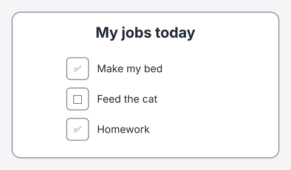

Today's prototype is a list of jobs, each with a box beside it. Click the box and it shows a tick. Click again and the tick goes.

A Construct **Button** can be the box: its text is just an empty-box character, ⬜, and an event changes it to a tick, ✅.



## Predict: two events, one click

```step
stage: predict
insight: "Predicting the two-event version sets up the lesson's move: on one click every matching event runs, so two flat events undo each other."
check:
  type: predict
  q: "The box shows ⬜. These two events are the only ones on the sheet. You click the box once. What does it show?"
  options: ["⬜, as if nothing happened", "✅", "It flickers between them forever", "An error message"]
  actual: "It still shows ⬜. On one click both events run, top to bottom. The first changes ⬜ to ✅, then the second sees ✅ and changes it straight back."
```

| When (condition) | Do (actions) |
|---|---|
| BedBox: on clicked · BedBox: text is "⬜" | BedBox: set text to "✅" |
| BedBox: on clicked · BedBox: text is "✅" | BedBox: set text to "⬜" |

## Build it: the checklist

```step
stage: run
insight: "Building the flat version first lets students see the prediction happen; the sub-event and Else then fix it."
check: { type: reflect, text: "I built the checklist. With two separate events the box didn't change. With one event, a sub-event and an Else, it ticks and unticks." }
```

**Make the screen**

1. Start a **New project** called *Chores checklist*.
2. Insert a **Text** object at the top with the text *My jobs today*.
3. Choose three jobs. Insert a **Text** object for each one, in a column, such as *Make my bed*.
4. Insert a **Button** beside the first job. Set its Text to ⬜ (copy it from here) and its Name to *BedBox*. Make it a small square.
5. Add a button beside each other job the same way, with names that match, such as *FeedBox* and *HomeworkBox*.

**A tick that stays on**

6. In the event sheet, add **BedBox**, **On clicked**. Add the action **BedBox**, **Set text**, and type `"✅"`.
7. Preview and click the box. It ticks. Click again: it stays ticked.

**Try two events (and watch them cancel)**

8. Add a condition to that event: right-click it, **Add another condition**, **BedBox**, **Compare text**, and type ⬜.
9. Add a second event the same way, but checking for ✅ and setting the text to ⬜.
10. Preview and click. Nothing seems to happen. That's your prediction.

**One event, two branches**

11. Delete both events. Add one event: **BedBox**, **On clicked**, with no other condition and no action.
12. Select it and press **S** to add a **sub-event**. Give the sub-event the condition **BedBox**, **Compare text**, ⬜ and the action **Set text** to ✅.
13. Select the sub-event and press **X** to add an **Else** below it. Give the Else the action **Set text** to ⬜.
14. Preview. Click to tick, click again to untick. Then do the same for the other boxes.

Your event should look like this:

| When (condition) | Do (actions) |
|---|---|
| BedBox: on clicked | |
| ↳ BedBox: text is "⬜" | BedBox: set text to "✅" |
| ↳ Else | BedBox: set text to "⬜" |

## Investigate: which branch runs?

```step
stage: investigate
insight: "Tracing which branch runs, and finding Nib's two flat events, both test the move: one trigger, then exactly one of the two branches."
tasks:
  - check:
      type: question
      q: "With the sub-event and Else, the box shows ✅. You click it once. What happens?"
      options: ["The Else runs, so it shows ⬜", "The sub-event runs, so it stays ✅", "Both run, so it shows ⬜ then ✅", "Neither runs, because ✅ isn't ⬜"]
      answer: 0
      feedback: [null, "The sub-event only runs if the text is ⬜. It isn't.", "Else only runs when the condition above it was false. Only one of them can run.", "When the sub-event's condition is false, that's exactly when Else runs."]
      explain: "The click triggers the event once. Its sub-event checks for ⬜, which is false, so the Else runs instead and sets the text to ⬜. Exactly one branch runs per click."
  - check:
      type: bug
      code: "working.txt#nib"
      text: "Nib's box won't untick properly. Click the line where Nib first goes wrong."
      answer: 3
      fault: logic
      misconception: flat-events-cancel
      explain: "Line 3: a second separate On clicked event also runs on the same click, straight after the first, and undoes it. The fix is one On clicked event with a sub-event and an Else."
  - check:
      type: question
      q: "A Button's Type can be set to Checkbox, which ticks and unticks by itself. Why build it with events here?"
      options: ["You can see how it works and use it for other things", "Checkbox buttons don't work in the free edition", "Checkbox buttons can't be clicked twice", "Events make the app run faster"]
      answer: 0
      feedback: [null, "They work. The point is what you learn by building it.", "They untick just fine.", "Speed isn't the reason; both are fast."]
      explain: "The built-in checkbox hides the logic. Building it with a sub-event and Else shows how a toggle works, and the same pattern works for anything: showing and hiding, colours, sounds."
```

### Trace a click

### Find Nib's mistake

### Why build it?

## Modify: count what's done

```step
stage: modify
insight: "Counting jobs done brings back last lesson's variable and Set text inside the two branches, so the review needs both moves together."
tasks:
  - check:
      type: question
      q: "A global variable Done counts ticked jobs. Where does \"add 1 to Done\" go in the BedBox event?"
      options: ["In the ⬜ branch, beside setting the tick", "In the Else branch, beside setting ⬜", "On the On clicked event itself", "In a new Every tick event"]
      answer: 0
      feedback: [null, "The Else unticks a job, so Done should go down there.", "Then it would count every click, ticking or unticking.", "That would add 1 about 60 times a second."]
      explain: "A job is done when it gets a tick, so add 1 in the branch that sets ✅, and subtract 1 in the Else that takes the tick away. Then set the text to show it."
  - check: { type: reflect, text: "My checklist shows \"Done: 2 of 3\" and it goes up and down as I tick and untick." }
```

### Where does it go?

### Build it

Add a global variable *Done* and a Text object called *DoneText*. In each box's ⬜ branch add 1 to Done; in each Else subtract 1. Then set DoneText to `"Done: " & Done & " of 3"` in both branches.

## Make: a checklist for someone

```step
stage: make
check: { type: reflect, text: "I made a checklist for a real person (their jobs, their words), and they used it without my help." }
insight: "Building for a real person moves the prototype from a lesson exercise to design: the user's words, the user's jobs, then watching them use it."
```

Make a checklist for someone you know: a packing list, a morning routine, or jobs for a club. Use their words for each job. Add a **Reset** button that unticks everything and sets Done to 0.

Then watch them use it without helping. What did they expect to happen that didn't?
