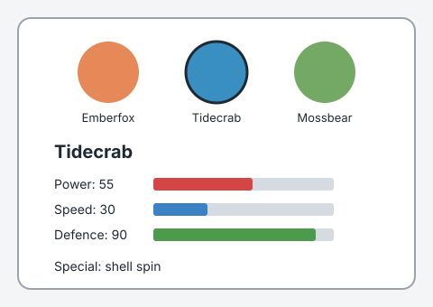

Today's prototype shows three made-up creatures: an Emberfox, a Tidecrab and a Mossbear. Click one, and its name, stats and special ability appear below.

You could make three separate sprites, each with its own events. Instead you'll make **one** sprite with three copies. In Construct the sprite is an **object type**, and each copy is an **instance**. **Instance variables** belong to the object type, but each instance keeps its own values: the Emberfox's power and the Tidecrab's power are different numbers.



## Predict: whose name shows?

```step
stage: predict
insight: "Predicting which name appears sets up the move: clicking an instance picks it, so the event reads that copy's instance variables."
check:
  type: predict
  q: "Three copies of the Creature sprite have the instance variable name: Emberfox, Tidecrab and Mossbear. The event is: Mouse on object clicked (Creature) → set NameText to Creature.name. You click the Tidecrab. What does NameText show?"
  options: ["Tidecrab", "Emberfox, the first copy", "All three names", "Creature.name"]
  actual: "Tidecrab. On object clicked picks the copy you clicked, so for the rest of that event Creature.name means that copy's name."
```


## Try the finished app

```step
stage: run
insight: "Clicking each creature in the finished viewer shows the move before it's built: one event, a different result for each copy."
try: { playground: board, starter: "app.yml#try", height: 540 }
check: { type: board, text: "Click each creature in turn. One event shows all three.", when: "c = 2", explain: "One click event shows whichever creature you click, because the click picks that copy." }
```

This is the finished app you'll build. Click the Tidecrab last.

## Build it: the creature viewer

```step
stage: run
insight: "Building one sprite with three instances and one click event makes picking visible: the same event shows different stats for each creature."
check: { type: reflect, text: "My viewer shows each creature's own name and stats when I click it, using one sprite and one click event." }
```

**One sprite, three looks**

1. Start a **New project** called *Creature stats*.
2. Insert a **Sprite** called *Creature*. Draw the first creature (a simple shape and colour is fine).
3. In the animation editor's **Animation frames** panel, right-click and add a frame. Draw the second creature. Add a third frame for the third.
4. Close the editor. In the sprite's animation properties, set **Speed** to 0, so it doesn't flick between frames.
5. Copy and paste the sprite twice, so there are three in a row. Select the second and set its **Initial frame** to 1; the third to 2.

**Instance variables**

6. Select any Creature. In Properties, find **Instance variables** and add: *name* (String), *power*, *speed*, *defence* (Numbers, 0 to 100), and *ability* (String).
7. Click each creature in turn and fill in its own values. Make up the numbers, but be ready to say why each creature has them.

**The stats area**

8. Below the creatures, insert **Text** objects: *NameText*, *PowerText*, *SpeedText*, *DefenceText* and *AbilityText*. Leave their text empty.
9. Beside PowerText, insert a **Sprite** called *PowerBar*: a red rectangle 200 wide. Set its width to 0 for now. Make *SpeedBar* and *DefenceBar* the same way in other colours.

**Make the sprites clickable**

10. Insert the **Mouse** object (and **Touch**, if your class uses tablets). It has no picture; it lets events react to clicks on any object.
11. Add the event: **Mouse**, **On object clicked**, left button, clicked, **Creature**.
12. Add actions: **NameText**, **Set text**, `Creature.name`; **PowerText**, **Set text**, `"Power: " & Creature.power`; and the same for speed and defence; **AbilityText**, `"Special: " & Creature.ability`.
13. Add **PowerBar**, **Set width**, `Creature.power / 100 * 200`, and the same for the other two bars.
14. Preview and click each creature.

## Investigate: one event, many creatures

```step
stage: investigate
insight: "The fade question and Nib's mistake test picking from the other side: an action in a picking event touches only the picked copy, not every instance."
tasks:
  - check:
      type: question
      q: "You add one more action to the click event: Creature, set opacity to 40 (faded). You click the Mossbear. Which creatures fade?"
      options: ["Only the Mossbear", "All three", "The two you didn't click", "None, because opacity needs Every tick"]
      answer: 0
      feedback: [null, "The click picked one copy. Actions in this event only touch that one.", "Nothing in the event picks the others.", "Opacity can be set in any event."]
      explain: "On object clicked picks the copy you clicked. Every Creature action in that event applies to the picked copy only."
  - check:
      type: bug
      code: "working.txt#nib"
      text: "Nib wanted the other two creatures to fade. Click the line where Nib's thinking goes wrong."
      answer: 3
      fault: logic
      misconception: action-hits-all
      explain: "Line 3: in this event the click has picked the Tidecrab, so Creature, set opacity only fades the Tidecrab. To fade the others, you'd first set every creature faded in an event that doesn't pick, then set the clicked one back."
  - check:
      type: question
      q: "Why use instance variables here, not global variables?"
      options: ["Each creature needs its own values; a global holds one", "Global variables can't hold text", "Instance variables are quicker to type", "Global variables reset on every click"]
      answer: 0
      feedback: [null, "Global variables can hold text (type String).", "Typing speed isn't it.", "They keep their value until an event changes it."]
      explain: "A global variable holds one value for the whole app. Each creature needs its own power, speed and so on, so they're instance variables: same names, different values in each copy."
```

### Which ones fade?

### Find Nib's mistake

### Why instance variables?

## Modify: a fourth creature

```step
stage: modify
insight: "Adding a creature without touching the event sheet shows the payoff of instance variables and picking: the event already works for any copy."
tasks:
  - check:
      type: question
      q: "You add a fourth creature: a new frame, a fourth copy, and its own values. What do you change in the event sheet?"
      options: ["Nothing", "Add a new click event for it", "Add a fourth Set text for its name", "Change Creature to Creature4"]
      answer: 0
      feedback: [null, "The existing event already works for any copy of Creature.", "Creature.name reads the clicked copy, whichever it is.", "It's another copy of the same object type."]
      explain: "The click event picks whichever copy is clicked and reads that copy's variables, so a new copy works straight away."
  - check: { type: reflect, text: "I added a fourth creature with its own values, without changing the event sheet, and it works." }
```

### Predict the change

### Try it

Add a fourth frame in the animation editor, paste a fourth copy of the sprite, set its Initial frame to 3, and fill in its instance variables. Then preview and click it.

## Make: your own character cards

```step
stage: make
check: { type: reflect, text: "I made my own viewer: at least three characters (one sprite with frames), at least three stats shown as bars, and an ability and a weakness for each. I can explain why each one has its numbers." }
insight: "A viewer of their own choosing uses the whole pattern (one object type, instance variables, a picking click event) in a new context."
```

Choose your own set: made-up creatures, pets, robots, plants or anything with at least three characters. Give each one at least three stats and a weakness as well as an ability. Make the numbers fair: be ready to say why the strongest one isn't the best at everything.
