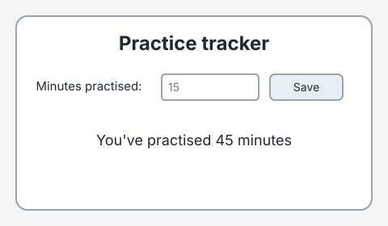

A **prototype** is an early version of an app that you can click through and test, before anyone spends weeks building the real thing. In this course you'll build prototypes with **Construct 3**, a tool that runs in your browser.

A Construct app has two halves:

- The **layout** is the screen: the text, boxes and buttons the user sees.
- The **event sheet** is what makes it work. Each **event** is a row: on the left, *when* something happens; on the right, *what to do* then.

Today's app remembers your practice total in a **global variable**: a named box that holds a number for the whole app.



## Predict: does the total change?

```step
stage: predict
insight: "Committing to an answer sets up the lesson's move: changing a variable doesn't change what's on the screen. An event has to set the text."
check:
  type: predict
  q: "The total starts at 0, and the screen says \"You've practised 0 minutes\". The only event is: Save on clicked → add 15 to Minutes. You click Save three times. What does the screen say now?"
  options: ["You've practised 0 minutes", "You've practised 45 minutes", "You've practised 15 minutes", "Nothing: the text disappears"]
  actual: "It still says 0 minutes. Minutes is now 45, but nothing told the text to change. The screen only shows a new total when an event sets the text."
```

| When (condition) | Do (actions) |
|---|---|
| Save: on clicked | System: add 15 to Minutes |


## Try it: an app with no Set text

```step
stage: run
insight: "Clicking Save on a version with no Set text settles the prediction on the page: the variable changes, the screen doesn't."
try: { playground: board, starter: "app.yml#try", height: 540 }
check: { type: board, text: "Click Save three times. Watch the variable and the screen. Then try a different number.", when: "k >= 3", explain: "Minutes goes up with every Save, but the screen still says 0 minutes: this version's Save event has no Set text." }
```

This is the version from the prediction. The event sheet beside it lights up each time an event runs, and the line under the app shows the variable's real value. You'll build the version that works.

## Build it: the practice tracker

```step
stage: run
insight: "Building the first version settles the prediction (the total changes but the screen doesn't), then adding Set text fixes it."
check: { type: reflect, text: "I built the practice tracker. With only the add action, the screen stayed at 0. With Set text added, it showed my total." }
```

Open Construct at [editor.construct.net](https://editor.construct.net). It runs in the browser and you don't need to sign in.

**Make the screen**

1. Choose **New project**, call it *Practice tracker* and choose **Create**.
2. Double-click the layout to insert a **Text** object. In the **Properties** panel on the left, set its Text to *Practice tracker* and make it bigger. Drag it to the top.
3. Insert a **Text Input** below it. This is the box the user types in.
4. Insert a **Button** beside it. Set its Text to *Save*, and set its **Name** to *SaveButton*.
5. Insert one more **Text** below. Set its Text to *You've practised 0 minutes* and its Name to *TotalText*.

Give objects names that say what they are. You'll pick them from a list in the event sheet, and *Text3* won't tell you which one it is.

**Make it work**

6. Open **Event sheet 1** from the Project panel on the right.
7. Right-click the sheet and choose **Add global variable**. Name it *Minutes*, type Number, starting value 0.
8. Choose **Add event**, then **SaveButton**, then **On clicked**.
9. Choose **Add action**, then **System**, then **Add to**. Pick *Minutes* and type 15.
10. Press the **Preview** button (the play arrow) and click Save a few times. Does the screen change?

**Show the total**

11. Add a second action to the same event: **TotalText**, then **Set text**. Type exactly: `"You've practised " & Minutes & " minutes"`
12. Preview again and click Save. Now it changes.
13. Last, use what the user typed. Change the 15 in the Add to action to `int(TextInput.Text)`. Preview, type a number and click Save.

Save a copy of your project to your computer before you close the tab.

## Investigate: how the text is made

```step
stage: investigate
insight: "Reading the Set text expression and Nib's mistake both point at the move: the screen shows whatever the last Set text said, and only an event changes it."
tasks:
  - check:
      type: question
      q: "Minutes is 45. The Set text action says \"You've practised \" & Minutes & \" minutes\". What does the screen show?"
      options: ["You've practised 45 minutes", "You've practised Minutes minutes", "You've practised & 45 & minutes", "45"]
      answer: 0
      feedback: [null, "Minutes isn't inside the quote marks, so Construct uses its value, not the word.", "The & signs join the pieces. They don't appear on the screen.", "The words inside the quote marks are shown too."]
      explain: "Words in quote marks are shown as they are. Minutes, outside the quotes, is replaced by its value. The & signs join the pieces into one line."
  - check:
      type: question
      q: "Why does the add action use int(TextInput.Text) and not just TextInput.Text?"
      options: ["A typed box holds text; int() makes it a number", "int() checks that the box isn't empty", "int() rounds the number to the nearest 10", "Construct needs int() before any action"]
      answer: 0
      feedback: [null, "An empty box gives 0 with int(), but checking isn't its job.", "Rounding is round(). int() turns text into a whole number.", "Set text and many other actions don't need it."]
      explain: "A Text Input always holds text, even when you type 20. int() turns the text \"20\" into the number 20, so it can be added to Minutes."
  - check:
      type: bug
      code: "working.txt#nib"
      text: "Nib's screen never changes from 0 minutes. Click the line that explains why."
      answer: 2
      fault: logic
      misconception: text-updates-itself
      explain: "Line 2: On start of layout runs once, when the app opens. After that nothing sets the text again, so it keeps saying 0. Nib needs a Set text action in the Save event too."
```

### Read the text

### Why int()?

### Find Nib's mistake

## Modify: a Reset button

```step
stage: modify
insight: "A Reset button needs both moves again: change the variable, then set the text. Choosing both is the check that the move has stuck."
tasks:
  - check:
      type: question
      q: "You add a Reset button. Which actions does its On clicked event need?"
      options: ["Set Minutes to 0, then set the text to show the total", "Set Minutes to 0, and nothing else", "Set the text to 0 minutes, and nothing else", "Delete the Minutes variable"]
      answer: 0
      feedback: [null, "Minutes would be 0, but the screen would still show the old total.", "The screen would say 0, but Minutes would still hold the old total, and the next Save would add to it.", "Variables are made in the event sheet, not deleted by actions."]
      explain: "Reset changes the variable and the screen, so it needs both: System, set value of Minutes to 0, then TotalText, set text."
  - check: { type: reflect, text: "I added a Reset button that sets Minutes to 0 and shows the new total, and tested it." }
```

### Choose the actions

### Build it

Insert a **Button** with the text *Reset* and name it *ResetButton*. In the event sheet, add **ResetButton**, **On clicked**, then the two actions. To set a variable, use **System**, then **Set value**.

## Make: count the sessions

```step
stage: make
insight: "A second variable and a second Set text show that each number the app remembers needs its own variable, changed and shown by events."
check: { type: reflect, text: "My tracker also counts how many times I've practised (one more each Save) and shows it, and Reset sets it back to 0." }
```

Add a second global variable, *Sessions*, that goes up by 1 each time you click Save. Show it in a new Text object, such as *Sessions: 3*. Make Reset clear it too.

Then show your tracker to someone. Ask them to use it without help. What did they try that you didn't expect?
