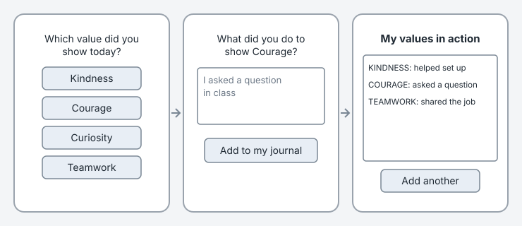

Today's prototype has three screens. In Construct each screen is a **layout**, with its own event sheet.

1. **Choose:** buttons for four values, such as Kindness, Courage, Curiosity and Teamwork (or your school's own values).
2. **Describe:** "What did you do to show Courage?", a box to type in, and an *Add to my journal* button.
3. **Journal:** a list of every entry so far, and a button to add another.



## Predict: does the choice survive?

```step
stage: predict
insight: "Predicting whether the chosen value reaches screen 2 sets up the move: a global variable keeps its value when the app goes to another layout."
check:
  type: predict
  q: "On screen 1 you click Courage. Its event sets the global variable Chosen to \"Courage\", then goes to screen 2. Screen 2's On start of layout sets its question to \"What did you do to show \" & Chosen & \"?\". What does the question say?"
  options: ["What did you do to show Courage?", "What did you do to show ?", "What did you do to show Chosen?", "Nothing: screen 2 can't see screen 1's variables"]
  actual: "It says Courage. A global variable belongs to the whole app, not one screen, so it keeps its value when the app goes to another layout."
```


## Try the finished app

```step
stage: run
insight: "Using the finished three-screen app first gives a target for the long build and shows the global variable carrying the choice."
try: { playground: board, starter: "app.yml#try", height: 540 }
check: { type: board, text: "Add two entries with different values. Watch Chosen and Journal.Width under the event sheet.", when: "n >= 2", explain: "Chosen keeps its value from screen 1 to screen 2, and Journal.Width goes up by one with each entry." }
```

This is the finished app you'll build. Each screen shows its own event sheet.

## Build it: three screens

```step
stage: run
insight: "Building the three layouts, and seeing the chosen value appear on the next screen, settles the prediction and sets up the array and list."
check: { type: reflect, text: "My journal works: I choose a value, describe it, and see it in the list, and new entries are added below the old ones." }
```

**Screen 1: choose**

1. Start a **New project** called *Values journal*.
2. On Layout 1, insert a title **Text**, *Values journal*, and a line below it, *Which value did you show today?*
3. Insert four **Buttons**, one per value, named *KindnessButton*, *CourageButton* and so on, with the value as each one's text.
4. Insert an **Array** object (it has no picture on the screen). In its Properties set Width to 0, Height 1, Depth 1, name it *Journal*, and make sure **Global** is ticked, so it carries on to the other screens.

**Screen 2: describe**

5. In the Project panel, right-click **Layouts** and add a layout. If Construct offers to make an event sheet for it, say yes.
6. On Layout 2, insert a **Text** called *Question*, a **Text Input** (make it wide), and a **Button** called *AddButton* with the text *Add to my journal*.

**Screen 3: the journal**

7. Add Layout 3 the same way. Insert a title **Text**, *My values in action*, a **List** object (make it tall), and a **Button** called *AnotherButton* with the text *Add another*.

Each layout must use its own event sheet: click an empty part of the layout and check its **Event sheet** property. If a screen's events never seem to run, this is the first thing to check.

**Events**

8. In Event sheet 1, add a global variable *Chosen*, type String (text), starting empty.
9. Still in Event sheet 1: **KindnessButton**, **On clicked** → **System**, **Set value**, Chosen to `"Kindness"`, then **System**, **Go to layout**, Layout 2. Do the same for each value button.
10. In Event sheet 2: **System**, **On start of layout** → **Question**, **Set text**: `"What did you do to show " & Chosen & "?"`
11. Also in Event sheet 2: **AddButton**, **On clicked** → **Journal**, **Push**, back, X axis, value `uppercase(Chosen) & ": " & TextInput.Text`, then **Go to layout**, Layout 3.
12. In Event sheet 3: **System**, **On start of layout** → **List**, **Clear**.
13. Add a *separate* event in Event sheet 3: **System**, **On start of layout**, then right-click it, **Add another condition**, **System**, **Repeat**, `Journal.Width` times. Action: **List**, **Add item**, `Journal.At(loopindex)`.
14. **AnotherButton**, **On clicked** → **Go to layout**, Layout 1.
15. Preview from Layout 1 and add three entries.

## Investigate: lists and loops

```step
stage: investigate
insight: "Tracing loopindex and finding Nib's combined event check how the list is built from the array, using the global array the move depends on."
tasks:
  - check:
      type: question
      q: "The journal has 3 entries, so Journal.Width is 3. The Repeat runs 3 times. What is loopindex each time?"
      options: ["0, then 1, then 2", "1, then 2, then 3", "3 each time", "0, then 1, then 2, then 3"]
      answer: 0
      feedback: [null, "Construct counts places in an array from 0, so the first entry is At(0).", "loopindex goes up by one each time round.", "That would be four times round, but Repeat 3 runs three times."]
      explain: "loopindex starts at 0 and goes up by 1 each time round, so 3 repeats give 0, 1, 2. The first entry is Journal.At(0), so each repeat adds the next entry to the list."
  - check:
      type: bug
      code: "working.txt#nib"
      text: "Nib's journal only ever shows the latest entry. Click the line where Nib first goes wrong."
      answer: 2
      fault: logic
      misconception: list-clear-in-loop
      explain: "Line 2: Clear is in the same event as the Repeat, so it runs on every repeat. Each time round the list is cleared, then one entry is added, so only the last one is left. Clear belongs in its own On start of layout event."
  - check:
      type: question
      q: "What if Chosen were an instance variable on a button in screen 1, not a global variable?"
      options: ["Screen 2 couldn't read it", "It would work the same way", "Screen 2 would read it faster", "It would show every value at once"]
      answer: 0
      feedback: [null, "Not quite: the button, and its variable, stay behind on screen 1.", "Speed isn't the difference here.", "A variable holds one value at a time."]
      explain: "When the app goes to Layout 2, screen 1's objects (and their variables) aren't there. A global variable belongs to the whole app, so every screen can read it."
```

### Count with loopindex

### Find Nib's mistake

### Why global?

## Modify: count the entries

```step
stage: modify
insight: "Showing the count reuses the array's Width, an existing value, rather than a new variable, which checks students know what the array holds."
tasks:
  - check:
      type: question
      q: "Screen 3 should say \"You've added 5 moments\". Which expression gives the 5?"
      options: ["Journal.Width", "loopindex", "Chosen", "Journal.At(0)"]
      answer: 0
      feedback: [null, "loopindex only means something inside the Repeat.", "Chosen is the last value picked, not a count.", "That's the first entry's text."]
      explain: "The array grows by one each time you push an entry, so its Width is the number of entries."
  - check: { type: reflect, text: "Screen 3 shows how many entries there are, and the number goes up as I add more." }
```

### Choose the expression

### Build it

Add a **Text** to Layout 3 and set it in the first On start of layout event: `"You've added " & Journal.Width & " moments"`

## Make: test the flow

```step
stage: make
check: { type: reflect, text: "Someone used my journal without help. I wrote down one place they got stuck, and I changed the app to fix it." }
insight: "Watching a user move through three screens is the design half of a prototype: the flow that made sense to the builder isn't always clear to someone else."
```

Ask someone to add two entries without any help from you. Watch where they pause or click the wrong thing. Then change one thing: a clearer button name, a *Back* button on screen 2, or an empty-box check before saving.
