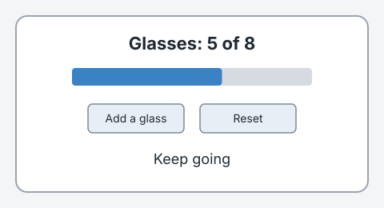

In the practice tracker, the Save event changed the total *and* set the text. That works with one button, but with three or four buttons you'd need a Set text in every one, and it's easy to miss one.

This time you'll use **Every tick**. Construct checks the event sheet over and over, about 60 times a second. An Every tick event runs on each of those checks, so it can keep the screen in step with the variables, whatever changed them.



## Predict: who sets the text?

```step
stage: predict
insight: "Predicting whether the count changes with no Set text in the button's event sets up the move: Every tick keeps the display in step on its own."
check:
  type: predict
  q: "The Add button's event only adds 1 to Glasses. It has no Set text. You click Add. Does the count on the screen change?"
  options: ["Yes, straight away", "No, the screen stays at 0", "Only after the next click", "Only after you press Reset"]
  actual: "Yes. The Every tick event sets the text again about 60 times a second, so as soon as Glasses changes, the screen shows it."
```

| When (condition) | Do (actions) |
|---|---|
| Every tick | GlassText: set text to "Glasses: " & Glasses & " of " & Goal |
| AddButton: on clicked | System: add 1 to Glasses |


## Try the finished app

```step
stage: run
insight: "Using the finished tracker, with its event sheet beside it, gives a target for the build and shows Every tick running all the time."
try: { playground: board, starter: "app.yml#try", height: 540 }
check: { type: board, text: "Add glasses until you reach the goal, then try to go past it. Watch the Every tick row on the event sheet.", when: "g = 8", explain: "Every tick keeps the count, the bar and the message in step. The cap is inside a sub-event here, so it stops at 8." }
```

This is the finished app you'll build. The Every tick row keeps flashing: it runs all the time, not just when you click.

## Build it: the water tracker

```step
stage: run
insight: "The build includes the cap exactly as many beginners write it, so the next step can test it and find why it doesn't stop at the goal."
check: { type: reflect, text: "I built the water tracker as set out, and I clicked Add 12 times to see what happens at the goal." }
```

**Make the screen**

1. Start a **New project** called *Water tracker*.
2. Insert a **Text** object called *GlassText* with the text *Glasses: 0 of 8*.
3. Insert a **Button** called *AddButton* with the text *Add a glass*, and another called *ResetButton* with the text *Reset*.

**Variables and the display**

4. In the event sheet, add two global variables: *Glasses* (starting at 0) and *Goal* (starting at 8).
5. Add an event: **System**, **Every tick**. Add the action **GlassText**, **Set text**: `"Glasses: " & Glasses & " of " & Goal`

**The buttons**

6. Add an event: **AddButton**, **On clicked**. Add the action **System**, **Add to**, Glasses, 1.
7. Now a cap, so it stops at the goal. Select the AddButton event and press **S** to add a sub-event. Give it the condition **System**, **Compare variable**: Glasses **<** Goal. Leave the Add 1 action where it is, on the On clicked event.
8. Add an event: **ResetButton**, **On clicked**, with the action **System**, **Set value**, Glasses, 0.
9. Preview. Click Add 12 times. What does the screen say? Then click Reset.

Keep this version: you'll find out what happened in the next step.

## Investigate: did the cap work?

```step
stage: investigate
insight: "Tracing the cap and reading the goal message test the two halves of the move: what a sub-event's condition controls, and conditions checked every tick."
tasks:
  - check:
      type: question
      q: "You built the cap as in step 7 and clicked Add 12 times, with a goal of 8. What did the screen say?"
      options: ["Glasses: 12 of 8", "Glasses: 8 of 8", "Glasses: 7 of 8", "Glasses: 0 of 8"]
      answer: 0
      feedback: [null, "Try it again, and count. Did it stop at 8?", "The cap didn't hold it back at all.", "Reset sets it to 0, but only when you click Reset."]
      explain: "It went past the goal. The Add 1 action sits on the On clicked event, so it runs on every click. The sub-event's condition only controls actions inside the sub-event, and there are none."
  - check:
      type: bug
      code: "working.txt#cap"
      text: "This is the cap you built. Click the line that lets the count pass the goal."
      answer: 2
      fault: logic
      misconception: action-outside-subevent
      explain: "Line 2: the action is on the parent event, so it runs on every click. The sub-event's condition below it only controls actions inside the sub-event. Move Add 1 into the sub-event."
  - check:
      type: question
      q: "Another event: Glasses = Goal → set Message to \"Goal reached!\". It has no green arrow. When does it run?"
      options: ["Every tick, while Glasses equals Goal", "Once, the moment Glasses reaches Goal", "Only when you click Add", "Only when the app starts"]
      answer: 0
      feedback: [null, "Only triggers (green arrow) happen once at a moment. This condition is checked every tick.", "It isn't tied to a button. Nothing about it mentions AddButton.", "That would be On start of layout."]
      explain: "Conditions without a green arrow are checked every tick. While Glasses equals Goal, the action runs about 60 times a second. That's fine for setting the same text; it would be a problem for adding to a score."
```

### What did you see?

### Find the slip

### When does it run?

## Modify: fix the cap

```step
stage: modify
insight: "Moving the action into the sub-event is the fix, and testing at the goal confirms students now know which actions a condition controls."
check: { type: reflect, text: "I moved Add 1 into the sub-event. Now 12 clicks stop at 8 of 8, and Reset still works." }
```

Drag the **Add 1** action from the On clicked event down onto the sub-event, so it sits beside the Compare variable condition. Then preview and click Add 12 times again.

| When (condition) | Do (actions) |
|---|---|
| AddButton: on clicked | |
| ↳ System: Glasses < Goal | System: add 1 to Glasses |

## Make: a message and a progress bar

```step
stage: make
insight: "The message and progress bar use the every-tick idea twice, plus an Else from last lesson, so the move is used in a new place."
tasks:
  - check:
      type: question
      q: "The bar is a sprite 400 pixels wide when full. Glasses is 2 and Goal is 8. What width should the bar be?"
      options: ["100", "200", "50", "250"]
      answer: 0
      feedback: [null, "That would be half full, 4 of 8.", "That's 400 ÷ 8, one glass's worth.", "There's no glass amount that gives 250 here."]
      explain: "2 of 8 is a quarter, and a quarter of 400 is 100. In Construct: Glasses / Goal * 400."
  - check: { type: reflect, text: "My tracker shows \"Goal reached!\" or \"Keep going\" (an event with Else), and a progress bar that fills as I add glasses." }
```

### Work out the width

### Build it

- **Message:** insert a Text called *Message*. Add an event **System**, **Compare variable**, Glasses **=** Goal, with the action **Message**, **Set text** *Goal reached!*. Press **X** to add an Else that sets it to *Keep going*.
- **Progress bar:** insert a **Sprite** called *BarFill*: draw a blue rectangle and make it 400 wide. Insert a grey one called *BarBack* the same size, right-click it and choose to send it to the back, and put it behind BarFill. In the Every tick event add **BarFill**, **Set width**: `Glasses / Goal * 400`
