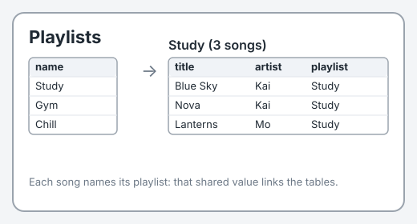

Some apps need two kinds of record: **playlists** and **songs**. Instead of putting a list of songs inside each playlist, keep two flat tables and **link** them:

- **Playlists** has one row per playlist: its *name*.
- **Songs** has one row per song, and a field *playlist* that names the playlist it belongs to. In the tables on the left it says **→ Playlists**: it's a **linked field**, so you choose its value from a dropdown of playlist names.

To show a playlist, go through Songs and keep the rows whose *playlist* matches. That's a filter, which you already know. Databases work the same way, and the SQL course shows how they search linked tables.



## Try the finished app

```step
stage: info
insight: "Clicking each playlist first shows the join working before it's built: the songs come from one table, chosen by a value from the other."
try: { playground: appbuilder, starter: "app.json#try", tab: run, level: 4, height: 640 }
check: { type: reflect, text: "I clicked each playlist and saw its songs, and found the playlist field in the Songs table on the left." }
```

This is the app you'll build, open on the **Run** tab. Click each playlist. On the left, open the **{ } JSON** view of Songs: two flat lists of records, linked only by the playlist's name. In the Songs table, click a playlist cell: it's a dropdown of the names in Playlists.

## Build 1: show a playlist's songs

```step
stage: run
app: true
query: { code: "@app.json#start", level: 4, id: build-1 }
caption: "Join two tables"
clip:
  - click: { selector: "[data-ab='tab:events']" }
  - caption: { text: "When a playlist is clicked: remember its name in Chosen.", say: "When a playlist is clicked, remember its name in Chosen." }
  - click: { selector: ".view-events [data-ab='add-event']" }
  - click: { selector: ".view-events .ev.sel [data-ab='add-condition']" }
  - click: { selector: "[data-ab='group:object:PlaylistTable']" }
  - click: { selector: "[data-ab='entry:onItemClicked']" }
  - click: { selector: "dialog[open] [data-ab='done']" }
  - click: { selector: ".view-events .ev.sel [data-ab='add-action']" }
  - click: { selector: "[data-ab='group:Variables']" }
  - click: { selector: "[data-ab='entry:setVar']" }
  - type: { selector: "dialog[open] [data-ab='param:value']", text: "ClickedItem.name" }
  - click: { selector: "dialog[open] [data-ab='done']" }
  - click: { selector: ".view-events .ev.sel [data-ab='add-action']" }
  - click: { selector: "[data-ab='group:Tables']" }
  - click: { selector: "[data-ab='entry:tableClear']" }
  - click: { selector: "dialog[open] [data-ab='param:table']" }
  - press: S
  - press: h
  - press: Enter
  - click: { selector: "dialog[open] [data-ab='done']" }
  - caption: { text: "For each song whose playlist is Chosen, copy it into Shown.", say: "For each song whose playlist is Chosen, copy it into Shown." }
  - click: { selector: ".view-events .ev.sel [data-ab='event-menu']" }
  - click: { selector: "[data-ab='menu:add-a-sub-event']" }
  - click: { selector: ".view-events .ev.sel [data-ab='add-condition']" }
  - click: { selector: "[data-ab='group:Tables']" }
  - click: { selector: "[data-ab='entry:forEachRow']" }
  - click: { selector: "dialog[open] [data-ab='param:table']" }
  - press: S
  - press: o
  - press: Enter
  - click: { selector: "dialog[open] [data-ab='done']" }
  - click: { selector: ".view-events .ev.sel [data-ab='add-condition']" }
  - click: { selector: "[data-ab='group:Variables']" }
  - click: { selector: "[data-ab='entry:compareValues']" }
  - type: { selector: "dialog[open] [data-ab='param:left']", text: "LoopItem.playlist" }
  - type: { selector: "dialog[open] [data-ab='param:right']", text: "Chosen" }
  - click: { selector: "dialog[open] [data-ab='done']" }
  - click: { selector: ".view-events .ev.sel [data-ab='add-action']" }
  - click: { selector: "[data-ab='group:Tables']" }
  - click: { selector: "[data-ab='entry:tableAdd']" }
  - click: { selector: "dialog[open] [data-ab='param:table']" }
  - press: S
  - press: h
  - press: Enter
  - type: { selector: "dialog[open] [data-ab='value:title']", text: "LoopItem.title" }
  - type: { selector: "dialog[open] [data-ab='value:artist']", text: "LoopItem.artist" }
  - type: { selector: "dialog[open] [data-ab='value:playlist']", text: "LoopItem.playlist" }
  - click: { selector: "dialog[open] [data-ab='done']" }
  - expect: { selector: ".view-events event-sheet", contains: "LoopItem.playlist = Chosen" }
  - wait: 900
insight: "Remembering the clicked name, then copying the songs whose playlist field matches it, joins the two tables with the filter pattern."
try: { playground: appbuilder, starter: "app.json#start", keep: build, level: 4, height: 640 }
check:
  type: code
  text: "Clicking a playlist sets Chosen to its name, clears Shown, and copies every song whose playlist is Chosen into Shown."
  rules: { event: [["when An item in PlaylistTable is clicked", "Set variable Chosen to ClickedItem.name", "Clear table Shown"], ["when An item in PlaylistTable is clicked > when For each row in table Songs", "LoopItem.playlist = Chosen", "Add a row to table Shown"]] }
```

1. Add an event: **An item in PlaylistTable is clicked** → **Set variable Chosen to** `ClickedItem.name`, then **Clear table** *Shown*.
2. Give it a sub-event: **For each row in table** *Songs*, and **Compare** `LoopItem.playlist` **=** `Chosen`.
3. Its action: **Add a row to table** *Shown*, with each field from `LoopItem`.
4. Run it and click each playlist.

## Build 2: a heading with a count

```step
stage: run
insight: "Counting the copied rows after the loop reuses count() on the result, so the heading always matches what's shown."
try: { playground: appbuilder, starter: "app.json#sol-step-2", keep: build, level: 4, height: 640 }
check:
  type: code
  text: "After the loop, Heading shows the playlist's name and how many songs it has."
  rules: { event: [["when An item in PlaylistTable is clicked > always", "Set Heading text to", "Chosen", "count(Shown)"]] }
```

Add a sub-event with no condition, below the loop: **Set Heading text to** `Chosen & " (" & count(Shown) & " songs)"`

## Check: what links them?

```step
stage: investigate
insight: "Renaming a playlist in one table only breaks the link, which shows the shared value is the only thing joining them."
check:
  type: question
  q: "In Playlists, Gym is renamed Workout. The Songs table isn't changed. What happens when Workout is clicked?"
  options: ["No songs show: the songs still say Gym", "Gym's songs show, under the new name", "Every song shows", "The app shows an error"]
  answer: 0
  feedback: [null, "The loop compares each song's playlist field with the clicked name, and no song says Workout.", "Only songs whose playlist matches are copied.", "Nothing is wrong with either table on its own: they just don't match any more."]
  explain: "The only link between the tables is the name they share. Change it in one table and the songs no longer match. When you rename a playlist in the tables on the left, App Builder changes the songs' playlist field for you, because it's a linked field; an event in your app changing a name doesn't. Real databases give each playlist a number that never changes, and link by that."
```

## Look at it nested

```step
stage: info
insight: "Seeing the same data nested, built from the flat tables, shows that nesting is a way to send or show data, while flat tables are the way to keep it."
try: { playground: appbuilder, starter: "app.json#sol-step-3", keep: build, level: 4, height: 640 }
check: { type: reflect, text: "I saw Playlists nested, with each playlist's songs inside it, and can say why the app keeps the two tables flat." }
```

On the left, open **{ } JSON** under **Playlists**, and choose **Songs grouped by playlist**. Now each playlist has its songs *inside* it, the way an app often sends data to another app.

You can't edit this view: App Builder builds it from the two flat tables each time. The app keeps the tables flat because then each song is stored once, in one place. Change a song's artist and every view of it changes too.

## Make it yours: add to a playlist

```step
stage: modify
insight: "Adding a song with Chosen in its playlist field writes the link, so the new song appears in the playlist that's open."
try: { playground: appbuilder, starter: "app.json#built", keep: build, level: 4, height: 640 }
tasks:
  - check:
      type: code
      text: "Add to playlist adds a song to Songs, with Chosen as its playlist."
      rules: { event: [["when AddButton is clicked", "Add a row to table Songs", "playlist = Chosen"]] }
  - check: { type: reflect, text: "I added a song to one playlist, clicked another playlist and back, and saw it stay in the right one." }
```

### Add a song

There are boxes for a title and an artist, and an **Add to playlist** button. Make it add a row to *Songs*, with `Chosen` as the playlist. Then click the playlist again: is the new song there?

### Check it stays put

Add a song to one playlist, click another playlist, then click back. Is the song still in the right one?
