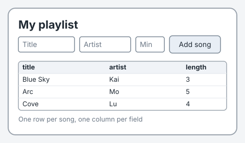

Last lesson, a song's title and artist were linked only by sitting at the same place in two lists. Today they live **together** in one **table**:

- Each **row** is one song: a **record**.
- Each **column** is a **field**: *title*, *artist*, *length*. Every row has the same fields.
- A field holds **text** or a **number**. *length* is a number, so you can add lengths up or sort by them later.

Removing a song now removes its whole row, so nothing can get out of step.



## Try the finished app

```step
stage: info
insight: "Using the finished app first shows rows moving as a whole: add one, remove one, and each song keeps its details."
try: { playground: appbuilder, starter: "app.json#try", tab: run, level: 4, height: 640 }
check: { type: reflect, text: "I added a song and removed one, and watched the Songs table change on the left while the app ran." }
```

This is the app you'll build, open on the **Run** tab. Add a song, then click a song in the table to remove it. On the left, under *Tables*, the rows the app has now show under the table.

## Build 1: make the table

```step
stage: run
insight: "Making the table by hand, field by field, shows its shape before any event touches it: the same fields in every row, each with a type."
try: { playground: appbuilder, starter: "app.json#start", keep: build, level: 4, height: 640 }
check:
  type: code
  text: "A table Songs with the fields title, artist and length."
  rules: { contains: ["table Songs = [title, artist, length]"] }
```

1. On the left, under **Tables**, type *Songs* and press **+**. A new table has one field, *name*.
2. Click **name** at the top of its column, choose **Rename**, and call it *title*.
3. Press **+** at the end of the field names to add a field. Call it *artist*. Add one more called *length*.
4. Click **length**, and choose **Number**: lengths are numbers, not text.
5. Press **+ Row** and type a song: title, artist, minutes. Press Tab to move along. Add a second song.

## Build 2: show it on the screen

```step
stage: run
insight: "The Table object shows a table by itself, a column per field, so the screen keeps up with the table with no extra events."
try: { playground: appbuilder, starter: "app.json#sol-step-2", keep: build, level: 4, height: 640 }
check:
  type: code
  text: "SongTable shows the Songs table."
  rules: { contains: ["object SongTable (table) text \"\" shows Songs"] }
```

On the **Design** tab, click the empty table on the screen (*SongTable*). In **Properties**, set **Shows table** to *Songs*. Your two songs appear, one row each. **Columns to show** lets you hide a field, but keep all three for now.

## Build 3: add a row

```step
stage: run
insight: "Add a row takes one value for each field, so a new song arrives as a whole record and lands at the end of the table."
try: { playground: appbuilder, starter: "app.json#sol-step-3", keep: build, level: 4, height: 640 }
check:
  type: code
  text: "When AddButton is clicked, a row is added to Songs with the title, artist and length that were typed."
  rules: { event: [["when AddButton is clicked", "Add a row to table Songs", "title = TitleInput.text", "artist = ArtistInput.text", "length ="]] }
```

1. Add an event: **AddButton is clicked**.
2. Add the action **Tables**, **Add a row to table**, table *Songs*. There's one box for each field.
3. Fill them in: *title* `TitleInput.text`, *artist* `ArtistInput.text`, *length* `int(LengthInput.text)`.
4. Run it and add a song. Watch it arrive at the bottom of the table.

## Build 4: click a row to remove it

```step
stage: run
insight: "Removing row ClickedIndex takes the whole record away, so one action does what needed two in the parallel lists."
try: { playground: appbuilder, starter: "app.json#sol-step-4", keep: build, level: 4, height: 640 }
check:
  type: code
  text: "When a row of SongTable is clicked, that row is removed from Songs."
  rules: { event: [["when An item in SongTable is clicked", "Remove row ClickedIndex from table Songs"]] }
```

1. Add an event: **SongTable**, **An item in SongTable is clicked**. **ClickedIndex** is the number of the clicked row.
2. Add the action **Tables**, **Remove row … from table**: row `ClickedIndex`, table *Songs*.
3. Run it and remove the middle song. One action, and the whole song is gone.

## Check: rows and fields

```step
stage: investigate
insight: "Tracing row numbers after a removal and reading one field of one row check the two new ideas: rows renumber, and each row keeps its own fields."
tasks:
  - check:
      type: question
      q: "Songs has three rows: Blue Sky, Arc, Cove. Row 2 is removed. What is item(Songs, 2).title now?"
      options: ["Cove", "Arc", "Blue Sky", "Nothing: row 2 is empty now"]
      answer: 0
      feedback: [null, "Arc was row 2, and that row was removed.", "Blue Sky is still row 1.", "The rows below move up, so there is no gap."]
      explain: "The rows below the removed one move up, so Cove is row 2 now. item(Songs, 2) is the whole row, and .title is one field of it."
  - check:
      type: question
      q: "In the table, can removing a song leave the wrong artist beside a title, as in the two lists?"
      options: ["No: each row holds its own title and artist, so they move together", "Yes, if you remove from the title column only", "Yes, the table sorts the artists by itself", "Only if length is a number"]
      answer: 0
      feedback: [null, "There's no way to remove from one column: Remove row takes the whole row.", "Nothing sorts unless an event says so.", "The type of a field doesn't change which row it's in."]
      explain: "A row is one record. Removing a row removes all its fields at once, so a title can't lose its artist."
```

### Which song is row 2?

### Can they get out of step?

## Make it yours: a genre field

```step
stage: modify
insight: "Adding a field shows how a table grows: one new column, and Add a row gets one more box, instead of a whole new list to keep in step."
try: { playground: appbuilder, starter: "app.json#built", keep: build, level: 4, height: 640 }
tasks:
  - check:
      type: code
      text: "Songs has a genre field, and Add a row fills it from GenreInput."
      rules: { contains: ["table Songs = [title, artist, length, genre]"], event: [["when AddButton is clicked", "Add a row to table Songs", "genre = GenreInput.text"]] }
  - check: { type: reflect, text: "Someone added three songs to my playlist without help. I wrote down one thing they weren't sure about, and changed the app so the next person would know." }
```

### Add a genre

This screen has a new *Genre* box.

1. Add a field *genre* to Songs (the **+** after the field names). It's text.
2. Open the AddButton event's **Add a row** action. It has a new box for *genre*: fill it with `GenreInput.text`.

Compare that with last lesson's third list: one new field, and nothing else to keep in step.

### Test it with someone

Ask someone to add three songs without any help from you. Watch where they pause. Labels, an example in a box, or a message after adding are all good fixes.
