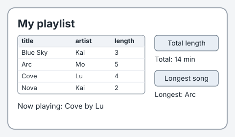

A table is a list of **records**. Today you'll read the fields of one record:

- `ClickedItem.title` is the title of the row that was clicked.
- `item(Songs, 2).artist` is the artist of row 2.
- Inside **For each row in table**, `LoopItem` is the row this time round, so `LoopItem.length` is that song's length.

Then you'll use two common patterns: a **running total** (add each song's length) and a **best so far** (keep the longest song seen).



## Try the finished app

```step
stage: info
insight: "Using the finished app first gives the targets: a clicked row's fields, a total of a column, and one row picked out of all of them."
try: { playground: appbuilder, starter: "app.json#try", tab: run, level: 4, height: 640 }
check: { type: reflect, text: "I clicked a song, then Total length and Longest song, and watched total and longest change on the left." }
```

This is the app you'll build, open on the **Run** tab. Click a song, then the two buttons. On the left, *total* and *longest* show their values now.

## Build 1: now playing

```step
stage: run
insight: "ClickedItem is the whole clicked row, so a dot and a field name pick out the one detail the screen needs."
try: { playground: appbuilder, starter: "app.json#start", keep: build, level: 4, height: 640 }
check:
  type: code
  text: "Clicking a song sets NowText to its title and artist."
  rules: { event: [["when An item in SongTable is clicked", "Set NowText text to", "ClickedItem.title", "ClickedItem.artist"]] }
```

1. Add an event: **An item in SongTable is clicked**.
2. Add the action **NowText**, **Set NowText text to** `"Now playing: " & ClickedItem.title & " by " & ClickedItem.artist`
3. Run it and click a few songs.

## Build 2: a running total

```step
stage: run
insight: "Starting the total at 0, adding one length per row, then showing it after the loop is the accumulator pattern; For each row makes the event run once per song."
try: { playground: appbuilder, starter: "app.json#sol-step-2", keep: build, level: 4, height: 640 }
check:
  type: code
  text: "Total length sets total to 0, adds LoopItem.length for each row, then shows the total."
  rules: { event: [["when TotalButton is clicked", "Set variable total to 0"], ["when TotalButton is clicked > when For each row in table Songs", "Add LoopItem.length to variable total"], ["when TotalButton is clicked > always", "Set TotalText text to", "total"]] }
```

The variable *total* is made for you.

1. Add an event: **TotalButton is clicked** → **Set variable total to** `0`.
2. Give it a **sub-event** (the event's ⋯ menu, **Add a sub-event**). Its condition: **Tables**, **For each row in table** *Songs*. Its action: **Add** `LoopItem.length` **to variable** *total*.
3. Add a second sub-event below it, with **no condition** and the action **Set TotalText text to** `"Total: " & total & " min"`. It runs after the loop has finished.
4. Run it. Check the answer by adding up the lengths yourself.

## Build 3: the longest song

```step
stage: run
insight: "Keeping the best row so far and swapping it when a longer one comes along is the running maximum; a variable can hold one whole row."
try: { playground: appbuilder, starter: "app.json#sol-step-3", keep: build, level: 4, height: 640 }
check:
  type: code
  text: "Longest song starts with row 1, swaps in any longer row inside For each row, then shows its title."
  rules: { event: [["when LongestButton is clicked", "Set variable longest to item(Songs, 1)"], ["when LongestButton is clicked > when For each row in table Songs", "LoopItem.length > longest.length", "Set variable longest to LoopItem"], ["when LongestButton is clicked > always", "longest.title"]] }
```

A variable can hold a whole row. *longest* will hold the longest song found so far.

1. Add an event: **LongestButton is clicked** → **Set variable longest to** `item(Songs, 1)` (the first song is the best so far, to begin with).
2. Add a sub-event: **For each row in table** *Songs*, and a second condition **Compare** `LoopItem.length` **>** `longest.length`. Its action: **Set variable longest to** `LoopItem`.
3. Add a sub-event with no condition: **Set LongestText text to** `"Longest: " & longest.title`
4. Run it. Then add a song longer than all the others, and try again.

## Check: trace the loop

```step
stage: investigate
insight: "Tracing total row by row, then finding Nib's reset inside the loop, check where each part of the accumulator has to sit."
tasks:
  - check:
      type: question
      q: "Songs has lengths 3, 5, 4, 2 in that order. Halfway through the Total length event, after the second row, what is total?"
      options: ["8", "5", "3", "14"]
      answer: 0
      feedback: [null, "That's the second song on its own. total keeps what was added before.", "That's after the first row only.", "That's after all four rows."]
      explain: "total starts at 0. Row 1 adds 3 (total 3), row 2 adds 5 (total 8). Rows 3 and 4 bring it to 14."
  - check:
      type: bug
      code: "working.txt#nib"
      text: "Nib's Total length always shows the last song's length. Click the line where Nib goes wrong."
      answer: 3
      fault: logic
      misconception: total-reset-each-row
      explain: "Line 3: Set total to 0 sits inside the For each row sub-event, so it runs once per row and wipes the total each time round. Starting the total belongs on the parent event, before the loop."
```

### Trace the total

### Find Nib's mistake

## Make it yours: average and shortest

```step
stage: modify
insight: "The average reuses the total with count(), and the shortest song flips one comparison in the running-maximum pattern, so both test the patterns rather than the steps."
try: { playground: appbuilder, starter: "app.json#built", keep: build, level: 4, height: 640 }
tasks:
  - check:
      type: code
      text: "TotalText also shows the average length: total divided by the number of songs."
      rules: { event: [["when TotalButton is clicked > always", "total / count(Songs)"]] }
  - check:
      type: code
      text: "Shortest song finds the row with the smallest length and shows its title."
      rules: { event: [["when ShortestButton is clicked > when For each row in table Songs", "LoopItem.length < shortest.length", "Set variable shortest to LoopItem"], ["when ShortestButton is clicked > always", "shortest.title"]] }
```

### The average

`count(Songs)` is how many rows there are. Change TotalText's text to also show `round(total / count(Songs))`, such as `"Total: " & total & " min, average " & round(total / count(Songs))`.

### The shortest song

There's a *Shortest song* button, a *ShortestText* and a variable *shortest*. Build it like the longest song. Which one thing changes?
