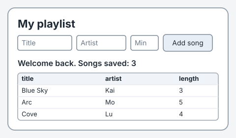

So far, every time the app starts, the table goes back to the rows you typed in the sidebar. Today the playlist will **remember** what was added, so a song added today is still there tomorrow.

- **Remember between visits** keeps a variable, list or table in **this browser**: on this computer, for this user, until it's forgotten.
- The project file you **Save** still holds the *starting* rows. What the app remembers is kept separately, in the browser.
- An app has a **first visit** (nothing saved yet) and **return visits** (something saved). A good app handles both.



## Try the finished app

```step
stage: info
insight: "Seeing a song survive a restart, then disappear with Forget saved data, shows both visits before building them."
try: { playground: appbuilder, starter: "app.json#try", tab: run, level: 4, height: 640 }
check: { type: reflect, text: "I added a song, pressed Restart and saw it was still there. Then I pressed Forget saved data and it was gone." }
```

This is the app you'll build, open on the **Run** tab. Add a song, then press **↻ Restart**: the app starts again, and your song is still there. Now press **Forget saved data**: it's like opening the app for the first time.

## Build 1: remember the songs

```step
stage: run
app: true
query: { code: "@app.json#start", level: 4, id: build-1 }
caption: "Remember between visits"
clip:
  - caption: { text: "Click the disk beside Songs: it's remembered now.", say: "Click the disk beside Songs. It's remembered now." }
  - click: { selector: "[data-ab='remember:Songs']" }
  - click: { selector: "[data-ab='tab:run']" }
  - caption: { text: "Add a song while the app runs…", say: "Add a song while the app runs." }
  - type: { selector: ".view-run [data-ab='widget:TitleInput'] input", text: "Cove" }
  - type: { selector: ".view-run [data-ab='widget:LengthInput'] input", text: "4" }
  - click: { selector: ".view-run [data-ab='widget:AddButton']" }
  - caption: { text: "…then Restart. The song is still there.", say: "Then restart. The song is still there." }
  - click: { selector: ".view-run [data-ab='restart']" }
  - expect: { selector: ".view-run [data-ab='widget:SongTable']", contains: "Cove" }
  - wait: 1200
insight: "One tick makes the table persist; testing with Restart, then Forget saved data, is how to check a saving app without waiting for tomorrow."
try: { playground: appbuilder, starter: "app.json#start", keep: build, level: 4, height: 640 }
check:
  type: code
  text: "The Songs table is remembered between visits."
  rules: { contains: ["table Songs =", "(remembered)"] }
```

1. On the left, under **Tables**, find *Songs* and click its **💾** button. It lights up: Songs is now remembered.
2. Open the **Run** tab. Add two songs.
3. Press **↻ Restart**. Are your songs still there?
4. Press **Forget saved data**. The table goes back to its one starting song.

## Build 2: first visit or return visit?

```step
stage: run
insight: "Checking count(Songs) when the screen starts lets the app tell a first visit from a return visit, using a sub-event and Else."
try: { playground: appbuilder, starter: "app.json#sol-step-2", keep: build, level: 4, height: 640 }
check:
  type: code
  text: "When the screen starts: with no songs, WelcomeText says to add the first one; otherwise it welcomes the user back with the number of songs."
  rules: { event: [["when On start of screen > when Compare count(Songs) = 0", "Set WelcomeText text to"], ["when On start of screen > else", "Set WelcomeText text to", "count(Songs)"]] }
```

1. Add an event: **Screen**, **On start of screen**. Leave it with no actions.
2. Give it a sub-event with the condition **Compare** `count(Songs)` **=** `0`, and the action **Set WelcomeText text to** `"Add your first song"`.
3. Add an **Else** below the sub-event (its ⋯ menu), with **Set WelcomeText text to** `"Welcome back. Songs saved: " & count(Songs)`.
4. Test both visits: Restart with songs saved, then remove every song and Restart again.

## Check: where is it kept?

```step
stage: investigate
insight: "Asking where the songs actually live, and what Save holds, separates the browser's saved data from the project file and from other computers."
tasks:
  - check:
      type: question
      q: "Kai's playlist remembers Songs. Kai adds five songs at home, then opens the same app on a school computer. What does the table show?"
      options: ["Only the starting rows", "All five songs", "Nothing at all", "Only the five songs"]
      answer: 0
      feedback: [null, "Nothing is sent anywhere. Remember keeps values in the browser it ran in, at home.", "The app still starts from its starting rows; this browser just has nothing saved yet.", "This browser has nothing saved, so the app starts from its starting rows."]
      explain: "Remember between visits keeps the songs in the browser the app ran in, on that computer. Another computer has nothing saved, so the app starts from its starting rows."
      fault: design
      misconception: saved-everywhere
  - check:
      type: question
      q: "Kai presses Save at the top and hands in the project file. Which songs are in it?"
      options: ["The starting rows typed in the sidebar", "The songs added while the app ran", "Both", "None: tables aren't saved"]
      answer: 0
      feedback: [null, "Those live in the browser, not in the project.", "The project keeps how the app is built and what it starts with.", "Tables are saved, with their starting rows."]
      explain: "The project file holds how the app is built, including the rows it starts with. What a user adds while it runs is kept by the browser, separately."
```

### Another computer

### What does Save keep?

## Make it yours: remember the last song

```step
stage: modify
insight: "Remembering a plain variable too shows Remember works on any value, and the welcome line puts it to use on a return visit."
try: { playground: appbuilder, starter: "app.json#built", keep: build, level: 4, height: 640 }
tasks:
  - check:
      type: code
      text: "A remembered variable LastAdded is set to the new title when a song is added, and the welcome back message shows it."
      rules: { contains: ["variable LastAdded = \"\" (remembered)"], event: [["when AddButton is clicked", "Set variable LastAdded to"], ["when On start of screen > else", "LastAdded"]] }
  - check: { type: reflect, text: "I thought about a shared computer: I wrote down one thing a user of my app should know about what it remembers, and where I'd tell them." }
```

### The last song added

There's a variable *LastAdded*.

1. Click its **💾** so it's remembered too.
2. In the AddButton event, add **Set variable LastAdded to** `TitleInput.text`.
3. Add it to the welcome back message, such as `& ". Last added: " & LastAdded`.

### On a shared computer

Anyone who uses this browser next will see what the app remembered. Write down one thing a user should know about that, and where in your app you'd tell them.
