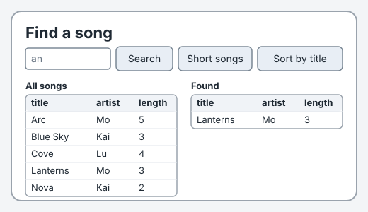

The playlist has more songs now. Today you'll help a user find one:

- **Sort** puts the rows of a table in order, by one field: titles A to Z, or the longest first. The whole row moves, so every song keeps its details.
- **Search** and **filter** go through **every row** with For each, and copy the rows that match into a second table, *Results*. The *Songs* table is never changed, so nothing is lost.

That second idea is an **algorithm**: a set of steps that works for any table. Search is the same steps with a different test.



## Try the finished app

```step
stage: info
insight: "Using the finished app first shows that searching fills a second table while the first stays whole, before any loop is built."
try: { playground: appbuilder, starter: "app.json#try", tab: run, level: 4, height: 640 }
check: { type: reflect, text: "I sorted the songs both ways, searched for some letters and showed the short songs, and saw All songs stay complete." }
```

This is the app you'll build, open on the **Run** tab. Sort both ways, then type *an* and click **Search**, then click **Short songs**.

## Build 1: sort

```step
stage: run
app: true
query: { code: "@app.json#start", level: 4, id: build-1 }
caption: "Sort by a field"
clip:
  - click: { selector: "[data-ab='tab:events']" }
  - caption: { text: "When Sort by title is clicked: Tables, Sort table.", say: "When Sort by title is clicked. Tables, Sort table." }
  - click: { selector: ".view-events [data-ab='add-event']" }
  - click: { selector: ".view-events .ev.sel [data-ab='add-condition']" }
  - click: { selector: "[data-ab='group:object:SortTitleButton']" }
  - click: { selector: "[data-ab='entry:onClicked']" }
  - click: { selector: "dialog[open] [data-ab='done']" }
  - click: { selector: ".view-events .ev.sel [data-ab='add-action']" }
  - click: { selector: "[data-ab='group:Tables']" }
  - click: { selector: "[data-ab='entry:tableSort']" }
  - click: { selector: "dialog[open] [data-ab='done']" }
  - expect: { selector: ".view-events event-sheet", contains: "Sort table Songs by title" }
  - wait: 900
insight: "Sort by a field moves whole rows; a number field sorts by size, which is why length was made a number."
try: { playground: appbuilder, starter: "app.json#start", keep: build, level: 4, height: 640 }
check:
  type: code
  text: "Sort by title sorts Songs by title A to Z; Longest first sorts Songs by length, biggest first."
  rules: { event: [["when SortTitleButton is clicked", "Sort table Songs by title A to Z"], ["when SortLengthButton is clicked", "Sort table Songs by length Z to A, biggest first"]] }
```

1. Add an event: **SortTitleButton is clicked** → **Tables**, **Sort table** *Songs* **by** *title*, **A to Z, smallest first**.
2. Add an event: **SortLengthButton is clicked** → sort *Songs* by *length*, **Z to A, biggest first**.
3. Run it and try both. Do the artists stay with their songs?

## Build 2: search

```step
stage: run
app: true
query: { code: "@app.json#sol-step-2", level: 4, id: build-2 }
caption: "Search every row"
clip:
  - click: { selector: "[data-ab='tab:events']" }
  - caption: { text: "Search: first clear the Results table.", say: "Search. First, clear the Results table." }
  - click: { selector: ".view-events [data-ab='add-event']" }
  - click: { selector: ".view-events .ev.sel [data-ab='add-condition']" }
  - click: { selector: "[data-ab='group:object:SearchButton']" }
  - click: { selector: "[data-ab='entry:onClicked']" }
  - click: { selector: "dialog[open] [data-ab='done']" }
  - click: { selector: ".view-events .ev.sel [data-ab='add-action']" }
  - click: { selector: "[data-ab='group:Tables']" }
  - click: { selector: "[data-ab='entry:tableClear']" }
  - click: { selector: "dialog[open] [data-ab='param:table']" }
  - press: R
  - press: Enter
  - click: { selector: "dialog[open] [data-ab='done']" }
  - caption: { text: "A sub-event: For each row in Songs, if the title contains the search.", say: "A sub-event. For each row in Songs, if the title contains the search." }
  - click: { selector: ".view-events .ev.sel [data-ab='event-menu']" }
  - click: { selector: "[data-ab='menu:add-a-sub-event']" }
  - click: { selector: ".view-events .ev.sel [data-ab='add-condition']" }
  - click: { selector: "[data-ab='group:Tables']" }
  - click: { selector: "[data-ab='entry:forEachRow']" }
  - click: { selector: "dialog[open] [data-ab='done']" }
  - click: { selector: ".view-events .ev.sel [data-ab='add-condition']" }
  - click: { selector: "[data-ab='group:Variables']" }
  - click: { selector: "[data-ab='entry:compareValues']" }
  - type: { selector: "dialog[open] [data-ab='param:left']", text: "contains(lower(LoopItem.title), lower(SearchInput.text))" }
  - type: { selector: "dialog[open] [data-ab='param:right']", text: "true" }
  - click: { selector: "dialog[open] [data-ab='done']" }
  - caption: { text: "A match? Copy the row into Results.", say: "A match? Copy the row into Results." }
  - click: { selector: ".view-events .ev.sel [data-ab='add-action']" }
  - click: { selector: "[data-ab='group:Tables']" }
  - click: { selector: "[data-ab='entry:tableAdd']" }
  - click: { selector: "dialog[open] [data-ab='param:table']" }
  - press: R
  - press: Enter
  - type: { selector: "dialog[open] [data-ab='value:title']", text: "LoopItem.title" }
  - type: { selector: "dialog[open] [data-ab='value:artist']", text: "LoopItem.artist" }
  - type: { selector: "dialog[open] [data-ab='value:length']", text: "LoopItem.length" }
  - click: { selector: "dialog[open] [data-ab='done']" }
  - expect: { selector: ".view-events event-sheet", contains: "Add a row to table Results" }
  - wait: 900
insight: "Clearing Results, then copying every row whose title contains the search text, is the linear search: one test per row, the matches kept."
try: { playground: appbuilder, starter: "app.json#sol-step-2", keep: build, level: 4, height: 640 }
check:
  type: code
  text: "Search clears Results, then for each row of Songs whose title contains the typed text, adds that row to Results."
  rules: { event: [["when SearchButton is clicked", "Clear table Results"], ["when SearchButton is clicked > when For each row in table Songs", "contains(", "LoopItem.title", "SearchInput.text", "Add a row to table Results", "title = LoopItem.title"]] }
```

The *Results* table has the same fields as Songs, and *ResultsTable* shows it.

1. Add an event: **SearchButton is clicked** → **Clear table** *Results* (so old results don't stay).
2. Give it a sub-event: **For each row in table** *Songs*, and a second condition **Compare** `contains(lower(LoopItem.title), lower(SearchInput.text))` **=** `true`. `lower(...)` makes capitals not matter.
3. The sub-event's action: **Add a row to table** *Results*, with *title* `LoopItem.title`, *artist* `LoopItem.artist`, *length* `LoopItem.length`.
4. Run it. Search for *an*, then *o*. Is *All songs* still complete?

## Build 3: filter the short songs

```step
stage: run
insight: "Filtering is the same algorithm with a different test, so the build checks students can reuse the pattern rather than copy steps."
try: { playground: appbuilder, starter: "app.json#sol-step-3", keep: build, level: 4, height: 640 }
check:
  type: code
  text: "Short songs clears Results, then adds every row of Songs with a length of 3 or less."
  rules: { event: [["when ShortButton is clicked", "Clear table Results"], ["when ShortButton is clicked > when For each row in table Songs", "LoopItem.length ≤ 3", "Add a row to table Results"]] }
```

Build **Short songs** the same way as Search. Only the test changes: **Compare** `LoopItem.length` **≤** `3`.

## Check: keep the songs safe

```step
stage: investigate
insight: "Nib's filter shows why the algorithm copies matches instead of removing the rest, and the sort question shows why a number field matters."
tasks:
  - check:
      type: bug
      code: "working.txt#nib"
      text: "After Nib's Short songs, the long songs are gone for good. Click the line where Nib goes wrong."
      answer: 3
      fault: logic
      misconception: filter-the-store
      explain: "Line 3: Nib removes the long songs from Songs itself. A filter should copy the matching rows into another table, so the original table keeps everything."
  - check:
      type: question
      q: "Suppose length were a text field. Sorting the lengths 10, 9 and 3 A to Z would give which order?"
      options: ["10, 3, 9", "3, 9, 10", "10, 9, 3", "9, 3, 10"]
      answer: 0
      feedback: [null, "That's sorting by size, which only happens for a number field.", "That's biggest first by size.", "Text is compared letter by letter, from the first character."]
      explain: "Text sorts character by character: \"1\" comes before \"3\", which comes before \"9\", so \"10\" comes first. A number field sorts by size: 3, 9, 10."
      fault: design
      misconception: text-number-sort
```

### Find Nib's mistake

### Text or number?

## Make it yours: search artists, show all

```step
stage: modify
insight: "Searching two fields changes only the test, and Show all removes the test altogether, so both confirm the loop-and-copy pattern."
try: { playground: appbuilder, starter: "app.json#built", keep: build, level: 4, height: 640 }
tasks:
  - check:
      type: code
      text: "Search also finds songs whose artist contains the typed text."
      rules: { event: [["when SearchButton is clicked > when For each row in table Songs", "LoopItem.artist)", "SearchInput.text", "Add a row to table Results"]] }
  - check:
      type: code
      text: "Show all clears Results and copies every row of Songs into it."
      rules: { event: [["when AllButton is clicked", "Clear table Results"], ["when AllButton is clicked > when For each row in table Songs", "Add a row to table Results"]] }
```

### Search artists too

Change Search's test so it looks in the title and the artist. One way: `contains(lower(LoopItem.title & " " & LoopItem.artist), lower(SearchInput.text))`

### Show all

There's a **Show all** button. Make it copy every song into Results. Which part of the pattern does it not need?

## Extra: play the clicked song

```step
stage: modify
tier: typical
insight: "A field can hold the name of something to use, so the clicked row's sound field chooses which sound plays: the same ClickedItem read as before, put to a new job."
try: { playground: appbuilder, starter: "app.json#sound", keep: sound, level: 4, height: 680 }
check:
  type: code
  text: "Clicking a song in SongTable sets Music's sound to that row's sound field, then plays it."
  rules: { event: [["when An item in SongTable is clicked", "Set Music sound to the one named ClickedItem.sound", "Play Music"]] }
```

Songs now has a **sound** field naming one of App Builder's built-in sounds (*calm*, *upbeat*, *sleepy*, *beat*), and there's a **Sound** object called *Music* under the tables.

1. Add an event: **An item in SongTable is clicked**.
2. Action: **Set Music sound to the one named** `ClickedItem.sound`.
3. Action: **Play Music**.
4. Run it and click a few songs. Search still copies the sound field into Results, so a found song plays too if you do the same for ResultsTable.

The sounds are short tracks made for App Builder, free to use. A browser only plays sound after you've clicked something in the app, which a row click is.
