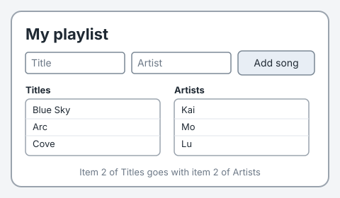

Today's playlist keeps its songs in **two lists**: one for titles and one for artists. A song's title and its artist sit at the **same place** in each list: item 1 of *Titles* goes with item 1 of *Artists*, item 2 with item 2, and so on. The place number is the only thing linking them.



## Try the finished app

```step
stage: info
insight: "Using the finished app first shows the two lists moving together before the build, so the later slip (changing one list) has something to break."
try: { playground: appbuilder, starter: "app.json#try", tab: run, level: 3, height: 600 }
check: { type: reflect, text: "I added a song and removed one, and watched Titles and Artists change on the left." }
```

This is the app you'll build, open on the **Run** tab. Add a song, then click a title to remove that song. On the left, beside *Titles* and *Artists*, you can see how many items each list has now.

## Build 1: add to both lists

```step
stage: run
insight: "Adding to both lists in one event is how the two stay in step: the new title and artist both land at the end, at the same place."
try: { playground: appbuilder, starter: "app.json#start", keep: build, level: 3, height: 600 }
check:
  type: code
  text: "When AddButton is clicked, the title goes on the end of Titles and the artist on the end of Artists."
  rules: { event: [["when AddButton is clicked", "Add TitleInput.text to the end of list Titles", "Add ArtistInput.text to the end of list Artists"]] }
```

The lists *Titles* and *Artists* are made for you (left side, under Lists), and each List object on the screen shows one of them.

1. On the **Events** tab, add an event: **AddButton is clicked**.
2. Add the action **Lists**, **Add … to the end of list**: value `TitleInput.text`, list *Titles*.
3. Add a second action to the same event: `ArtistInput.text` to the end of *Artists*.
4. Run it and add a song. Is the new title level with its artist?

## Build 2: remove from both lists

```step
stage: run
insight: "Removing the same place from both lists keeps every pair together; ClickedIndex is the place of the clicked title."
try: { playground: appbuilder, starter: "app.json#sol-step-2", keep: build, level: 3, height: 600 }
check:
  type: code
  text: "When a title is clicked, item ClickedIndex is removed from Titles and from Artists."
  rules: { event: [["when An item in TitleList is clicked", "Remove item ClickedIndex from list Titles", "Remove item ClickedIndex from list Artists"]] }
```

1. Add an event: **TitleList**, **An item in TitleList is clicked**. Inside it, **ClickedIndex** is the place of the title that was clicked: 1 for the first, 2 for the second.
2. Add the action **Lists**, **Remove item … from list**: index `ClickedIndex`, list *Titles*.
3. Add the same action for *Artists*.
4. Run it and remove the middle song. Check every title still sits next to its own artist.

## Check: when the lists disagree

```step
stage: investigate
insight: "Predicting what goes wrong when only one list changes, then finding Nib's slip, shows that the place number is the only link between the two lists."
tasks:
  - check:
      type: question
      q: "Titles is Blue Sky, Arc, Cove. Artists is Kai, Mo, Lu. An event removes item 2 from Titles only. Who does the app now say sang Cove?"
      options: ["Mo", "Lu", "Kai", "Nobody: the app shows an error"]
      answer: 0
      feedback: [null, "Lu was at place 3 in Artists, and still is. Where is Cove in Titles now?", "Kai is still at place 1, beside Blue Sky.", "Nothing stops it: each list is fine on its own. The mistake is only in how they line up."]
      explain: "Cove moves up to place 2 in Titles, but Artists didn't change, so place 2 there is still Mo. Every song after the removed one now has the wrong artist."
  - check:
      type: bug
      code: "working.txt#nib"
      text: "After Nib removes a song, the artists are wrong for every song below it. Click the line where Nib first goes wrong."
      answer: 2
      fault: logic
      misconception: parallel-lists-sync
      explain: "Line 2: Nib only removes the item from Titles. Artists keeps the old item, so every artist below it is now one place out. Both lists must lose the same place."
```

### What happens to Cove?

### Find Nib's mistake

## Make it yours: a third list

```step
stage: modify
insight: "Adding a third list makes the cost of keeping parallel lists in step visible: every change now has to touch three places."
try: { playground: appbuilder, starter: "app.json#built", keep: build, level: 3, height: 600 }
tasks:
  - check:
      type: code
      text: "A list Lengths, shown by LengthList; Add puts the minutes on the end of it, and clicking a title removes that place from it too."
      rules: { contains: ["list Lengths =", "object LengthList (list) text \"\" shows Lengths"], event: [["when AddButton is clicked", "to the end of list Lengths"], ["when An item in TitleList is clicked", "Remove item ClickedIndex from list Lengths"]] }
  - check: { type: reflect, text: "I wrote one sentence: what would go wrong if I sorted Titles A to Z but didn't move the other two lists the same way?" }
```

### Add a Lengths list

This screen now has a *Minutes* box and a third List object, *LengthList*.

1. Add a list called *Lengths* (left side, under Lists), and set *LengthList* to show it (click it, then **Shows** in Properties).
2. In the AddButton event, add `int(LengthInput.text)` to the end of *Lengths*. `int(...)` turns the typed text into a number.
3. In the title-clicked event, remove item `ClickedIndex` from *Lengths* too.

### What about sorting?

Imagine a button that sorts *Titles* from A to Z. Write one sentence: what would happen to the artists and lengths? Keep it for the next lesson, which keeps each song's details together in one place.
