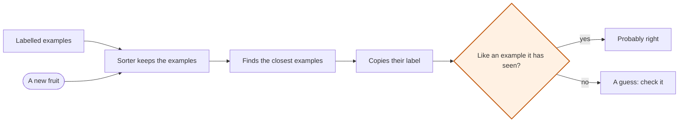

# How does a machine learn?

AI Foundations · How AI learns

<!-- Speaker note: Students teach a fruit sorter with labelled examples, test fruit it has never seen, and add an example to change what it predicts. About 30 minutes. -->

---

## Today

- I can explain what a label is and how labelled examples shape a model's predictions.
- I can test a model on a case it was not shown, and say what one test does and doesn't prove.
- I can change a model's examples and explain why its prediction changed.

<!-- Speaker note: Before class: The board is a transparent teaching model: it copies the label of the nearest examples. It is not a neural network. The two clues (colour and shape) are deliberately too few for real fruit; let students find this. Optional extension, with school approval: train an image classifier in the Pattern Trainer (https://tools.learningwaypoints.com/trainer/, photos stay on the computer; Teachable Machine also works) with two fruit classes and test photos not used in training. Ask the same questions: what examples were used, what did it predict, what surprised you? A real image classifier learns much richer features than the board. The board alone is the complete core route. -->

---

💬 Discussion

## Think, pair, share

**Would a sorter trained on a hundred yellow bananas be better than one trained on ten bananas of different colours?**

- Better at which fruit?
- What would you test it on to find out?

<!-- Speaker note: More examples help only if they cover what the sorter will meet. Variety can matter more than quantity; let students argue it before the board settles it. Give 30 seconds alone, 2 minutes in pairs, then take answers from both sides. There is no single right answer: ask for a reason, and let students change their minds. -->

---

💬 Discussion

## Engage: predict

**A sorter has only seen yellow, long bananas. Can it reliably recognise every banana?**

- It will always choose the right label
- Not necessarily: unfamiliar bananas may look different
- Yes, it has learned what every banana looks like

<!-- Speaker note: What happens: Not necessarily. The examples shape the patterns it uses, and real bananas vary. Take two or three predictions before anyone runs it. -->

<!-- Speaker note: Teacher: ask what a sorter taught only long yellow bananas would do with other bananas. -->

---

✍️ Activity

## Be the sorter (5 min)

Show four labelled picture cards (yellow long banana, red round apple, and two more). Then show a green, long fruit. Students who are the 'sorter' may only use the cards to decide: what do they say?

<!-- Speaker note: Students use colour and shape just as the model will. Ask what they would need to see to be more sure. -->

---

✍️ Activity

## Explore it

{{embed: https://tutorials.learningwaypoints.com/_playground-board/index.html?id=deck%2Fai%2Ffoundations%2Ftraining-examples%2Fstep-2&code=widget%3A+fruit-learning%0Amode%3A+examples%0Aexample%3A+green+%7C+round+%7C+apple%0Aexample%3A+green+%7C+round+%7C+apple%0Aexample%3A+yellow+%7C+round+%7C+apple%0Aexample%3A+yellow+%7C+long+%7C+banana%0Aexample%3A+yellow+%7C+long+%7C+banana%0Aexample%3A+yellow+%7C+long+%7C+banana%0A&fresh=1}}

[Open this step in the tutorial](https://tutorials.learningwaypoints.com/ai/foundations/training-examples/?full=step-2#step-2)

<!-- Speaker note: The model sees only two clues: **colour** (green or yellow) and **shape** (round or long). Real fruits are more varied. Predict its answer first, then choose clues and press **Predict label**. Compare the result with your prediction. Look at the labelled examples. Test a yellow, long fruit and a green, round fruit. What does the model do when the clues do not clearly match one kind? -->

<!-- Speaker note: Teacher: insist on a prediction before each test. -->

---

✅ Check

## What happened?

* Not necessarily. The examples shape the patterns it uses, and real bananas vary.

<!-- Speaker note: Reveal after running. Ask who predicted it, and what made them think so. -->

---

💬 Discussion

## Which part is the label? (3 min)

Write 'yellow | round | apple' on the board. Point to the features and the label. What would happen if the label were wrong?

<!-- Speaker note: Sets up the next lesson on mistakes. Keep it brief. -->

---

## How the sorter makes a prediction

<!-- Speaker note: A flowchart of the fruit sorter. It keeps its labelled examples. A new fruit comes in. The sorter finds the closest examples and copies their label. Then ask: is the new fruit like any example it has seen? If yes, the prediction is probably right. If no, it is a guess: check it. -->

---

✅ Check

## Identify the evidence

**On the board, one training example reads: yellow | round | apple. Which part is the label?**

- yellow
- round
- apple

* Answer: apple

<!-- Speaker note:  -->

<!-- Speaker note: Teacher: name the parts of an example: the clues and the label. -->

---

✅ Check

## Test the claim

**No training example is green and long. You test a green, long fruit and the sorter says banana. What does that show?**

- Green, long fruits are always bananas
- It can sort at least one fruit it was never shown
- It will be right about every fruit

* Answer: It can sort at least one fruit it was never shown

<!-- Speaker note:  -->

---

✅ Check

## Never seen it (2 min)

Thumbs up or down: "The sorter called a green, long fruit a banana, so it knows what green bananas are."

<!-- Speaker note: Thumbs down. It matched the shape it had seen; it has no example of green and long. Ask one student to say why. -->

---

✍️ Activity

## Elaborate: change and test

{{embed: https://tutorials.learningwaypoints.com/_playground-board/index.html?id=deck%2Fai%2Ffoundations%2Ftraining-examples%2Fstep-4&code=widget%3A+fruit-learning%0Amode%3A+examples%0Aexample%3A+green+%7C+round+%7C+apple%0Aexample%3A+green+%7C+round+%7C+apple%0Aexample%3A+yellow+%7C+round+%7C+apple%0Aexample%3A+yellow+%7C+long+%7C+banana%0Aexample%3A+yellow+%7C+long+%7C+banana%0Aexample%3A+yellow+%7C+long+%7C+banana%0A&fresh=1}}

[Open this step in the tutorial](https://tutorials.learningwaypoints.com/ai/foundations/training-examples/?full=step-4#step-4)

<!-- Speaker note: Add a correctly labelled example of a yellow, round banana. Test the same clues before and after adding it. Explain what changed. **Wider investigation:** Try a case where the same two clues could describe different real fruits. What additional information might help? Explain why a better dataset may help without guaranteeing a correct answer. -->

<!-- Speaker note: Teacher: test the same fruit before and after adding an example. -->

---

## Evaluate: judge a new prediction

Without using the model, write: **One thing I understand about how this model works is … One thing I would check before trusting its output is …**

---

## Learning with AI: you can't see its examples

On the board you could see every example. A real AI assistant learned from far more examples than you could ever read, and you can't see them. So when it gives you a confident answer, ask: *what might it have learned from?* Better examples often help a model, but they can't guarantee a good answer.

---

✅ Check

## Exit ticket

**Why can adding one example change a sorter's prediction?**

* The sorter copies its nearest examples, so a new nearby example can change which label wins.

<!-- Speaker note: Students answer on paper or a mini whiteboard before the reveal. Anyone who cannot answer needs the main idea again next lesson. Where this leads: Unit 2, lesson 2 breaks the sorter on purpose with wrong labels and missing examples. -->
