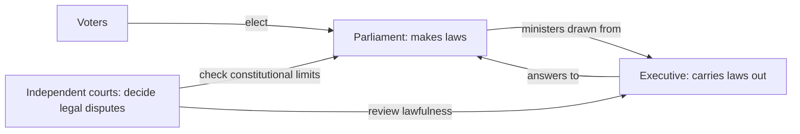

# Power shared, power checked

How Australia is governed · How Australia is governed

<!-- Speaker note: Authority comes from the people. Australia shares law-making, executive and judicial powers, with ministers in Parliament and independent courts. About 40 minutes (Predict and Try 8 min · Worked example 12 min · Vary 6 min · Practise 6 min · Make and exit 8 min. Optional width is extra.). Sources: US Constitution, Article I section 6 (US National Archives), https://www.archives.gov/founding-docs/constitution-transcript (checked 30 October 2026); Operation of the High Court (High Court of Australia), https://www.hcourt.gov.au/about/overview-high-court/operation-high-court (checked 30 October 2026); Separation of powers (Parliamentary Education Office), https://peo.gov.au/understand-our-parliament/how-parliament-works/system-of-government/separation-of-powers-parliament-executive-and-judiciary (checked 30 October 2026); Constitution overview (Parliamentary Education Office), https://peo.gov.au/understand-our-parliament/how-parliament-works/the-australian-constitution/the-australian-constitution-online/overview (checked 30 October 2026); British and US influences (Parliamentary Education Office), https://peo.gov.au/understand-our-parliament/your-questions-on-notice/questions/historically-how-have-the-british-and-us-systems-of-government-influenced-the-australian-government-system (checked 30 October 2026); Democracy (Parliamentary Education Office), https://peo.gov.au/understand-our-parliament/how-parliament-works/system-of-government/democracy (checked 30 October 2026); High Court and Judiciary (Australian Government Solicitor), https://www.ags.gov.au/publications/sawers-australian-constitution/chapter-8 (checked 30 October 2026). -->

---

## Today

- I can explain popular sovereignty and representation.
- I can distinguish legislative, executive and judicial work.
- I can explain why Australia’s separation of powers is partial.

<!-- Speaker note: Before class: Usually Year 7. This follows the n2 hinge: retrieve the minister’s parliamentary membership before adding the three powers. The diagram is a simplified view of Commonwealth functions, not an exhaustive constitutional chart. Parliament and the executive both include the Crown; say this explicitly so the shorthand does not erase the Governor-General. Popular sovereignty is taught as a democratic principle, not a claim that every person can make binding law directly. All disputes and statements by Nib are made up. No current office holders, parties or live policy debates. Teacher: Worked example: let students find and explain Nib’s first wrong line. Teacher: Vary and Practise: ask for reasons, not just labels. -->

---

## Why it matters

> Could the people carrying out a law also decide every dispute about whether they broke it?

<!-- Speaker note: **Popular sovereignty** means government authority comes from the people. **Representation** means people elect members to act on their behalf. Those members must also be accountable: they must explain their decisions and face checks on their power. -->

---

<span style="background:#dbeafe; color:#1a1a1a; border:1.5px solid #3b82f6; padding:6px 18px; border-radius:8px; font-size:1em; font-weight:500;">💬 Discussion</span>

## Think, pair, share

**If a government has won an election, should its decisions still face legal checks? Why?**

- Which feature supports your explanation?
- What could go wrong without that check or division?

<!-- Speaker note: Judge the institutional explanation, not a student’s political view. Use no current office holders or named parties. Give 30 seconds alone, 2 minutes in pairs, then take answers from both sides. There is no single right answer: ask for a reason, and let students change their minds. -->

---

<span style="background:#dbeafe; color:#1a1a1a; border:1.5px solid #3b82f6; padding:6px 18px; border-radius:8px; font-size:1em; font-weight:500;">💬 Discussion</span>

## Predict

**A made-up minister is challenged for acting beyond a law. Who should settle the legal dispute?**

- The minister alone
- An independent court
- Whoever has the loudest opinion

<!-- Speaker note: What happens: An independent court decides legal disputes. The minister does not get the final legal judgement on their own actions. Take two or three predictions before anyone runs it. -->

<!-- Speaker note: Teacher: collect answers before revealing the result. -->

---

<span style="background:#dcfce7; color:#1a1a1a; border:1.5px solid #22c55e; padding:6px 18px; border-radius:8px; font-size:1em; font-weight:500;">✅ Check</span>

## What happened?

* An independent court decides legal disputes. The minister does not get the final legal judgement on their own actions.

<!-- Speaker note: Reveal after running. Ask who predicted it, and what made them think so. -->

---

<span style="background:#fef3c7; color:#1a1a1a; border:1.5px solid #f59e0b; padding:6px 18px; border-radius:8px; font-size:1em; font-weight:500;">✍️ Activity</span>

## Try it

Open the lesson at this step and try it together.

[tutorials.learningwaypoints.com/civics/government-7/power-shared-and-checked/?full=step-2#step-2](https://tutorials.learningwaypoints.com/civics/government-7/power-shared-and-checked/?full=step-2#step-2)

<!-- Speaker note:  -->

---

## Different jobs, with an overlap



<!-- Speaker note: Voters elect Parliament. Parliament makes laws; ministers drawn from it lead the executive that carries laws out. Independent courts judge legal disputes and can check whether laws are constitutional. -->

---

<span style="background:#dcfce7; color:#1a1a1a; border:1.5px solid #22c55e; padding:6px 18px; border-radius:8px; font-size:1em; font-weight:500;">✅ Check</span>

## Find Nib’s mistake

**Click the line where Nib's explanation first goes wrong.**

```
 1  Parliament makes laws, and the executive puts them into action.
 2  Courts decide legal disputes independently.
 3  Nib says: "Ministers cannot be in Parliament: all powers are separate."
 4  The different jobs help prevent power being concentrated.
```

* Answer: line 3

<!-- Speaker note: Line 3: Australia has a partial separation. Ministers are in Parliament as well as the executive. Judicial decisions remain independent. -->

---

<span style="background:#dcfce7; color:#1a1a1a; border:1.5px solid #22c55e; padding:6px 18px; border-radius:8px; font-size:1em; font-weight:500;">✅ Check</span>

## Explain the connection

**Which situation explains popular sovereignty?**

- A minister owns government authority
- Courts choose all representatives
- Government authority comes from the people

* Answer: Government authority comes from the people

<!-- Speaker note: The people are the source of democratic authority; elected members exercise authority on their behalf. -->

---

<span style="background:#fef3c7; color:#1a1a1a; border:1.5px solid #f59e0b; padding:6px 18px; border-radius:8px; font-size:1em; font-weight:500;">✍️ Activity</span>

## Explain the connection <span style="font-size:.6em;color:#64748b">(5 min)</span>

Give three students job cards: make laws, carry them out, decide disputes. Give the minister a second Parliament card. Ask which overlap is allowed and whose decisions must stay independent.

<!-- Speaker note: Use three job cards first: make, carry out, decide a legal dispute. Then attach the institutional names. -->

---

<span style="background:#fef3c7; color:#1a1a1a; border:1.5px solid #f59e0b; padding:6px 18px; border-radius:8px; font-size:1em; font-weight:500;">✍️ Activity</span>

## Vary: name the principle


<!-- Speaker note: What this step is for: Popular sovereignty, representation and accountability answer different questions. For students who need more support: Use three job cards first: make, carry out, decide a legal dispute. Then attach the institutional names. For early finishers: Why might elections and independent courts both matter even when a government has popular support? The hard part, on purpose: Students may think separate powers means no shared membership. Ask them to identify the minister’s two roles and the court’s different position. When students get stuck: A student confuses legislative with executive. Ask: Is this making a rule or carrying an existing rule out? Fix: Name the job before naming the branch. / A student says independent courts can do anything. Ask: What must a court use to explain its judgement? Fix: Independence means freedom from directions in deciding cases, not freedom from law. Judgements give reasons and can be reviewed through appeals where available. -->

---

<span style="background:#dcfce7; color:#1a1a1a; border:1.5px solid #22c55e; padding:6px 18px; border-radius:8px; font-size:1em; font-weight:500;">✅ Check</span>

## Case 1

**A made-up minister tells a court what judgement to give. What is the problem?**

- Only the Senate can give that instruction
- A court should take instructions from ministers
- Judicial decisions must be independent

* Answer: Judicial decisions must be independent

<!-- Speaker note: Courts decide cases according to law, independently of ministers. -->

---

<span style="background:#dcfce7; color:#1a1a1a; border:1.5px solid #22c55e; padding:6px 18px; border-radius:8px; font-size:1em; font-weight:500;">✅ Check</span>

## Case 2

**Which power is being exercised?**

Groups: Legislative · Executive · Judicial

Passing a proposed law through Parliament · Administering a law through a department · The High Court deciding if a law exceeds constitutional power

* Answer: Passing a proposed law through Parliament → Legislative; Administering a law through a department → Executive; The High Court deciding if a law exceeds constitutional power → Judicial

<!-- Speaker note:  -->

<style scoped>pre, marp-pre { font-size: 0.5em; line-height: 1.25; } section { font-size: 26px; }</style>

---

<span style="background:#fef3c7; color:#1a1a1a; border:1.5px solid #f59e0b; padding:6px 18px; border-radius:8px; font-size:1em; font-weight:500;">✍️ Activity</span>

## Make: who holds each power?

For example, the executive carries out laws and ministers answer questions in Parliament. Add examples for the other two powers. For courts, distinguish accountability through reasons and appeals from interference with a judgement. Use the diagram to check the overlap.

<!-- Speaker note: What this step is for: An example and a check make the three labels useful. -->

<!-- Speaker note: Teacher: the student writes in their own book or document; a partner or teacher reads it. The site only records a reflect tick. -->

---

<span style="background:#dcfce7; color:#1a1a1a; border:1.5px solid #22c55e; padding:6px 18px; border-radius:8px; font-size:1em; font-weight:500;">✅ Check</span>

## Check a partner’s explanation <span style="font-size:.6em;color:#64748b">(4 min)</span>

Read the partner’s work against the Make brief. Ask for a reason if a label alone does not explain the idea.

<!-- Speaker note: Students write elsewhere; the site does not take or mark writing. -->

---

<span style="background:#fef3c7; color:#1a1a1a; border:1.5px solid #f59e0b; padding:6px 18px; border-radius:8px; font-size:1em; font-weight:500;">✍️ Activity</span>

## Make: Typical: more than one check


<!-- Speaker note: What this step is for: Checks combine rather than relying on one institution. -->

---

<span style="background:#fef3c7; color:#1a1a1a; border:1.5px solid #f59e0b; padding:6px 18px; border-radius:8px; font-size:1em; font-weight:500;">✍️ Activity</span>

## Make: Wider: a different separation

Congress is the US legislature. Its President is not a member of Congress. In Australia ministers come from Parliament. This is a comparison of structures, not a ranking of countries.

Typical and wider steps are optional extras on this idea. The untiered steps are the required path.

<!-- Speaker note: What this step is for: Comparing the overlap makes partial separation precise. -->

---

<span style="background:#dcfce7; color:#1a1a1a; border:1.5px solid #22c55e; padding:6px 18px; border-radius:8px; font-size:1em; font-weight:500;">✅ Check</span>

## Exit ticket

**Why is Australia’s separation of powers called partial?**

* Ministers belong to Parliament and the executive. Courts decide legal disputes independently of both.

<!-- Speaker note: Students answer on paper or a mini whiteboard before the reveal. Anyone who cannot answer needs the main idea again next lesson. Where this leads: Next in this course: One country, several governments. ACARA elaboration for AC9HC7K01 (an example, not a checklist): "exploring key democratic concepts, including popular sovereignty, representation, accountability and a partial separation of powers through the election of members of a legislative branch who answer to the people and from whom the executive branch is drawn" -->
