# We elect them, they answer to us

How Australia is governed · How Australia is governed

<!-- Speaker note: Voters choose representatives. The government is drawn from Parliament and must answer to it, with the support of the House of Representatives. About 40 minutes (Predict and Try 8 min · Worked example 12 min · Vary 6 min · Practise 6 min · Make and exit 8 min. Optional width is extra.). Sources: Constitution Chapter II, section 64 (Parliamentary Education Office), https://peo.gov.au/understand-our-parliament/how-parliament-works/the-australian-constitution/the-australian-constitution-online/chapter-ii (checked 30 October 2026); Prime Minister (Parliamentary Education Office), https://peo.gov.au/understand-our-parliament/parliament-and-its-people/government/prime-minister (checked 30 October 2026); Australian Constitution (Parliamentary Education Office), https://peo.gov.au/understand-our-parliament/how-parliament-works/the-australian-constitution/australian-constitution (checked 30 October 2026); Constitution overview (Parliamentary Education Office), https://peo.gov.au/understand-our-parliament/how-parliament-works/the-australian-constitution/the-australian-constitution-online/overview (checked 30 October 2026); Question Time (Parliamentary Education Office), https://peo.gov.au/understand-our-parliament/how-parliament-works/parliament-at-work/question-time (checked 30 October 2026); What is confidence and supply? (Parliamentary Education Office), https://peo.gov.au/understand-our-parliament/your-questions-on-notice/questions/what-is-confidence-and-supply (checked 30 October 2026); Opposition (Parliamentary Education Office), https://peo.gov.au/understand-our-parliament/parliament-and-its-people/opposition/the-opposition (checked 30 October 2026); Separation of powers (Parliamentary Education Office), https://peo.gov.au/understand-our-parliament/how-parliament-works/system-of-government/separation-of-powers-parliament-executive-and-judiciary (checked 30 October 2026); Governor-General (Parliamentary Education Office), https://peo.gov.au/understand-our-parliament/parliament-and-its-people/people-in-parliament/governor-general (checked 30 October 2026); Senate estimates (Parliamentary Education Office), https://peo.gov.au/understand-our-parliament/how-parliament-works/parliament-at-work/senate-estimates (checked 30 October 2026); Government and Parliament (House of Representatives Practice), https://www.aph.gov.au/About_Parliament/House_of_Representatives/Powers_practice_and_procedure/Practice7/HTML/Chapter2/Government%20and%20Parliament (checked 30 October 2026). -->

---

## Today

- I can trace a House vote through to the formation of government.
- I can explain how ministers come from and answer to Parliament.
- I can describe the roles of the House, Senate and Governor-General.

<!-- Speaker note: Before class: Hinge n2: without the accountability link between executive and legislature, students misread who holds power. Spend time on the chain and the direct-election slip before leaving this waypoint. Majority support, not merely being the largest grouping, is the test; support can come from members outside the governing grouping. The chain is a teaching sequence, not a full legal timetable. Section 64 permits a minister to hold office outside Parliament for up to three months: the core states the continuing rule, not that exception. No current office holders, named parties or real election results are used. Nib and all situations are made up. The 1975 dismissal is left for a teacher-led extension after understanding is secure. Teacher: Try and worked example: give the chain time; ask students to explain the support and accountability arrows. Teacher: Vary and Practise: ask for reasons, not just labels. -->

---

## Why it matters

> If we elect a local member, how does anyone become Prime Minister?

<!-- Speaker note: **Representative government** means we elect people to act on our behalf. **Responsible government** means ministers come from Parliament and answer to it. Voters elect senators as well as members of the House of Representatives. Here, follow the House vote through to forming government and appointing the Prime Minister (PM). -->

---

<span style="background:#dbeafe; color:#1a1a1a; border:1.5px solid #3b82f6; padding:6px 18px; border-radius:8px; font-size:1em; font-weight:500;">💬 Discussion</span>

## Think, pair, share

**If voters have chosen their representatives, why should ministers still have to answer questions between elections?**

- Which feature supports your explanation?
- What could go wrong without that check or division?

<!-- Speaker note: Judge the institutional explanation, not a student’s political view. Use no current office holders or named parties. Give 30 seconds alone, 2 minutes in pairs, then take answers from both sides. There is no single right answer: ask for a reason, and let students change their minds. -->

---

<span style="background:#dbeafe; color:#1a1a1a; border:1.5px solid #3b82f6; padding:6px 18px; border-radius:8px; font-size:1em; font-weight:500;">💬 Discussion</span>

## Predict

**A voter fills in a House of Representatives ballot. What are they choosing?**

- The Prime Minister directly
- The Governor-General
- The national Cabinet
- A local member

<!-- Speaker note: What happens: The ballot chooses a member for the local electorate. There is no separate national ballot for Prime Minister. Take two or three predictions before anyone runs it. -->

<!-- Speaker note: Teacher: collect answers before revealing the result. -->

---

<span style="background:#dcfce7; color:#1a1a1a; border:1.5px solid #22c55e; padding:6px 18px; border-radius:8px; font-size:1em; font-weight:500;">✅ Check</span>

## What happened?

* The ballot chooses a member for the local electorate. There is no separate national ballot for Prime Minister.

<!-- Speaker note: Reveal after running. Ask who predicted it, and what made them think so. -->

---

<span style="background:#fef3c7; color:#1a1a1a; border:1.5px solid #f59e0b; padding:6px 18px; border-radius:8px; font-size:1em; font-weight:500;">✍️ Activity</span>

## Try it

Open the lesson at this step and try it together.

[tutorials.learningwaypoints.com/civics/government-7/representative-and-responsible/?full=step-2#step-2](https://tutorials.learningwaypoints.com/civics/government-7/representative-and-responsible/?full=step-2#step-2)

<!-- Speaker note:  -->

---

## From a vote to a government

```mermaid
flowchart LR
  accTitle: From a vote to a government
  accDescr: Voters elect the House. Majority support in the House allows a government to form. The Governor-General appoints its leader as Prime Minister. Ministers come from Parliament and answer to Parliament.
  V["Voters"] -->|elect| H["House of Representatives"]
  H -->|majority support| G["Government can form"]
  G --> A["Governor-General appoints Prime Minister"]
  A --> M["Ministers drawn from Parliament"]
  M -->|answer to| P["Parliament: House and Senate"]
```



<!-- Speaker note: Voters elect the House. Majority support in the House allows a government to form. The Governor-General appoints its leader as Prime Minister. Ministers come from Parliament and answer to Parliament. -->

---

<span style="background:#dcfce7; color:#1a1a1a; border:1.5px solid #22c55e; padding:6px 18px; border-radius:8px; font-size:1em; font-weight:500;">✅ Check</span>

## Explain the connection

**Why does electing the House matter for forming government?**

- The Senate chooses a national leader
- The Governor-General runs a popular vote
- Government needs majority support in the House

* Answer: Government needs majority support in the House

<!-- Speaker note: House support connects the voters to the government. -->

---

<span style="background:#dcfce7; color:#1a1a1a; border:1.5px solid #22c55e; padding:6px 18px; border-radius:8px; font-size:1em; font-weight:500;">✅ Check</span>

## Find Nib’s mistake

**Click the line where Nib's explanation first goes wrong.**

```
 1  Voters choose their local member of the House of Representatives.
 2  The government needs the support of a majority in the House.
 3  Nib says: "The House ballot elects the Prime Minister directly."
 4  Ministers answer questions in Parliament.
```

* Answer: line 3

<!-- Speaker note: Line 3: the voter elects a local member. The Prime Minister leads the government that has majority support in the House, and is formally appointed by the Governor-General. -->

---

<span style="background:#fef3c7; color:#1a1a1a; border:1.5px solid #f59e0b; padding:6px 18px; border-radius:8px; font-size:1em; font-weight:500;">✍️ Activity</span>

## Follow the chain <span style="font-size:.6em;color:#64748b">(8 min)</span>

Give pairs the five chain cards. Ask them to order them and explain the link from House support to government. Return to the cards after Nib’s mistake.

<!-- Speaker note: Lay out five chain cards. Ask which arrow explains why the government must keep the support of the House. -->

---

<span style="background:#fef3c7; color:#1a1a1a; border:1.5px solid #f59e0b; padding:6px 18px; border-radius:8px; font-size:1em; font-weight:500;">✍️ Activity</span>

## Vary: match the roles


<!-- Speaker note: What this step is for: Different roles explain how the institutions work together. For students who need more support: Lay out five chain cards. Ask which arrow explains why the government must keep the support of the House. For early finishers: Compare a Question Time question with a vote testing House confidence. Which asks for an explanation, and which tests the ability to govern? The hard part, on purpose: The counter-intuitive move is that ministers are both in Parliament and accountable to it. Let students reorder the chain and explain its arrows before supplying the terms. When students get stuck: A student says they vote for Prime Minister. Ask: What electorate is on the House ballot? Fix: A House ballot chooses a local member; the leader able to command House support is appointed Prime Minister. / A student says the executive is outside Parliament. Ask: What other job does a minister still have? Fix: They are a parliamentarian as well as a minister. -->

---

<span style="background:#dcfce7; color:#1a1a1a; border:1.5px solid #22c55e; padding:6px 18px; border-radius:8px; font-size:1em; font-weight:500;">✅ Check</span>

## Case 1

**A made-up minister says, "The election is over, so Parliament cannot ask about my decisions." Which reply fits responsible government?**

- Ministers still answer to Parliament
- Wait until the next election
- Only the Governor-General can ask

* Answer: Ministers still answer to Parliament

<!-- Speaker note: Accountability continues between elections, including through Question Time. -->

---

<span style="background:#dcfce7; color:#1a1a1a; border:1.5px solid #22c55e; padding:6px 18px; border-radius:8px; font-size:1em; font-weight:500;">✅ Check</span>

## Case 2

**A made-up senator becomes a minister. Must they stop being a senator?**

- Yes, ministers cannot sit in Parliament
- Yes, all ministers move to the House
- No, ministers are drawn from Parliament

* Answer: No, ministers are drawn from Parliament

<!-- Speaker note: Ministers can come from either house. The Prime Minister comes from the House by convention. -->

---

<span style="background:#fef3c7; color:#1a1a1a; border:1.5px solid #f59e0b; padding:6px 18px; border-radius:8px; font-size:1em; font-weight:500;">✍️ Activity</span>

## Make: draw the connection

Start with a voter. Use the diagram to check your finished drawing, then add an arrow showing who ministers answer to. Your drawing should explain why a House vote is not a direct vote for Prime Minister. Write in your own book or document.

<!-- Speaker note: What this step is for: Drawing both the choice and the return accountability link shows the whole relationship. -->

<!-- Speaker note: Teacher: the student writes in their own book or document; a partner or teacher reads it. The site only records a reflect tick. -->

---

<span style="background:#dcfce7; color:#1a1a1a; border:1.5px solid #22c55e; padding:6px 18px; border-radius:8px; font-size:1em; font-weight:500;">✅ Check</span>

## Check a partner’s explanation <span style="font-size:.6em;color:#64748b">(4 min)</span>

Read the partner’s work against the Make brief. Ask for a reason if a label alone does not explain the idea.

<!-- Speaker note: Students write elsewhere; the site does not take or mark writing. -->

---

<span style="background:#fef3c7; color:#1a1a1a; border:1.5px solid #f59e0b; padding:6px 18px; border-radius:8px; font-size:1em; font-weight:500;">✍️ Activity</span>

## Make: Typical: a rule that is not written there

A **convention** is an established practice of government. It is different from a law a court enforces.

<!-- Speaker note: What this step is for: Conventions can organise government without being named constitutional offices. -->

---

<span style="background:#fef3c7; color:#1a1a1a; border:1.5px solid #f59e0b; padding:6px 18px; border-radius:8px; font-size:1em; font-weight:500;">✍️ Activity</span>

## Make: Wider: how scrutiny works

A government needs House confidence to remain in office. Losing it normally means resigning or seeking an election; the next step depends on the circumstances. A difficult question by itself does not remove a government.

Typical and wider steps are optional extras on this idea. The untiered steps are the required path.

<!-- Speaker note: What this step is for: Different accountability tools ask different questions of government. -->

---

<span style="background:#dcfce7; color:#1a1a1a; border:1.5px solid #22c55e; padding:6px 18px; border-radius:8px; font-size:1em; font-weight:500;">✅ Check</span>

## Exit ticket

**How is the government connected to the voters, and who checks it between elections?**

* Voters elect representatives. House majority support allows government to form; ministers come from Parliament and answer to it between elections.

<!-- Speaker note: Students answer on paper or a mini whiteboard before the reveal. Anyone who cannot answer needs the main idea again next lesson. Where this leads: Next in this course: Power shared, power checked. ACARA elaboration for AC9HC7K01 (an example, not a checklist): "describing Australia's system of responsible and representative government set out in the Australian Constitution, with a focus on the roles of the Governor-General, the Senate and the House of Representatives, the Prime Minister and Cabinet, the Opposition and the members of parliament" -->
