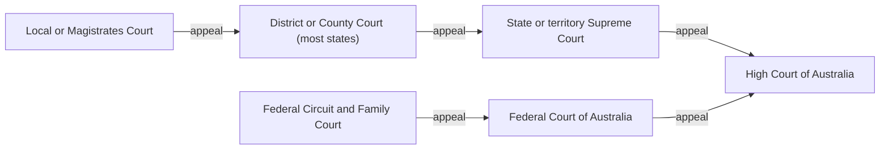

# Courts and a fair trial

Law and justice · Law and justice

<!-- Speaker note: Students learn Australia's court ladder (lower courts, higher courts, the High Court; state and federal) and what an appeal is, and the elements of a fair trial: an impartial judge, a jury in most serious criminal trials, witnesses, a lawyer for each side and due process. About 40 minutes (Predict and Try 8 min · Worked example 12 min · Vary 6 min · Practise 6 min · Make and exit 8 min. Typical and wider steps are extras and not counted in this.). Sources: Australian Court Hierarchy posters (Rule of Law Education Centre), https://www.ruleoflaw.org.au/wp-content/uploads/Australian-Court-Hierarchy.pdf (checked 1 November 2026); Australian Constitution, section 80 (Federal Register of Legislation), https://www.legislation.gov.au/C2004Q00685/latest/text (checked 1 November 2026). -->

---

## Today

**We are learning to** describe Australia's court hierarchy and explain the roles of the judge, jury, witnesses and lawyers in a fair trial.

- I can describe Australia's court ladder from a local court to the High Court.
- I can explain what an appeal is.
- I can explain who does what in a jury trial, and why it is fair.

<!-- Speaker note: Before class: The ladder in the diagram is the general shape. Tasmania, the ACT and the Northern Territory have no middle (District or County) court: cases go from the Magistrates Court (the Local Court in the NT) to the Supreme Court. Supreme Courts have their own appeal divisions (a Court of Appeal or Full Court), left out of the diagram. Federal Circuit and Family Court appeals can also go to that court's own appeal division. Tribunals are left out. Juries: most serious criminal trials have a jury of 12 chosen at random from the electoral roll. Some states and territories allow a judge-alone trial in some cases, and many allow majority verdicts in some cases; trials on indictment for Commonwealth offences must be by jury (Constitution s 80). Civil juries are rare. Student text says "in most serious criminal trials" and leaves the rest out. Jess, Morgan and Wattle Creek are made up. Morgan's trial carries over from the last lesson, so students already know the burden of proof. Teacher: Try: put the diagram up. Trace one made-up case up the ladder with your finger. Teacher: Worked example: ask 'Who decides guilty? Who decides the punishment?' before Nib's mistake. Teacher: Vary and Practise: the appeal to the Prime Minister is the most common slip. Link back to independent judges in lesson 1. -->

---

## Why it matters

> Why doesn't every case go straight to the High Court?

<!-- Speaker note: Australia has many courts, arranged like a ladder: - **Lower courts** (a local or Magistrates Court) hear most cases, such as minor crimes and smaller disputes. - **Higher courts** hear more serious cases, and **appeals**. An appeal is asking a higher court to check whether a lower court got the law or the decision wrong. - The **High Court of Australia** is at the top. It hears appeals from all the other courts, if it agrees to, and decides cases about the Constitution. States and territories have their own courts, and there are federal courts for federal laws. Both lead up to the High Court. In this lesson, Wattle Creek and its people are made up. The courts are real. -->

---

<span style="background:#dbeafe; color:#1a1a1a; border:1.5px solid #3b82f6; padding:6px 18px; border-radius:8px; font-size:1em; font-weight:500;">💬 Discussion</span>

## Think, pair, share

**Why does Australia have so many courts, instead of one?**

- What would happen if every case went to the High Court?
- Why might someone need a second court to check a decision?

<!-- Speaker note: Aim for seriousness (cases start at the level that fits) and appeals (mistakes can be checked). Give 30 seconds alone, 2 minutes in pairs, then take answers from both sides. There is no single right answer: ask for a reason, and let students change their minds. -->

---

<span style="background:#dbeafe; color:#1a1a1a; border:1.5px solid #3b82f6; padding:6px 18px; border-radius:8px; font-size:1em; font-weight:500;">💬 Discussion</span>

## Predict

**Jess, an adult in Wattle Creek, is charged with damaging a neighbour's letterbox. Which court is the case most likely to start in?**

- The state's Supreme Court
- Whichever court Jess chooses
- The High Court of Australia
- A local or Magistrates Court

<!-- Speaker note: What happens: A local or Magistrates Court. Lower courts hear most cases, including minor crimes like this one. Higher courts hear serious cases and appeals, and the High Court hears only a small number of cases it agrees to take. Take two or three predictions before anyone runs it. -->

<!-- Speaker note: Teacher: ask why the High Court doesn't hear every case. Expect 'it's too busy'; push for 'cases start at the level that fits'. -->

---

<span style="background:#dcfce7; color:#1a1a1a; border:1.5px solid #22c55e; padding:6px 18px; border-radius:8px; font-size:1em; font-weight:500;">✅ Check</span>

## What happened?

* A local or Magistrates Court. Lower courts hear most cases, including minor crimes like this one. Higher courts hear serious cases and appeals, and the High Court hears only a small number of cases it agrees to take.

<!-- Speaker note: Reveal after running. Ask who predicted it, and what made them think so. -->

---

<span style="background:#fef3c7; color:#1a1a1a; border:1.5px solid #f59e0b; padding:6px 18px; border-radius:8px; font-size:1em; font-weight:500;">✍️ Activity</span>

## Try it

Open the lesson at this step and try it together.

[tutorials.learningwaypoints.com/civics/law-7/courts-and-fair-trials/?full=step-2#step-2](https://tutorials.learningwaypoints.com/civics/law-7/courts-and-fair-trials/?full=step-2#step-2)

<!-- Speaker note:  -->

---

<span style="background:#fef3c7; color:#1a1a1a; border:1.5px solid #f59e0b; padding:6px 18px; border-radius:8px; font-size:1em; font-weight:500;">✍️ Activity</span>

## Trace a case up the ladder <span style="font-size:.6em;color:#64748b">(4 min)</span>

Put the court diagram up. Trace one made-up case from a local court to the High Court, naming each appeal.

<!-- Speaker note: Mention that Tasmania, the ACT and the NT skip the middle court. -->

---

## Australia's courts



<!-- Speaker note: State or territory courts go from a local or Magistrates Court, to a District or County Court in most states, to the Supreme Court. Federal courts are the Federal Circuit and Family Court and the Federal Court. Both lead up to the High Court of Australia. -->

---

<span style="background:#dcfce7; color:#1a1a1a; border:1.5px solid #22c55e; padding:6px 18px; border-radius:8px; font-size:1em; font-weight:500;">✅ Check</span>

## Who does what?

**Morgan's made-up trial (from the last lesson) is held in front of a jury. Match each person to their job.**

| | |
|---|---|
| `Judge` | A. Tells the court what they saw or know |
| `Jury` | B. Ordinary citizens who decide whether guilt is proved |
| `Witness` | C. Argues the case for the person charged |
| `Prosecution` | D. Brings the charge and has to prove it |
| `Defence lawyer` | E. Runs the trial fairly, explains the law, and sentences if guilty |

* Answer: Judge → E. Runs the trial fairly, explains the law, and sentences if guilty; Jury → B. Ordinary citizens who decide whether guilt is proved; Witness → A. Tells the court what they saw or know; Prosecution → D. Brings the charge and has to prove it; Defence lawyer → C. Argues the case for the person charged

<!-- Speaker note:  -->

<style scoped>pre, marp-pre { font-size: 0.5em; line-height: 1.25; } section { font-size: 16px; }</style>

---

<span style="background:#dcfce7; color:#1a1a1a; border:1.5px solid #22c55e; padding:6px 18px; border-radius:8px; font-size:1em; font-weight:500;">✅ Check</span>

## Find Nib's mistake

**Nib is explaining Morgan's trial. Click the first line where Nib goes wrong.**

```
 1  Morgan's trial is in front of a judge and a jury.
 2  Witnesses tell the court what they saw, and Morgan has a lawyer.
 3  Nib says: "The jury found Morgan guilty, so now the jury picks the punishment."
 4  Nib says: "The judge's only job was to keep everyone quiet."
```

* Answer: line 3

<!-- Speaker note: Line 3: the jury decides only whether guilt is proved. If the verdict is guilty, the judge decides the punishment (the sentence). -->

---

<span style="background:#fef3c7; color:#1a1a1a; border:1.5px solid #f59e0b; padding:6px 18px; border-radius:8px; font-size:1em; font-weight:500;">✍️ Activity</span>

## Mock courtroom roles <span style="font-size:.6em;color:#64748b">(5 min)</span>

Give five students a role card each: judge, juror, witness, prosecution, defence lawyer. Each says their job in one sentence. The class corrects any mix-ups.

<!-- Speaker note: Listen for the jury picking the sentence. That is Nib's mistake. -->

---

<span style="background:#dcfce7; color:#1a1a1a; border:1.5px solid #22c55e; padding:6px 18px; border-radius:8px; font-size:1em; font-weight:500;">✅ Check</span>

## Judge or jury?

**In a jury trial, who decides the sentence if the person is found guilty?**

- The judge
- The jury
- The prosecution
- The witnesses

* Answer: The judge

<!-- Speaker note: The jury decides guilty or not guilty. The judge decides the sentence. Ask on mini whiteboards or by show of hands before the reveal. -->

---

<span style="background:#fef3c7; color:#1a1a1a; border:1.5px solid #f59e0b; padding:6px 18px; border-radius:8px; font-size:1em; font-weight:500;">✍️ Activity</span>

## Vary: which court?


<!-- Speaker note: What this step is for: Placing made-up cases on the ladder checks that students match a case to its level and know what an appeal is. For students who need more support: Draw three rungs on the board: lower court, higher court, High Court. Place each made-up case on a rung together. For early finishers: Why might it be fairer for twelve citizens, rather than one judge, to decide whether someone is guilty? Is there any downside? The hard part, on purpose: Students mix up the jury's job and the judge's. Separate them firmly: the jury decides the facts (guilty or not), the judge decides the law and the sentence. When students get stuck: A student says the jury chooses the punishment. Ask: What does the jury say at the end of a trial? Fix: The jury says guilty or not guilty. If guilty, the judge decides the sentence. / A student says you appeal to the Prime Minister. Ask: Can the government tell a court what to decide? Fix: An appeal goes to a higher court. Courts are independent of the government. -->

---

<span style="background:#dcfce7; color:#1a1a1a; border:1.5px solid #22c55e; padding:6px 18px; border-radius:8px; font-size:1em; font-weight:500;">✅ Check</span>

## What can Jess do?

**Jess is found guilty in the local court and thinks the magistrate got the law wrong. What can Jess do?**

- Take the case straight to the High Court
- Ask the jury to meet again and vote again
- Appeal to a higher court to check the decision
- Ask the Prime Minister to change the verdict

* Answer: Appeal to a higher court to check the decision

<!-- Speaker note: An appeal asks a higher court to check whether a lower court got the law or the decision wrong. -->

---

<span style="background:#dcfce7; color:#1a1a1a; border:1.5px solid #22c55e; padding:6px 18px; border-radius:8px; font-size:1em; font-weight:500;">✅ Check</span>

## Why a jury?

**Why are ordinary citizens asked to be jurors in serious criminal trials?**

- So the judge doesn't have to explain the law to anyone
- So the government can pick who decides each case
- So jurors can choose the punishment they think is fair
- So people from the community decide whether guilt is proved

* Answer: So people from the community decide whether guilt is proved

<!-- Speaker note: A jury means the community, not the government or one judge alone, decides whether guilt has been proved. -->

<style scoped>pre, marp-pre { font-size: 0.5em; line-height: 1.25; } section { font-size: 27px; }</style>

---

<span style="background:#fef3c7; color:#1a1a1a; border:1.5px solid #f59e0b; padding:6px 18px; border-radius:8px; font-size:1em; font-weight:500;">✍️ Activity</span>

## Make: the ladder and a fair trial

Draw it in your own book or document, not on this page. Your partner or teacher reads it.

<!-- Speaker note: What this step is for: Drawing the ladder and adding a fair-trial idea at each step joins the two halves of the lesson. -->

<!-- Speaker note: Teacher: the student draws in their own book or document; a partner or teacher reads it. The site only records a reflect tick. -->

---

<span style="background:#dcfce7; color:#1a1a1a; border:1.5px solid #22c55e; padding:6px 18px; border-radius:8px; font-size:1em; font-weight:500;">✅ Check</span>

## Check a partner's ladder <span style="font-size:.6em;color:#64748b">(4 min)</span>

Partners check the ladder against the diagram and the fair-trial note.

<!-- Speaker note: Students write elsewhere; the site does not take or mark writing. -->

---

<span style="background:#fef3c7; color:#1a1a1a; border:1.5px solid #f59e0b; padding:6px 18px; border-radius:8px; font-size:1em; font-weight:500;">✍️ Activity</span>

## Make: Typical: why random jurors?


<!-- Speaker note: What this step is for: Asking why jurors are chosen at random links the jury to fairness and independence. -->

---

<span style="background:#fef3c7; color:#1a1a1a; border:1.5px solid #f59e0b; padding:6px 18px; border-radius:8px; font-size:1em; font-weight:500;">✍️ Activity</span>

## Make: Wider: two sets of courts

Typical and wider steps are extras on the same idea. You do not need them to finish the lesson.

<!-- Speaker note: What this step is for: Sorting state and federal courts shows the two sets of courts that both lead to the High Court. -->

---

<span style="background:#dcfce7; color:#1a1a1a; border:1.5px solid #22c55e; padding:6px 18px; border-radius:8px; font-size:1em; font-weight:500;">✅ Check</span>

## Exit ticket

**What is an appeal, and who decides the verdict and the sentence in a jury trial?**

* An appeal asks a higher court to check a lower court's decision. The jury decides guilty or not guilty; the judge decides the sentence.

<!-- Speaker note: Students answer on paper or a mini whiteboard before the reveal. Anyone who cannot answer needs the main idea again next lesson. Where this leads: Next in this course: Fair courts and democracy. ACARA elaboration for AC9HC7K03 (an example, not a checklist): "discussing the elements of a 'fair trial', including citizens' roles as witnesses and jurors, legal representation and due process" -->
