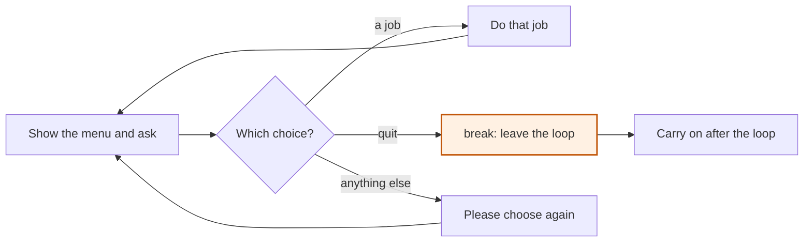

# A menu that keeps showing

Console bridge: text in, text out · Menus and testing

<!-- Speaker note: Students build a menu with while True, choose with if and elif, and leave with break. About 35 minutes (Predict and Run 9 min · Investigate 9 min · Modify 5 min · Mix it up 3 min · Make 9 min). The Run, Modify and Make slides have the live playground in them; the tutorial link under it is the backup. -->

---

## Today

- I can use while True with break to make a menu that keeps showing.
- I can add a choice to a menu with elif.
- I can build my own small menu app.

---

## Why it matters

> An ATM shows you the choices, waits, does what you picked, then shows you the choices again.

<!-- Speaker note: A `while` loop stops when its condition turns false. A menu has no such moment: it should keep showing until the person says **stop**. So it loops for ever and leaves from the inside, with `break`. -->

---

<span style="background:#dbeafe; color:#1a1a1a; border:1.5px solid #3b82f6; padding:6px 18px; border-radius:8px; font-size:1em; font-weight:500;">💬 Discussion</span>

## Predict

```python
total = 0
while True:
    choice = input("1 add $5, 2 pay: ")
    if choice == "1":
        total += 5
        print("Total: $" + str(total))
    elif choice == "2":
        print("Pay $" + str(total))
        break
    else:
        print("Please choose 1 or 2.")
print("Thank you")
```

**You type 1, 1, 3, then 2. What does the program show?**

- Total: $5, Total: $10, Please choose 1 or 2., Pay $10, Thank you
- Total: $5, Total: $10, Please choose 1 or 2., and then the program stops
- It never stops, even after 2
- Total: $5, Total: $10, Please choose 1 or 2., Pay $10, and then it asks again

<!-- Speaker note: What happens: Total: $5, Total: $10, Please choose 1 or 2., Pay $10, Thank you. break leaves the whole loop at once, not just the if, so the program carries on after the loop and ends. Take two or three predictions before anyone runs it. -->

<!-- Speaker note: Teacher: take a vote. The wrong options are three real beliefs: break only leaves the if, a wrong choice ends the program, and nothing ends it. -->

<style scoped>pre, marp-pre { font-size: 0.5em; line-height: 1.25; } section { font-size: 19px; }</style>

---

<span style="background:#fef3c7; color:#1a1a1a; border:1.5px solid #f59e0b; padding:6px 18px; border-radius:8px; font-size:1em; font-weight:500;">✍️ Activity</span>

## Run it

{{embed: https://tutorials.learningwaypoints.com/_playground/index.html?code=total+%3D+0%0Awhile+True%3A%0A++++choice+%3D+input%28%221+add+%245%2C+2+pay%3A+%22%29%0A++++if+choice+%3D%3D+%221%22%3A%0A++++++++total+%2B%3D+5%0A++++++++print%28%22Total%3A+%24%22+%2B+str%28total%29%29%0A++++elif+choice+%3D%3D+%222%22%3A%0A++++++++print%28%22Pay+%24%22+%2B+str%28total%29%29%0A++++++++break%0A++++else%3A%0A++++++++print%28%22Please+choose+1+or+2.%22%29%0Aprint%28%22Thank+you%22%29%0A}}

_If it does not load:_ [open this step in the tutorial](https://tutorials.learningwaypoints.com/code/console/console-menu/?full=step-2#step-2)

<!-- Speaker note: Run it. Add a few items, try a wrong choice, then pay. | Line | What it does | Why | |---|---|---| | `while True:` | A loop whose condition is never false | The menu keeps showing until something inside ends it | | `choice = input(...)` | Shows the menu and waits | Asked again on every pass | | `if` / `elif` / `else` | Picks what to do for each choice | The `else` catches anything else, so a wrong choice gets a reply | | `break` | Leaves the loop straight away | The program carries on with the first line after the loop | -->

<!-- Speaker note: Teacher: students try all the choices, including a wrong one. Ask which line stopped the loop. -->

<style scoped>pre, marp-pre { font-size: 0.5em; line-height: 1.25; } section { font-size: 25px; }</style>

---

<span style="background:#dcfce7; color:#1a1a1a; border:1.5px solid #22c55e; padding:6px 18px; border-radius:8px; font-size:1em; font-weight:500;">✅ Check</span>

## What happened?

* Total: $5, Total: $10, Please choose 1 or 2., Pay $10, Thank you. break leaves the whole loop at once, not just the if, so the program carries on after the loop and ends.

<!-- Speaker note: Reveal after running. Ask who predicted it, and what made them think so. -->

---

<span style="background:#dbeafe; color:#1a1a1a; border:1.5px solid #3b82f6; padding:6px 18px; border-radius:8px; font-size:1em; font-weight:500;">💬 Discussion</span>

## Investigate

```python
total = 0
while True:
    choice = input("1 add $5, 2 pay: ")
    if choice == "1":
        total += 5
        print("Total: $" + str(total))
    elif choice == "2":
        print("Pay $" + str(total))
        break
    else:
        print("Please choose 1 or 2.")
print("Thank you")
```

<!-- Speaker note: What this step is for: A menu is a loop that ends only when you choose to end it. Every way out must be a break. -->

<!-- Speaker note: Teacher: the bug has no break line at all, so the loop cannot end. Ask what ends a while True. -->

<style scoped>pre, marp-pre { font-size: 0.85em; line-height: 1.25; }</style>

---

<span style="background:#dcfce7; color:#1a1a1a; border:1.5px solid #22c55e; padding:6px 18px; border-radius:8px; font-size:1em; font-weight:500;">✅ Check</span>

## Follow a session

<div class="side" style="display:grid;grid-template-columns:1fr 1fr;gap:1em">
<div>

```python
total = 0
while True:
    choice = input("1 add $5, 2 pay: ")
    if choice == "1":
        total += 5
        print("Total: $" + str(total))
    elif choice == "2":
        print("Pay $" + str(total))
        break
    else:
        print("Please choose 1 or 2.")
print("Thank you")
```

</div>
<div>

**You type 1, 1, 3, 2. Fill in the total after each choice and whether the loop goes round again.**

| choice | total after | loop goes round again |
|---|---|---|
| 1 | 5 | yes |
| 1 | ? | ? |
| 3 | ? | ? |
| 2 | ? | ? |

* Answer: 10, yes, 10, yes, 10, no

</div>
</div>

<!-- Speaker note: A wrong choice (3) changes nothing, and the menu shows again. Only 2 runs break. -->

<style scoped>section { font-size: 21px; }</style>

---

<span style="background:#dcfce7; color:#1a1a1a; border:1.5px solid #22c55e; padding:6px 18px; border-radius:8px; font-size:1em; font-weight:500;">✅ Check</span>

## Spot the bug

**Choosing 2 shows Pay $10, but then the menu comes back and the program never ends. Click the line where something is missing.**

```
 1  total = 0
 2  while True:
 3      choice = input("1 add $5, 2 pay: ")
 4      if choice == "1":
 5          total += 5
 6      elif choice == "2":
 7          print("Pay $" + str(total))
 8      else:
 9          print("Please choose 1 or 2.")
10  print("Thank you")
```

* Answer: line 7

<!-- Speaker note: Nothing ever runs break, so while True never ends. The pay branch needs a break line after the print. -->

<style scoped>pre, marp-pre { font-size: 0.58em; line-height: 1.25; }</style>

---

<span style="background:#dcfce7; color:#1a1a1a; border:1.5px solid #22c55e; padding:6px 18px; border-radius:8px; font-size:1em; font-weight:500;">✅ Check</span>

## What does break do?

<div class="side" style="display:grid;grid-template-columns:1fr 1fr;gap:1em">
<div>

```python
total = 0
while True:
    choice = input("1 add $5, 2 pay: ")
    if choice == "1":
        total += 5
        print("Total: $" + str(total))
    elif choice == "2":
        print("Pay $" + str(total))
        break
    else:
        print("Please choose 1 or 2.")
print("Thank you")
```

</div>
<div>

**What does break do when it runs inside an if inside a while True?**

- Stops the program
- Leaves only the if
- Skips to the next pass
- Leaves the whole loop at once

* Answer: Leaves the whole loop at once

</div>
</div>

<!-- Speaker note: break ends the loop it is in. The program continues with the first line after the loop. -->

<style scoped>section { font-size: 26px; }</style>

---

<span style="background:#fef3c7; color:#1a1a1a; border:1.5px solid #f59e0b; padding:6px 18px; border-radius:8px; font-size:1em; font-weight:500;">✍️ Activity</span>

## Modify

Add a drink for $2 as choice 3. Paying becomes choice 4. Update the menu text too.

<!-- Speaker note: What this step is for: Adding a choice is one more elif; the loop and the way out stay as they are. Hints, in order: Add an elif for a new choice before the pay choice, and change the menu text. / Pay becomes choice 4, so change the pay elif too. For students who need more support: Give the menu with the choices as comments and ask the student to fill in each branch. For early finishers: Add a choice that clears the total and starts the order again. The hard part, on purpose: Forgetting a way out. Ask what makes a while True stop. When students get stuck: The program never ends. Ask: Which line makes the loop stop? Fix: One branch needs a break line, indented inside the loop. / A wrong choice makes the program do something odd. Ask: What does the program do when none of the choices match? Fix: Add an else with a message, such as Please choose 1, 2 or 3. -->

---

<span style="background:#fef3c7; color:#1a1a1a; border:1.5px solid #f59e0b; padding:6px 18px; border-radius:8px; font-size:1em; font-weight:500;">✍️ Activity</span>

## Live: Modify

{{embed: https://tutorials.learningwaypoints.com/_playground/index.html?code=total+%3D+0%0Awhile+True%3A%0A++++choice+%3D+input%28%221+add+%245%2C+2+pay%3A+%22%29%0A++++if+choice+%3D%3D+%221%22%3A%0A++++++++total+%2B%3D+5%0A++++++++print%28%22Total%3A+%24%22+%2B+str%28total%29%29%0A++++elif+choice+%3D%3D+%222%22%3A%0A++++++++print%28%22Pay+%24%22+%2B+str%28total%29%29%0A++++++++break%0A++++else%3A%0A++++++++print%28%22Please+choose+1+or+2.%22%29%0Aprint%28%22Thank+you%22%29%0A}}

_If it does not load:_ [open this step in the tutorial](https://tutorials.learningwaypoints.com/code/console/console-menu/?full=step-4#step-4)

<!-- Speaker note: Work the first task live, or let students start on their own screens and walk round. -->

<style scoped>pre, marp-pre { font-size: 0.5em; line-height: 1.25; } section { font-size: 25px; }</style>

---

<span style="background:#dbeafe; color:#1a1a1a; border:1.5px solid #3b82f6; padding:6px 18px; border-radius:8px; font-size:1em; font-weight:500;">💬 Discussion</span>

## Investigate: Mix it up

```python
total = 0
while True:
    choice = input("1 add $5, 2 pay: ")
    if choice == "1":
        total += 5
        print("Total: $" + str(total))
    elif choice == "2":
        print("Pay $" + str(total))
        break
    else:
        print("Please choose 1 or 2.")
print("Thank you")
```

<!-- Speaker note: Here the loop goes round again and stores a new answer every time. Follow it pass by pass. What this step is for: Ask, test, add, repeat: each pass of the menu uses every move so far. -->

<style scoped>pre, marp-pre { font-size: 0.85em; line-height: 1.25; }</style>

---

<span style="background:#dcfce7; color:#1a1a1a; border:1.5px solid #22c55e; padding:6px 18px; border-radius:8px; font-size:1em; font-weight:500;">✅ Check</span>

## Mix it up

<div class="side" style="display:grid;grid-template-columns:1fr 1fr;gap:1em">
<div>

```python
total = 0
while True:
    choice = input("1 add $5, 2 pay: ")
    if choice == "1":
        total += 5
        print("Total: $" + str(total))
    elif choice == "2":
        print("Pay $" + str(total))
        break
    else:
        print("Please choose 1 or 2.")
print("Thank you")
```

</div>
<div>

**You type 3, 3, 2. How many times does the menu question appear?**

* Answer: 3

</div>
</div>

<!-- Speaker note: Each pass asks once. 3 and 3 are wrong choices that go round again, and 2 asks a third time before it breaks. What this step is for: Ask, test, add, repeat: each pass of the menu uses every move so far. -->

<style scoped>section { font-size: 26px; }</style>

---

## The shape of every menu app



<!-- Speaker note: A flowchart of a menu app. Show the menu and ask. Then: which choice? A job choice does that job and goes back to the menu. Quit runs break, which leaves the loop, and the program carries on after it. Anything else says please choose again and goes back to the menu. -->

---

<span style="background:#fef3c7; color:#1a1a1a; border:1.5px solid #f59e0b; padding:6px 18px; border-radius:8px; font-size:1em; font-weight:500;">✍️ Activity</span>

## Make

Make your own menu app: a café, a game shop, a quiz scoreboard or a unit converter. It needs `while True`, at least three choices, a reply for a wrong choice, and a way to quit.

<!-- Speaker note: Hints, in order: A menu starts with while True: and an input line inside it. / Use if / elif for each choice and else for anything else. One choice runs break. -->

<!-- Speaker note: Teacher: students choose their theme. Check each program has an else for a wrong choice. -->

---

<span style="background:#fef3c7; color:#1a1a1a; border:1.5px solid #f59e0b; padding:6px 18px; border-radius:8px; font-size:1em; font-weight:500;">✍️ Activity</span>

## Live: Make

{{embed: https://tutorials.learningwaypoints.com/_playground/index.html?code=%23+Menu+app%3A+while+True%2C+at+least+three+choices%2C+a+reply+for+a+wrong+choice%2C+and+a+way+to+quit.%0A}}

_If it does not load:_ [open this step in the tutorial](https://tutorials.learningwaypoints.com/code/console/console-menu/?full=step-6#step-6)

<!-- Speaker note: Work the first task live, or let students start on their own screens and walk round. -->

<style scoped>pre, marp-pre { font-size: 0.5em; line-height: 1.25; } section { font-size: 25px; }</style>

---

<span style="background:#fef3c7; color:#1a1a1a; border:1.5px solid #f59e0b; padding:6px 18px; border-radius:8px; font-size:1em; font-weight:500;">✍️ Activity</span>

## Order from my menu <span style="font-size:.6em;color:#64748b">(4 min)</span>

Swap seats and use your partner's menu app. Try every choice and a wrong one.

---

<span style="background:#dcfce7; color:#1a1a1a; border:1.5px solid #22c55e; padding:6px 18px; border-radius:8px; font-size:1em; font-weight:500;">✅ Check</span>

## Exit ticket

**What does break do, and what happens to the program after it?**

* break leaves the loop at once. The program carries on with the first line after the loop.

<!-- Speaker note: Students answer on paper or a mini whiteboard before the reveal. Anyone who cannot answer needs the main idea again next lesson. Where this leads: Next lesson: how to test a menu without typing the same choices over and over. -->
