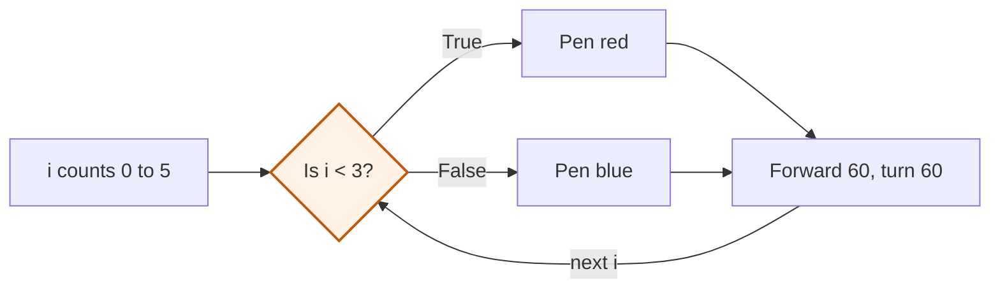

# If and else

Python Foundations with Turtle · Choices and lists

<!-- Speaker note: Students make a program choose between two paths with if and else, reading a condition that is true or false. About 35 minutes (Predict and Run 10 min · Investigate 10 min · Modify 5 min · Mix it up 3 min · Make 7 min). The Run, Modify and Make slides have the live playground in them; the tutorial link under it is the backup. -->

---

## Today

**We are learning to** make a program choose which lines to run, using if and else.

- I can write an if / else that chooses between two actions.
- I can work out whether a condition is true for a given value.
- I can say that only one of the two paths runs on each pass.

<!-- Speaker note: Before class: Run the red and blue hexagon, then change `i < 3` to `i < 4`. Notice that only the number in the condition changed. `<` means "less than". Teacher: Mix it up: students work the number out on paper. It joins a growing value to a decision, so the condition reads size, not i. -->

---

## Why it matters

> Traffic lights, game scores, login screens and thermostats all do the same thing: check a condition and pick what happens next.

<!-- Speaker note: So far every line of your program has run, every time. Now the program will **choose**: run some lines if something is true, and other lines if it is not. -->

---

## By the end of this lesson

Here is the finished program running. By the end of the lesson you will write one like it.

<!-- Speaker note: Run the finished example on the projector before anything else. -->

---

## The same program as a flowchart



<!-- Speaker note: A flowchart of the loop. i counts 0 to 5. Each time, the check asks: is i less than 3? If True, the pen turns red. If False, the pen turns blue. Either way the turtle goes forward 60 and turns 60, then the next i comes back to the check. -->

---

<span style="background:#dbeafe; color:#1a1a1a; border:1.5px solid #3b82f6; padding:6px 18px; border-radius:8px; font-size:1em; font-weight:500;">💬 Discussion</span>

## Predict

```python
from turtle import *

pensize(6)
for i in range(6):
    if i < 3:
        pencolor("red")
    else:
        pencolor("blue")
    forward(60)
    right(60)
```

**What will the turtle draw?**

- A hexagon with the sides taking turns, red then blue
- A hexagon: three red sides, then three blue
- A hexagon with every side red, then every side blue (twelve lines)
- A blue hexagon, because else runs last and covers the red

<!-- Speaker note: What happens: Three red sides, then three blue. On each pass the program asks one question, i &lt; 3, and runs only one of the two paths. i is 0, 1, 2 for the first three passes (red) and 3, 4, 5 for the last three (blue). Take two or three predictions before anyone runs it. -->

<!-- Speaker note: Teacher: show the loop and take a vote before anyone runs it. The wrong options are three slips: both paths run on every pass, the sides take turns, and the else covers everything. -->

<style scoped>pre, marp-pre { font-size: 0.5em; line-height: 1.25; } section { font-size: 23px; }</style>

---

<span style="background:#fef3c7; color:#1a1a1a; border:1.5px solid #f59e0b; padding:6px 18px; border-radius:8px; font-size:1em; font-weight:500;">✍️ Activity</span>

## Run it

{{embed: https://tutorials.learningwaypoints.com/_playground/index.html?code=from+turtle+import+*%0A%0Apensize%286%29%0Afor+i+in+range%286%29%3A%0A++++if+i+%3C+3%3A%0A++++++++pencolor%28%22red%22%29%0A++++else%3A%0A++++++++pencolor%28%22blue%22%29%0A++++forward%2860%29%0A++++right%2860%29%0A}}

_If it does not load:_ [open this step in the tutorial](https://tutorials.learningwaypoints.com/code/python-foundations/turtle-decisions/?full=step-2#step-2)

<!-- Speaker note: Run it and compare it with your prediction. | Line | What it does | Why | |---|---|---| | `if i < 3:` | Asks: is `i` less than 3? | The answer is `True` or `False` | | ` pencolor("red")` | Runs only when the answer is `True` | It is indented under the `if` | | `else:` | Means "otherwise" | Its lines run only when the answer is `False` | | ` pencolor("blue")` | Runs only when the answer is `False` | Only one of the two paths runs on each pass | -->

<!-- Speaker note: Teacher: run it live, then students run it. Read the if line aloud as a question: is i less than 3? Yes runs the lines under if; no runs the lines under else. -->

<style scoped>pre, marp-pre { font-size: 0.5em; line-height: 1.25; } section { font-size: 25px; }</style>

---

<span style="background:#dcfce7; color:#1a1a1a; border:1.5px solid #22c55e; padding:6px 18px; border-radius:8px; font-size:1em; font-weight:500;">✅ Check</span>

## What happened?

* Three red sides, then three blue. On each pass the program asks one question, i &lt; 3, and runs only one of the two paths. i is 0, 1, 2 for the first three passes (red) and 3, 4, 5 for the last three (blue).

<!-- Speaker note: Reveal after running. Ask who predicted it, and what made them think so. -->

---

<span style="background:#dbeafe; color:#1a1a1a; border:1.5px solid #3b82f6; padding:6px 18px; border-radius:8px; font-size:1em; font-weight:500;">💬 Discussion</span>

## Investigate

```python
from turtle import *

pensize(6)
for i in range(6):
    if i < 3:
        pencolor("red")
    else:
        pencolor("blue")
    forward(60)
    right(60)
```

<!-- Speaker note: What this step is for: A decision is a condition plus two paths. You can follow it by working out the condition for each value, and find a bug by checking the form of the condition. -->

<!-- Speaker note: Teacher: students fill in the trace table before running anything. The bug task is the classic slip: = stores, == asks. The last question shows that a condition works out to True or False, like a sum works out to a number. -->

---

<span style="background:#dcfce7; color:#1a1a1a; border:1.5px solid #22c55e; padding:6px 18px; border-radius:8px; font-size:1em; font-weight:500;">✅ Check</span>

## Trace the passes

<div class="side" style="display:grid;grid-template-columns:1fr 1fr;gap:1em">
<div>

```python
from turtle import *

pensize(6)
for i in range(6):
    if i < 3:
        pencolor("red")
    else:
        pencolor("blue")
    forward(60)
    right(60)
```

</div>
<div>

**Fill in the gaps for each pass: is i &lt; 3, and which colour does the program pick?**

| i | i < 3 | colour |
|---|---|---|
| 0 | True | red |
| 2 | ? | ? |
| 3 | ? | ? |
| 5 | ? | ? |

* Answer: True, red, False, blue, False, blue

</div>
</div>

<!-- Speaker note: The condition is true for 0, 1 and 2, so the if path runs and the pen is red. From 3 on it is false, so the else path runs and the pen is blue. -->

<style scoped>section { font-size: 21px; }</style>

---

<span style="background:#dcfce7; color:#1a1a1a; border:1.5px solid #22c55e; padding:6px 18px; border-radius:8px; font-size:1em; font-weight:500;">✅ Check</span>

## Spot the bug

**This should colour only the fourth side red, but the program will not even start. Click the wrong line.**

```
 1  from turtle import *
 2  
 3  pensize(6)
 4  for i in range(6):
 5      if i = 3:
 6          pencolor("red")
 7      else:
 8          pencolor("blue")
 9      forward(60)
10      right(60)
```

* Answer: line 5

<!-- Speaker note: A single = stores a value. To ask whether two things are equal, the condition needs two: i == 3. -->

<style scoped>pre, marp-pre { font-size: 0.58em; line-height: 1.25; }</style>

---

<span style="background:#dcfce7; color:#1a1a1a; border:1.5px solid #22c55e; padding:6px 18px; border-radius:8px; font-size:1em; font-weight:500;">✅ Check</span>

## True or false

<div class="side" style="display:grid;grid-template-columns:1fr 1fr;gap:1em">
<div>

```python
from turtle import *

pensize(6)
for i in range(6):
    if i < 3:
        pencolor("red")
    else:
        pencolor("blue")
    forward(60)
    right(60)
```

</div>
<div>

**A condition works out to a value, like a sum does. What does 5 &lt; 3 work out to?**

- 5
- 3
- False
- True

* Answer: False

</div>
</div>

<!-- Speaker note: 5 < 3 is a question, and the answer is False. Every condition works out to True or False, and if runs its lines only when it is True. -->

<style scoped>section { font-size: 27px; }</style>

---

<span style="background:#fef3c7; color:#1a1a1a; border:1.5px solid #f59e0b; padding:6px 18px; border-radius:8px; font-size:1em; font-weight:500;">✍️ Activity</span>

## Be the condition <span style="font-size:.6em;color:#64748b">(5 min)</span>

Students stand when the condition is true for their pass number. i < 3: who stands? Then change the number.

<!-- Speaker note: Make the idea physical before it goes back to the screen. -->

---

<span style="background:#fef3c7; color:#1a1a1a; border:1.5px solid #f59e0b; padding:6px 18px; border-radius:8px; font-size:1em; font-weight:500;">✍️ Activity</span>

## Modify

Change the condition so **four** sides are red and two are blue. Run it to check.

<!-- Speaker note: What this step is for: Changing a condition changes which passes take which path, and nothing else in the program. Hints, in order: Which number sets where the red stops and the blue starts? / i is 0, 1, 2, 3 for four passes. Which test is true for exactly those? For students who need more support: Give the trace table with the first two rows done and ask the student to say each condition aloud before filling in the colour. For early finishers: Colour the first half of the lines red and the second half blue without typing the number 6 anywhere in the condition. The hard part, on purpose: Writing a condition: the comparison sign, the colon, and the idea that only one path runs. Ask them to work out the condition for i = 0, 1, 2 before running. When students get stuck: A SyntaxError on the if line. Ask: Does the condition ask a question (==, <) or store a value (=)? Is there a colon at the end? Fix: Use == or < to compare, and end the line with a colon: if i < 3: / Every side is the same colour. Ask: Is the if / else inside the loop, so it is asked again every pass? Fix: Indent the if / else under the for line so it runs once per pass. / The spiral is all red or all blue. Ask: What is size on the first pass and on the last? Is the cut-off between them? Fix: The cut-off must be a number size passes through, for example 60. -->

<!-- Speaker note: Teacher: one number changes. Ask: which passes are true now? -->

---

<span style="background:#fef3c7; color:#1a1a1a; border:1.5px solid #f59e0b; padding:6px 18px; border-radius:8px; font-size:1em; font-weight:500;">✍️ Activity</span>

## Live: Modify

{{embed: https://tutorials.learningwaypoints.com/_playground/index.html?code=from+turtle+import+*%0A%0Apensize%286%29%0Afor+i+in+range%286%29%3A%0A++++if+i+%3C+3%3A%0A++++++++pencolor%28%22red%22%29%0A++++else%3A%0A++++++++pencolor%28%22blue%22%29%0A++++forward%2860%29%0A++++right%2860%29%0A%0A%23+Change+the+number+so+4+sides+are+red+and+2+are+blue.%0A}}

_If it does not load:_ [open this step in the tutorial](https://tutorials.learningwaypoints.com/code/python-foundations/turtle-decisions/?full=step-4#step-4)

<!-- Speaker note: Work the first task live, or let students start on their own screens and walk round. -->

<style scoped>pre, marp-pre { font-size: 0.5em; line-height: 1.25; } section { font-size: 25px; }</style>

---

<span style="background:#dbeafe; color:#1a1a1a; border:1.5px solid #3b82f6; padding:6px 18px; border-radius:8px; font-size:1em; font-weight:500;">💬 Discussion</span>

## Investigate: Mix it up

```python
from turtle import *

size = 10
pensize(5)
for i in range(12):
    # Choose the colour here: red while size is small, blue once it is big.
    forward(size)
    right(90)
    size = size + 10
```

<!-- Speaker note: This mixes two lessons: a value that grows, and a decision that reads it. Work it out on paper first. What this step is for: A decision can use any name, not only the counter. Follow the value that the condition reads. -->

---

<span style="background:#dcfce7; color:#1a1a1a; border:1.5px solid #22c55e; padding:6px 18px; border-radius:8px; font-size:1em; font-weight:500;">✅ Check</span>

## Mix it up

<div class="side" style="display:grid;grid-template-columns:1fr 1fr;gap:1em">
<div>

```python
from turtle import *

size = 10
pensize(5)
for i in range(12):
    # Choose the colour here: red while size is small, blue once it is big.
    forward(size)
    right(90)
    size = size + 10
```

</div>
<div>

**size starts at 10 and grows by 20 every pass. A line is red while size &lt; 50, otherwise blue. How many of the first six lines are red?**

* Answer: 2

</div>
</div>

<!-- Speaker note: size is 10, 30, 50, 70, 90, 110. Only 10 and 30 are less than 50, so two lines are red. What this step is for: A decision can use any name, not only the counter. Follow the value that the condition reads. -->

---

<span style="background:#fef3c7; color:#1a1a1a; border:1.5px solid #f59e0b; padding:6px 18px; border-radius:8px; font-size:1em; font-weight:500;">✍️ Activity</span>

## Make

The spiral grows by 10 every pass. Make it **red while the lines are short and blue once they are long**. Then try a different cut-off, or a third colour of your own once you have seen `elif` next lesson.

<!-- Speaker note: Hints, in order: Put an if / else at the top of the loop, before the forward line. / The condition reads size: if size < 60, the pen is red; else it is blue. -->

<!-- Speaker note: Teacher: the colour depends on the line length. Check that the if / else is inside the loop, so it is asked again on every pass. -->

---

<span style="background:#fef3c7; color:#1a1a1a; border:1.5px solid #f59e0b; padding:6px 18px; border-radius:8px; font-size:1em; font-weight:500;">✍️ Activity</span>

## Live: Make

{{embed: https://tutorials.learningwaypoints.com/_playground/index.html?code=from+turtle+import+*%0A%0Asize+%3D+10%0Apensize%285%29%0Afor+i+in+range%2812%29%3A%0A++++%23+Choose+the+colour+here%3A+red+while+size+is+small%2C+blue+once+it+is+big.%0A++++forward%28size%29%0A++++right%2890%29%0A++++size+%3D+size+%2B+10%0A}}

_If it does not load:_ [open this step in the tutorial](https://tutorials.learningwaypoints.com/code/python-foundations/turtle-decisions/?full=step-6#step-6)

<!-- Speaker note: Work the first task live, or let students start on their own screens and walk round. -->

<style scoped>pre, marp-pre { font-size: 0.5em; line-height: 1.25; } section { font-size: 25px; }</style>

---

<span style="background:#dcfce7; color:#1a1a1a; border:1.5px solid #22c55e; padding:6px 18px; border-radius:8px; font-size:1em; font-weight:500;">✅ Check</span>

## Exit ticket

**A loop colours pass i red if i &lt; 2, else blue. For range(5), how many passes are blue?**

* Three. The red passes are i = 0 and 1, so 2, 3 and 4 are blue.

<!-- Speaker note: Students answer on paper or a mini whiteboard before the reveal. Anyone who cannot answer needs the main idea again next lesson. Where this leads: Next lesson uses the remainder, %, to make a pattern that repeats every second or third pass, and adds a third choice with elif. Decisions return later inside functions and in the game's hit test. -->
