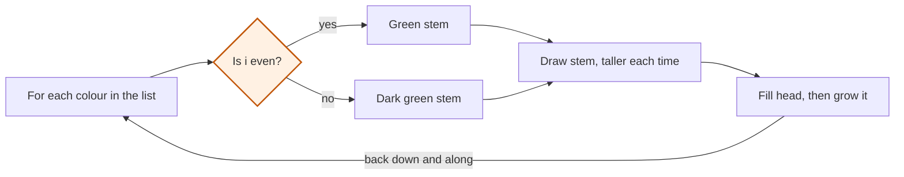

# Read a program

Python functions and events · Start from a working program

<!-- Speaker note: Students read a longer program that combines the counter, a list, an update and a decision, find the lines that do each job, and change one part without breaking the rest. About 35 minutes (Predict and Run 10 min · Investigate 12 min · Modify 13 min). The Run, Modify and Make slides have the live playground in them; the tutorial link under it is the backup. -->

---

## Today

- I can find the lines that do one job in a longer program.
- I can say what a part depends on before I change it.
- I can change one part and keep the rest working.

<!-- Speaker note: Before class: Run the garden, then do the Modify tasks yourself. The program is a loop with a long body: that length is what the next lesson fixes. -->

---

## Why it matters

> Programmers read far more code than they write. The first skill is finding the part that does the job you want to change.

<!-- Speaker note: This program is longer than any you have met, but it uses only things you know. The skill now is **reading**: finding which lines do which job. -->

---

## By the end of this lesson

Here is the finished program running. By the end of the lesson you will write one like it.

<!-- Speaker note: Run the finished example on the projector before anything else. -->

---

<span style="background:#dbeafe; color:#1a1a1a; border:1.5px solid #3b82f6; padding:6px 18px; border-radius:8px; font-size:1em; font-weight:500;">💬 Discussion</span>

## Predict

_The program is 35 lines long: open it in the tutorial and read it together._

[Open this step](https://tutorials.learningwaypoints.com/code/python-functions/turtle-read/?full=step-1#step-1)

**stem is 50. How tall is the third stem (when i is 2)?**

<!-- Speaker note: What happens: 70. The stem is stem + i * 10, which is 50 + 2 * 10 = 70. Each stem is 10 taller than the one before. Take two or three predictions before anyone runs it. -->

<!-- Speaker note: Teacher: read the code with the class, one comment at a time. The stem line uses the counter; ask what i is on the third pass. -->

---

<span style="background:#fef3c7; color:#1a1a1a; border:1.5px solid #f59e0b; padding:6px 18px; border-radius:8px; font-size:1em; font-weight:500;">✍️ Activity</span>

## Run it

{{embed: https://tutorials.learningwaypoints.com/_playground/index.html?code=from+turtle+import+*%0A%0Aspeed%280%29%0Acolours+%3D+%5B%22red%22%2C+%22orange%22%2C+%22pink%22%2C+%22purple%22%5D%0Astem+%3D+50%0Ahead+%3D+10%0A%0Apenup%28%29%0Agoto%28-150%2C+-80%29%0Apendown%28%29%0A%0Afor+i+in+range%28len%28colours%29%29%3A%0A++++%23+stem%0A++++if+i+%25+2+%3D%3D+0%3A%0A++++++++pencolor%28%22green%22%29%0A++++else%3A%0A++++++++pencolor%28%22darkgreen%22%29%0A++++pensize%283%29%0A++++left%2890%29%0A++++forward%28stem+%2B+i+*+10%29%0A%0A++++%23+flower+head%0A++++fillcolor%28colours%5Bi%5D%29%0A++++begin_fill%28%29%0A++++circle%28head%29%0A++++end_fill%28%29%0A++++head+%3D+head+%2B+4%0A%0A++++%23+back+down%2C+then+along+to+the+next+flower%0A++++penup%28%29%0A++++backward%28stem+%2B+i+*+10%29%0A++++right%2890%29%0A++++forward%2870%29%0A++++pendown%28%29%0A}}

_If it does not load:_ [open this step in the tutorial](https://tutorials.learningwaypoints.com/code/python-functions/turtle-read/?full=step-2#step-2)

<!-- Speaker note: Run it and compare it with your prediction. Which part is the turtle running right now? Students should be able to say: I can point to the lines that draw a stem, the lines that draw a flower head, and the line that makes the flowers repeat. -->

<!-- Speaker note: Teacher: students run it and watch which part the turtle is drawing. Ask: which lines draw a stem? Which draw a flower head? -->

<style scoped>pre, marp-pre { font-size: 0.5em; line-height: 1.25; } section { font-size: 25px; }</style>

---

<span style="background:#dcfce7; color:#1a1a1a; border:1.5px solid #22c55e; padding:6px 18px; border-radius:8px; font-size:1em; font-weight:500;">✅ Check</span>

## What happened?

* 70. The stem is stem + i * 10, which is 50 + 2 * 10 = 70. Each stem is 10 taller than the one before.

<!-- Speaker note: Reveal after running. Ask who predicted it, and what made them think so. -->

---

<span style="background:#dbeafe; color:#1a1a1a; border:1.5px solid #3b82f6; padding:6px 18px; border-radius:8px; font-size:1em; font-weight:500;">💬 Discussion</span>

## Investigate

_The program is 35 lines long: open it in the tutorial and read it together._

[Open this step](https://tutorials.learningwaypoints.com/code/python-functions/turtle-read/?full=step-3#step-3)

<!-- Speaker note: What this step is for: A longer program is made of parts that each do one job. Find the part, see what it depends on, and you can change it without breaking the rest. -->

<!-- Speaker note: Teacher: the match task names each part's job. The bug is a reset: a value set inside the loop is set again every pass. -->

---

## One pass of the garden loop



<!-- Speaker note: A flowchart of one pass of the loop, once for each colour. First a decision: is i even? Yes gives a green stem, no a dark green stem. Then draw the stem, taller each time. Then fill the flower head and grow the next head by 4. Then go back down and along 70, and start the next flower. -->

---

<span style="background:#dcfce7; color:#1a1a1a; border:1.5px solid #22c55e; padding:6px 18px; border-radius:8px; font-size:1em; font-weight:500;">✅ Check</span>

## Find the parts

**Match each part of the program with its job.**

| | |
|---|---|
| `if i % 2 == 0: ... else: ...` | A. makes each stem taller than the last |
| `forward(stem + i * 10)` | B. picks the flower's colour by its place |
| `head = head + 4` | C. makes each flower head bigger than the last |
| `colours[i]` | D. alternates the stem between two greens |

* Answer: if i % 2 == 0: ... else: ... → D. alternates the stem between two greens; forward(stem + i * 10) → A. makes each stem taller than the last; head = head + 4 → C. makes each flower head bigger than the last; colours[i] → B. picks the flower's colour by its place

<!-- Speaker note: Each line has one job. The if / else is a decision, i * 10 uses the counter, head + 4 is an update, and colours[i] is a list item picked by its place. -->

<style scoped>pre, marp-pre { font-size: 0.5em; line-height: 1.25; } section { font-size: 17px; }</style>

---

<span style="background:#dcfce7; color:#1a1a1a; border:1.5px solid #22c55e; padding:6px 18px; border-radius:8px; font-size:1em; font-weight:500;">✅ Check</span>

## Spot the bug

**The flower heads should grow, but all four are the same size. Click the line that stops them growing.**

```
 1  from turtle import *
 2  
 3  speed(0)
 4  colours = ["red", "orange", "pink", "purple"]
 5  stem = 50
 6  head = 10
 7  
 8  penup()
 9  goto(-150, -80)
10  pendown()
11  
12  for i in range(len(colours)):
13      pensize(3)
14      left(90)
15      forward(stem + i * 10)
16      head = 10
17      fillcolor(colours[i])
18      begin_fill()
19      circle(head)
20      end_fill()
21      head = head + 4
22      penup()
23      backward(stem + i * 10)
24      right(90)
25      forward(70)
26      pendown()
```

* Answer: line 16

<!-- Speaker note: head = 10 is inside the loop, so it is reset to 10 at the start of every pass, and the update never gets a chance to add up. Set it once before the loop. -->

<style scoped>pre, marp-pre { font-size: 0.5em; line-height: 1.25; } section { font-size: 19px; }</style>

---

<span style="background:#fef3c7; color:#1a1a1a; border:1.5px solid #f59e0b; padding:6px 18px; border-radius:8px; font-size:1em; font-weight:500;">✍️ Activity</span>

## Highlight the jobs <span style="font-size:.6em;color:#64748b">(5 min)</span>

Pairs colour the garden lines on paper: stem, head, spacing, decision. Compare with the next pair.

<!-- Speaker note: Make the idea physical before it goes back to the screen. -->

---

<span style="background:#fef3c7; color:#1a1a1a; border:1.5px solid #f59e0b; padding:6px 18px; border-radius:8px; font-size:1em; font-weight:500;">✍️ Activity</span>

## Modify


- **Add flowers:** Add two more colours. Everything else should keep working.
- **Same height:** Find the part that makes the stems different, and change only that. You've found the parts by their jobs. Over the next few lessons you'll give those parts name

<!-- Speaker note: What this step is for: Change one part at a time and run after each change; the rest of the program should keep working. Hints, in order: Which line holds the list of colours? Add to it. / Six flowers are wider than four. Move the start further left with goto. / Which part of the program makes the stems different heights? / Where it says stem + i * 10, take away the part that uses i. For students who need more support: Colour or underline the lines for each job on paper before changing anything. For early finishers: Make every other flower head a different shape by adding a decision to the flower-head lines. The hard part, on purpose: Knowing which lines to change. Ask what job the new feature is, then which lines do that job. When students get stuck: The extra flowers run off the screen. Ask: Where does the first flower start, and how far apart are the flowers? Fix: Move the start further left with goto, for example goto(-200, -80). / Changing one thing breaks another. Ask: Which other lines use the name you changed? Fix: Find every line that uses it before you change it. A name is used wherever it appears. -->

<!-- Speaker note: Teacher: students change one part at a time. If the extra flowers run off the screen, ask which line moves the start. -->

---

<span style="background:#fef3c7; color:#1a1a1a; border:1.5px solid #f59e0b; padding:6px 18px; border-radius:8px; font-size:1em; font-weight:500;">✍️ Activity</span>

## Live: Modify

{{embed: https://tutorials.learningwaypoints.com/_playground/index.html?code=from+turtle+import+*%0A%0Aspeed%280%29%0Acolours+%3D+%5B%22red%22%2C+%22orange%22%2C+%22pink%22%2C+%22purple%22%5D%0Astem+%3D+50%0Ahead+%3D+10%0A%0Apenup%28%29%0Agoto%28-150%2C+-80%29%0Apendown%28%29%0A%0Afor+i+in+range%28len%28colours%29%29%3A%0A++++if+i+%25+2+%3D%3D+0%3A%0A++++++++pencolor%28%22green%22%29%0A++++else%3A%0A++++++++pencolor%28%22darkgreen%22%29%0A++++pensize%283%29%0A++++left%2890%29%0A++++forward%28stem+%2B+i+*+10%29%0A%0A++++fillcolor%28colours%5Bi%5D%29%0A++++begin_fill%28%29%0A++++circle%28head%29%0A++++end_fill%28%29%0A++++head+%3D+head+%2B+4%0A%0A++++penup%28%29%0A++++backward%28stem+%2B+i+*+10%29%0A++++right%2890%29%0A++++forward%2870%29%0A++++pendown%28%29%0A%0A%23+1.+Add+two+more+colours.+Make+sure+they+fit+on+the+screen.%0A%23+2.+Make+every+stem+the+same+height.%0A}}

_If it does not load:_ [open this step in the tutorial](https://tutorials.learningwaypoints.com/code/python-functions/turtle-read/?full=step-4#step-4)

<!-- Speaker note: Work the first task live, or let students start on their own screens and walk round. -->

<style scoped>pre, marp-pre { font-size: 0.5em; line-height: 1.25; } section { font-size: 25px; }</style>

---

<span style="background:#dcfce7; color:#1a1a1a; border:1.5px solid #22c55e; padding:6px 18px; border-radius:8px; font-size:1em; font-weight:500;">✅ Check</span>

## Exit ticket

**In the garden, which part would you change to make every flower head the same size?**

* The update head = head + 4. Remove it, or set head once and never add to it.

<!-- Speaker note: Students answer on paper or a mini whiteboard before the reveal. Anyone who cannot answer needs the main idea again next lesson. Where this leads: Next lesson names a group of lines (a function). The garden's long loop body is the first thing to name. -->
