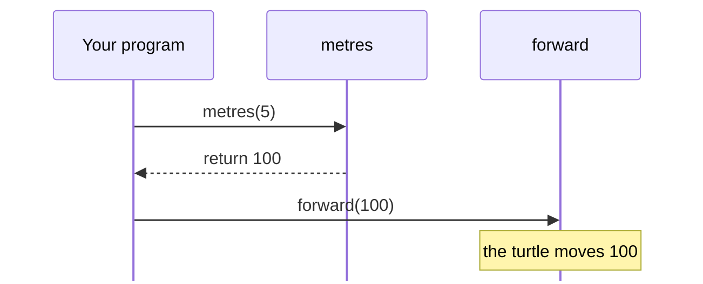

# Functions that give answers

Python functions and events · Functions

<!-- Speaker note: Students write functions that give an answer back with return, see why print is not the same, and combine small functions to build a street. About 55 minutes (Predict and Run 10 min · Investigate 15 min · Modify 10 min · Make 15 min · Street 5 min). The Run, Modify and Make slides have the live playground in them; the tutorial link under it is the backup. -->

---

## Today

**We are learning to** return a value, combine functions, and use them inside loops.

- I can write a function that gives a value back with return.
- I can explain the difference between return (hand the value back) and print (only show it).
- I can build a program from several small functions working together.

<!-- Speaker note: Before class: Read the unit primer first. The one idea to be clear on: `print` shows a value on the screen, but the program cannot use it; `return` hands the value back to the line that called the function, so it can be used, like `forward(metres(5))`. Try the bug task yourself: it stops with a TypeError because a function without return gives back `None` (Python's word for "nothing"). Teacher: Street: the loop varies the size argument, so each house is different. Ask how to make them shrink instead of grow. -->

---

## Why it matters

> Calculators, maps and games are full of functions that take something in and give an answer back.

<!-- Speaker note: You can write functions that draw. Now you will write functions that **give an answer back**, and combine several functions to build something bigger. -->

---

<span style="background:#dbeafe; color:#1a1a1a; border:1.5px solid #3b82f6; padding:6px 18px; border-radius:8px; font-size:1em; font-weight:500;">💬 Discussion</span>

## Predict

```python
from turtle import *

scale = 20


def metres(m):
    return m * scale


forward(metres(5))
right(90)
forward(metres(3))
```

`metres(5)` gives back a number. What do you think `forward(metres(5))` does? How far will the turtle move, and how far does the second `forward` take it?

<!-- Speaker note: Take two or three predictions before anyone runs it. -->

<!-- Speaker note: Teacher: metres(5) is replaced by its answer, 100, so forward(metres(5)) is forward(100). Write this substitution on the board. -->

<style scoped>pre, marp-pre { font-size: 0.51em; line-height: 1.25; }</style>

---

<span style="background:#fef3c7; color:#1a1a1a; border:1.5px solid #f59e0b; padding:6px 18px; border-radius:8px; font-size:1em; font-weight:500;">✍️ Activity</span>

## Run it

{{embed: https://tutorials.learningwaypoints.com/_playground/index.html?code=from+turtle+import+*%0A%0Ascale+%3D+20%0A%0A%0Adef+metres%28m%29%3A%0A++++return+m+*+scale%0A%0A%0Aforward%28metres%285%29%29%0Aright%2890%29%0Aforward%28metres%283%29%29%0A}}

_If it does not load:_ [open this step in the tutorial](https://tutorials.learningwaypoints.com/code/python-functions/turtle-returns/?full=step-2#step-2)

<!-- Speaker note: Run it and compare it with your prediction. Try `metres(10)`. Students should be able to say: I can explain how metres(5) becomes a number that forward uses. -->

<style scoped>pre, marp-pre { font-size: 0.5em; line-height: 1.25; } section { font-size: 25px; }</style>

---

## forward(metres(5)) runs in two steps



<!-- Speaker note: A sequence of calls. Your program calls metres(5). metres works out 5 times 20 and returns 100 to your program. Then your program calls forward(100), and the turtle moves 100. -->

---

<span style="background:#dbeafe; color:#1a1a1a; border:1.5px solid #3b82f6; padding:6px 18px; border-radius:8px; font-size:1em; font-weight:500;">💬 Discussion</span>

## Investigate

```python
from turtle import *

scale = 20


def metres(m):
    return m * scale


print(metres(5))
forward(metres(5))
right(90)
forward(metres(3))
```

<!-- Speaker note: `print(metres(5))` shows the answer under the drawing. Change `scale` and watch both the printed value and the drawing change. What this step is for: return hands a value back so other code can use it; print only shows it. Knowing the difference is what makes functions reusable. -->

<!-- Speaker note: Teacher: work out metres(5) before running. Then do the bug task and ask why the number is printed but the turtle still fails. -->

<style scoped>pre, marp-pre { font-size: 0.79em; line-height: 1.25; }</style>

---

<span style="background:#dcfce7; color:#1a1a1a; border:1.5px solid #22c55e; padding:6px 18px; border-radius:8px; font-size:1em; font-weight:500;">✅ Check</span>

## What comes back?

<div class="side" style="display:grid;grid-template-columns:1fr 3fr;gap:1em">
<div>

**scale is 20. What number does metres(5) give back?**

* Answer: 100

</div>
<div>

{{embed: https://tutorials.learningwaypoints.com/_playground/index.html?code=from+turtle+import+*%0A%0Ascale+%3D+20%0A%0A%0Adef+metres%28m%29%3A%0A++++return+m+*+scale%0A%0A%0Aprint%28metres%285%29%29%0Aforward%28metres%285%29%29%0Aright%2890%29%0Aforward%28metres%283%29%29%0A}}

</div>
</div>

<!-- Speaker note: metres(5) returns 5 * 20 = 100, so forward(metres(5)) moves 100. -->

<style scoped>section { font-size: 28px; }</style>

---

<span style="background:#dcfce7; color:#1a1a1a; border:1.5px solid #22c55e; padding:6px 18px; border-radius:8px; font-size:1em; font-weight:500;">✅ Check</span>

## Spot the bug

**This version prints 100, then stops with a TypeError on the last line. Click the line that causes it.**

```
 1  from turtle import *
 2  
 3  scale = 20
 4  
 5  
 6  def metres(m):
 7      print(m * scale)
 8  
 9  
10  forward(metres(5))
```

* Answer: line 7

<!-- Speaker note: print(m * scale) shows the value but does not give it back. It should be return m * scale. -->

<style scoped>pre, marp-pre { font-size: 0.58em; line-height: 1.25; }</style>

---

<span style="background:#dcfce7; color:#1a1a1a; border:1.5px solid #22c55e; padding:6px 18px; border-radius:8px; font-size:1em; font-weight:500;">✅ Check</span>

## Explain return

<div class="side" style="display:grid;grid-template-columns:1fr 1fr;gap:1em">
<div>

```python
from turtle import *

scale = 20


def metres(m):
    return m * scale


print(metres(5))
forward(metres(5))
right(90)
forward(metres(3))
```

</div>
<div>

**What does the word return do in metres?**

- It draws the shape again
- It prints the answer
- It gives the answer back to the code that called the function
- It stops the program

* Answer: It gives the answer back to the code that called the function

</div>
</div>

<!-- Speaker note: return hands the value back, so forward(metres(5)) can use it. print only shows a value; it does not give it back. -->

<style scoped>section { font-size: 24px; }</style>

---

<span style="background:#fef3c7; color:#1a1a1a; border:1.5px solid #f59e0b; padding:6px 18px; border-radius:8px; font-size:1em; font-weight:500;">✍️ Activity</span>

## Modify

`room` calls `metres` to turn sizes into pixels. Functions are working together here.

- **Write area:** Write `def area(width, depth)` that **returns** the area.
- **Print the area:** Print the area of the room that the program draws.

<!-- Speaker note: What this step is for: A function that returns a value can be combined with other code, and functions can call each other. Hints, in order: Your function should work out the answer and give it back with return, not print it. / The area of a room is its width times its depth. / Call your function inside print(...), for example print(area(5, 4)). For students who need more support: Before the Make step, write the one-house function together on the board, then let students add the loop themselves. For early finishers: Write a function that returns the perimeter of a room, then print the area and perimeter of three rooms. The hard part, on purpose: return versus print: both show a number, but only return hands it back. Let the NoneType error happen, then ask what the function gives back. When students get stuck: A TypeError mentioning NoneType, often on a forward line. Ask: Does the function return its answer, or only print it? Fix: Replace print(...) inside the function with return ..., then use the value where it is needed. / The area is worked out but nothing appears. Ask: Where is the returned value used or shown? Fix: A returned value has to be used. Print it outside the function, print(area(5, 4)). / Code after return never runs. Ask: What happens at the moment a function reaches return? Fix: return ends the function. Put any other lines before it. -->

<!-- Speaker note: Teacher: area returns width * depth. Students print it to see it; the room drawing does not change. -->

---

<span style="background:#fef3c7; color:#1a1a1a; border:1.5px solid #f59e0b; padding:6px 18px; border-radius:8px; font-size:1em; font-weight:500;">✍️ Activity</span>

## Live: Modify

{{embed: https://tutorials.learningwaypoints.com/_playground/index.html?code=from+turtle+import+*%0A%0Ascale+%3D+20%0A%0A%0Adef+metres%28m%29%3A%0A++++return+m+*+scale%0A%0A%0Adef+room%28width%2C+depth%29%3A%0A++++for+i+in+range%282%29%3A%0A++++++++forward%28metres%28width%29%29%0A++++++++right%2890%29%0A++++++++forward%28metres%28depth%29%29%0A++++++++right%2890%29%0A%0A%0Aroom%285%2C+4%29%0A%0A%23+Write+def+area%28width%2C+depth%29+that+returns+width+*+depth%2C+then+print+the+area+of+this+room.%0A}}

_If it does not load:_ [open this step in the tutorial](https://tutorials.learningwaypoints.com/code/python-functions/turtle-returns/?full=step-4#step-4)

<!-- Speaker note: Work the first task live, or let students start on their own screens and walk round. -->

<style scoped>pre, marp-pre { font-size: 0.5em; line-height: 1.25; } section { font-size: 25px; }</style>

---

<span style="background:#dcfce7; color:#1a1a1a; border:1.5px solid #22c55e; padding:6px 18px; border-radius:8px; font-size:1em; font-weight:500;">✅ Check</span>

## Mix it up

**What does label(50) give back?**

- 50
- big
- nothing
- small

* Answer: small

<!-- Speaker note: 50 > 50 is False, because 50 is not more than 50. So the else path runs and the function returns "small". What this step is for: A function with an if returns one answer per call: whichever path runs decides it. -->

---

<span style="background:#fef3c7; color:#1a1a1a; border:1.5px solid #f59e0b; padding:6px 18px; border-radius:8px; font-size:1em; font-weight:500;">✍️ Activity</span>

## Make a street

This time there is no starter. Build the street in two stages.

- **Draw one house:** Write a function that draws one house.
- **Draw five in a row:** Use a loop to repeat it for a **street of five houses**.

<!-- Speaker note: What this step is for: Written without a starter, this shows whether a student can define, call and repeat a function on their own. Hints, in order: Write a function that draws one house, with a size parameter. / A loop calls your function five times. A new size for each house can come from the loop variable. -->

<!-- Speaker note: Teacher: there is no starter on purpose. This shows whether students can write and use a function on their own. Give the hint only after a real attempt. -->

---

<span style="background:#fef3c7; color:#1a1a1a; border:1.5px solid #f59e0b; padding:6px 18px; border-radius:8px; font-size:1em; font-weight:500;">✍️ Activity</span>

## Live: Make a street

{{embed: https://tutorials.learningwaypoints.com/_playground/index.html?code=from+turtle+import+*%0A%0A%23+Draw+a+street+of+five+houses.%0A}}

_If it does not load:_ [open this step in the tutorial](https://tutorials.learningwaypoints.com/code/python-functions/turtle-returns/?full=step-6#step-6)

<!-- Speaker note: Work the first task live, or let students start on their own screens and walk round. -->

<style scoped>pre, marp-pre { font-size: 0.5em; line-height: 1.25; } section { font-size: 25px; }</style>

---

<span style="background:#fef3c7; color:#1a1a1a; border:1.5px solid #f59e0b; padding:6px 18px; border-radius:8px; font-size:1em; font-weight:500;">✍️ Activity</span>

## Vary a street of houses

This is a finished street. Make the houses all the same size, then make them shrink along the street. Add a sixth house, or change the gap between them.

---

<span style="background:#fef3c7; color:#1a1a1a; border:1.5px solid #f59e0b; padding:6px 18px; border-radius:8px; font-size:1em; font-weight:500;">✍️ Activity</span>

## Live: Vary a street of houses

{{embed: https://tutorials.learningwaypoints.com/_playground/index.html?code=from+turtle+import+*%0A%0A%0Adef+house%28size%29%3A%0A++++for+i+in+range%284%29%3A%0A++++++++forward%28size%29%0A++++++++right%2890%29%0A++++left%2860%29%0A++++forward%28size%29%0A++++right%28120%29%0A++++forward%28size%29%0A++++right%28120%29%0A++++forward%28size%29%0A++++right%28180%29%0A%0A%0Adef+move%28distance%29%3A%0A++++penup%28%29%0A++++forward%28distance%29%0A++++pendown%28%29%0A%0A%0Afor+i+in+range%285%29%3A%0A++++house%2830+%2B+i+*+10%29%0A++++move%2880%29%0A}}

_If it does not load:_ [open this step in the tutorial](https://tutorials.learningwaypoints.com/code/python-functions/turtle-returns/?full=step-7#step-7)

<!-- Speaker note: Work the first task live, or let students start on their own screens and walk round. -->

<style scoped>pre, marp-pre { font-size: 0.5em; line-height: 1.25; } section { font-size: 25px; }</style>

---

<span style="background:#dcfce7; color:#1a1a1a; border:1.5px solid #22c55e; padding:6px 18px; border-radius:8px; font-size:1em; font-weight:500;">✅ Check</span>

## Exit ticket

**def double(n): return n * 2. What does forward(double(30)) do?**

* double(30) gives back 60, so the turtle moves forward 60 steps.

<!-- Speaker note: Students answer on paper or a mini whiteboard before the reveal. Anyone who cannot answer needs the main idea again next lesson. Where this leads: Next lesson: functions that decide, an if inside a function, called for every item in a list. Then modules keep related functions where other programs can import them. Calculators, maps and games are full of functions that take something in and give an answer back. Class ideas: a class toolbox of unit conversions; a street where every house has a different design. -->
