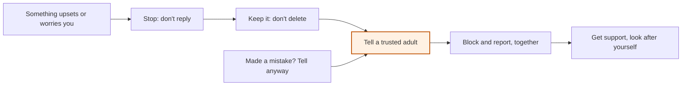

# When something goes wrong

Staying safe and well · When something goes wrong

<!-- Speaker note: Students predict what happens when a problem is deleted and kept secret, sort first moves into helps and makes it harder, and learn a five-step plan as a diagram: stop, keep it, tell a trusted adult, block and report, look after yourself, with 'made a mistake? tell anyway'. Typical width (Years 7 and 8): choose the next step in harder situations. About 40 minutes (Engage and Explore 10 min · Explain 12 min · Elaborate 8 min · Evaluate 10 min). -->

---

## Today

- I can say the plan for when something goes wrong online.
- I can explain why keeping it and telling helps more than deleting.
- I can explain why telling helps even if I made a mistake.

<!-- Speaker note: Before class: **⚑ Wellbeing review:** this is the course's key lesson for help-seeking. Read it with the school's wellbeing lead and child-protection contact before teaching. Agree: who students should tell at school, the school's reporting process, and how the school responds when a student tells (so the lesson's promise that telling helps is true here). One line tells students not to save or forward a picture that shouldn't be shared (for example a nude image) and to tell an adult straight away; check the wording with the wellbeing lead, especially for Years 5 and 6. **If a student discloses something:** this lesson invites help-seeking, so a disclosure is possible. Follow the school's child-protection procedure. Listen, don't probe, don't promise to keep it secret (say you may need to tell someone whose job is to help), and pass it on as the procedure says. Thank them for telling. **Ground rules:** Zara, Ollie, Kai, Mei, Ari and Priya are made up. Never ask what has happened to students or people they know, and don't ask for examples. Avoid suggesting that devices will be taken away. The closing think is private. **Support:** the school's wellbeing team; Kids Helpline 1800 55 1800, kidshelpline.com.au (free, for young people; checked 26 Oct 2026, check it is current); the eSafety Commissioner's reporting pages at esafety.gov.au/report (checked 26 Oct 2026) and its pages for kids at esafety.gov.au/kids. No laws are stated; eSafety explains what can be reported and how. The diagram is a Mermaid flowchart (lesson.md › diagrams.mmd#plan). Years 5 and 6: give the link with `?width=minimum`. Teacher: Evaluate: say the school's own reporting route and the Kids Helpline number aloud. -->

---

## Why it matters

> Zara gets a nasty message from an account she doesn't know. Her first idea is to delete it and never tell anyone. What might happen if she does?

<!-- Speaker note: Zara, Ollie and everything that happens to them are made up. Nobody will ask what has happened to you. -->

---

<span style="background:#dbeafe; color:#1a1a1a; border:1.5px solid #3b82f6; padding:6px 18px; border-radius:8px; font-size:1em; font-weight:500;">💬 Discussion</span>

## Think, pair, share

**Why might someone not tell an adult when something goes wrong online? What would make it easier?**

- Think about Ollie and Zara, not yourself.
- What could an adult say or do that would make telling easier?

<!-- Speaker note: Common reasons: fear of trouble, of losing a device, of making it worse, embarrassment. Use the answers to say what the school actually does when a student tells. Keep it general. Give 30 seconds alone, 2 minutes in pairs, then take answers from both sides. There is no single right answer: ask for a reason, and let students change their minds. -->

---

<span style="background:#dbeafe; color:#1a1a1a; border:1.5px solid #3b82f6; padding:6px 18px; border-radius:8px; font-size:1em; font-weight:500;">💬 Discussion</span>

## Engage: predict

**Zara deletes the nasty message and tells nobody. What is most likely?**

- It may keep happening, and nobody can help because nobody knows
- The sender gets in trouble automatically
- It stops, because she deleted it

<!-- Speaker note: What happens: It may keep happening. Deleting removes what an adult could use to help, and staying quiet means Zara deals with it alone. Take two or three predictions before anyone runs it. -->

<!-- Speaker note: Teacher: ask why deleting feels like the safe choice. -->

---

<span style="background:#dcfce7; color:#1a1a1a; border:1.5px solid #22c55e; padding:6px 18px; border-radius:8px; font-size:1em; font-weight:500;">✅ Check</span>

## What happened?

* It may keep happening. Deleting removes what an adult could use to help, and staying quiet means Zara deals with it alone.

<!-- Speaker note: Reveal after running. Ask who predicted it, and what made them think so. -->

---

<span style="background:#fef3c7; color:#1a1a1a; border:1.5px solid #f59e0b; padding:6px 18px; border-radius:8px; font-size:1em; font-weight:500;">✍️ Activity</span>

## Explore it

Open the lesson at this step and try it together.

[tutorials.learningwaypoints.com/ict/safe/when-something-goes-wrong/?full=step-2#step-2](https://tutorials.learningwaypoints.com/ict/safe/when-something-goes-wrong/?full=step-2#step-2)

<!-- Speaker note: Was your guess right? The moves that help keep things calm and **bring in help**. -->

<!-- Speaker note: Teacher: ask what the 'helps' moves have in common (calm, and bringing in help). -->

---

## When something goes wrong



<!-- Speaker note: A flowchart of the plan. Something online upsets or worries you. Stop: don't reply. Keep it: don't delete it. Tell a trusted adult. Block and report, together. Get support and look after yourself. A side note: made a mistake yourself? Tell anyway, it can be fixed; it joins the plan at Tell a trusted adult. -->

---

<span style="background:#dcfce7; color:#1a1a1a; border:1.5px solid #22c55e; padding:6px 18px; border-radius:8px; font-size:1em; font-weight:500;">✅ Check</span>

## Ollie's mistake

**Ollie made a mistake. Click the line where his thinking first goes wrong.**

```
 1  Ollie clicks a link in a game chat that promised free coins.
 2  His game account starts sending strange messages to his friends.
 3  He thinks: if I tell anyone, I'll get in trouble, so I'll just hide it.
 4  He says nothing, and a week later he can't get into the account at all.
```

* Answer: line 3

<!-- Speaker note: Line 3: Ollie thinks telling will get him in trouble, so he hides it. Telling early is how things get fixed. Adults would much rather know, and an account can often be got back if someone acts quickly. -->

<!-- Speaker note: Teacher: walk through the diagram; ask who students could tell at school (in general, no names needed). -->

---

<span style="background:#dcfce7; color:#1a1a1a; border:1.5px solid #22c55e; padding:6px 18px; border-radius:8px; font-size:1em; font-weight:500;">✅ Check</span>

## Keep it

**Why does the plan say keep it, not delete it?**

- So you can read it again later
- So a trusted adult can see what happened and help report it
- So you can send it to friends
- Because deleting is against the rules

* Answer: So a trusted adult can see what happened and help report it

<!-- Speaker note: A screenshot or the username helps an adult help you, and helps an app act on a report. -->

---

<span style="background:#fef3c7; color:#1a1a1a; border:1.5px solid #f59e0b; padding:6px 18px; border-radius:8px; font-size:1em; font-weight:500;">✍️ Activity</span>

## Our school's version <span style="font-size:.6em;color:#64748b">(5 min)</span>

Look at the plan. Who at our school could you tell? Where is the report button in an app? Add the school's own route to the plan.

<!-- Speaker note: Fill in the school's process (the wellbeing team, a form, a teacher). No student names a person they would tell out loud unless they want to. -->

---

<span style="background:#dcfce7; color:#1a1a1a; border:1.5px solid #22c55e; padding:6px 18px; border-radius:8px; font-size:1em; font-weight:500;">✅ Check</span>

## Keep it or delete it?

**Someone sends Zara a mean message. Which step comes right after 'Stop: don't reply'?**

- Keep it: don't delete
- Block the account
- Send it to friends

* Answer: Keep it: don't delete

<!-- Speaker note: Keep it first, so a trusted adult can see what happened. Then tell, then block and report together. Ask on mini whiteboards or by show of hands before the reveal. -->

---

<span style="background:#dcfce7; color:#1a1a1a; border:1.5px solid #22c55e; padding:6px 18px; border-radius:8px; font-size:1em; font-weight:500;">✅ Check</span>

## Elaborate: which step next?

**Match each situation to the step that comes next in the plan.**

| | |
|---|---|
| `Someone keeps messaging Kai after he asked them to stop. He's already told his mum.` | A. Stop: don't reply |
| `Mei sees a fake account using her name and photo. She wants to delete everything she has ever posted.` | B. Block and report, together |
| `Ari shared a friend's private message by mistake and feels awful.` | C. Tell a trusted adult |
| `A message makes Priya feel scared. Her first thought is to write back angrily.` | D. Keep it: don't delete |

* Answer: Someone keeps messaging Kai after he asked them to stop. He's already told his mum. → B. Block and report, together; Mei sees a fake account using her name and photo. She wants to delete everything she has ever posted. → D. Keep it: don't delete; Ari shared a friend's private message by mistake and feels awful. → C. Tell a trusted adult; A message makes Priya feel scared. Her first thought is to write back angrily. → A. Stop: don't reply

<!-- Speaker note: What this step is for: Years 7 and 8: the same plan in harder situations, choosing the next step. -->

<!-- Speaker note: Teacher: ask which situation was hardest to place. -->

<style scoped>pre, marp-pre { font-size: 0.5em; line-height: 1.25; } section { font-size: 16px; }</style>

---

## Where to get help

A trusted adult at home or school. The school's wellbeing team. Kids Helpline: 1800 55 1800, free, any time. eSafety Commissioner: esafety.gov.au

<!-- Speaker note: Leave this slide up at the end. Check the Kids Helpline number is current. -->

---

<span style="background:#dcfce7; color:#1a1a1a; border:1.5px solid #22c55e; padding:6px 18px; border-radius:8px; font-size:1em; font-weight:500;">✅ Check</span>

## Exit ticket

**Name the first three steps of the plan.**

* Stop (don't reply), keep it (don't delete), tell a trusted adult.

<!-- Speaker note: Students answer on paper or a mini whiteboard before the reveal. Anyone who cannot answer needs the main idea again next lesson. Where this leads: Next: our class agreement. The class writes how it will treat each other online. Links: AI in your life › A fake about someone (Years 7 and up; the same plan when a fake is shared). -->
