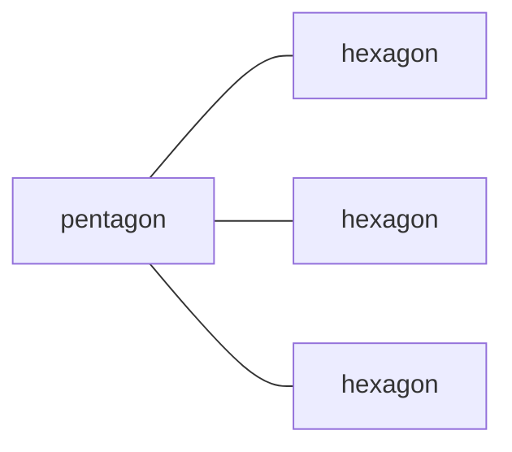
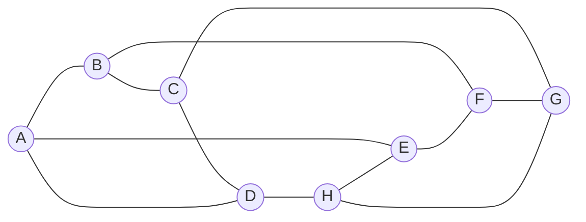

# Euler's rule

Angles and shapes · Networks

<!-- Speaker note: Students find faces + vertices = edges + 2 on a cube and a pyramid, use it to find a missing count, and count a soccer ball's 90 edges and 60 vertices from its patches (AC9M10SP02, node 3). About 40 minutes (Opening and Predict 8 min · Run 4 min · Investigate 12 min · Modify 8 min · Practise and Make 8 min). -->

---

## Today

- I can count the faces, vertices and edges of a solid.
- I can use faces + vertices = edges + 2 to find a missing count.
- I can explain why adding the sides of every face counts each edge twice.

<!-- Speaker note: Before class: The soccer ball counts (12 pentagons, 20 hexagons, 60 vertices, 90 edges, 32 faces) are those of the truncated icosahedron. They are standard geometry results, but the lesson doesn't cite a page yet, so please check them against a source you trust before this goes out. Every other number in the lesson is worked out in the lesson itself. The one idea: for a solid with flat faces and no holes, faces + vertices - edges = 2. Students find it by counting, then use it backwards. It is not proved here. Linking to the last lessons: each edge of a solid joins two vertices, so the degrees of the vertices add to twice the edges, as in a network. Each edge is also on two faces, which is why adding the sides of every face gives twice the edges. Limits: the rule fails for solids with holes (a picture frame), which are outside this lesson. The word "polyhedron" isn't needed. Teacher: Opening: ask for a guess at the number of seams before the lesson says anything. Most guesses are too low. Teacher: Paper: the pentagonal prism try-one and the Make task are worked on paper first, with a sketch of the solid. -->

---

## Why it matters

> A soccer ball has 32 patches. How many seams, without counting every one?

<!-- Speaker note: A classic soccer ball is stitched from flat patches: 12 pentagons and 20 hexagons (the shape is called a [truncated icosahedron](https://en.wikipedia.org/wiki/Truncated_icosahedron); modern balls are rounder versions of it). The corners where patches meet are the vertices, the seams are the edges, and each patch is a face. Counting 90 seams by hand would be slow. There's a rule that links the three counts, and you'll find it on simpler solids first. -->

---

## One pentagon, with three of its five hexagons shown



<!-- Speaker note: A pentagon joined to three of the five hexagons around it, drawn as boxes. -->

---

## A patch of the ball

On the ball, each pentagon touches five hexagons, and each seam is shared by two patches. Keep that in mind.

---

## A cube drawn as a network: 8 vertices, 12 edges



<!-- Speaker note: A cube drawn as a network with eight corners and twelve edges: a square on the top, a square on the bottom, and four edges joining them. -->

---

<span style="background:#dbeafe; color:#1a1a1a; border:1.5px solid #3b82f6; padding:6px 18px; border-radius:8px; font-size:1em; font-weight:500;">💬 Discussion</span>

## Predict

**A cube has 6 faces, 8 vertices and 12 edges. Add the faces and vertices: 6 + 8 = 14. How does 14 compare with the number of edges?**

- Twice the edges
- 2 more than the edges
- The same as the edges
- 2 fewer than the edges

<!-- Speaker note: What happens: 14 is 2 more than 12. Faces + vertices = edges + 2. Does the same happen on every solid? Take two or three predictions before anyone runs it. -->

<!-- Speaker note: Teacher: show of hands. The cube gives 14 against 12 edges, which is two more. -->

---

<span style="background:#dcfce7; color:#1a1a1a; border:1.5px solid #22c55e; padding:6px 18px; border-radius:8px; font-size:1em; font-weight:500;">✅ Check</span>

## What happened?

* 14 is 2 more than 12. Faces + vertices = edges + 2. Does the same happen on every solid?

<!-- Speaker note: Reveal after running. Ask who predicted it, and what made them think so. -->

---

<span style="background:#fef3c7; color:#1a1a1a; border:1.5px solid #f59e0b; padding:6px 18px; border-radius:8px; font-size:1em; font-weight:500;">✍️ Activity</span>

## Try it

Open the lesson at this step and try it together.

[tutorials.learningwaypoints.com/maths/angles/eulers-rule/?full=step-3#step-3](https://tutorials.learningwaypoints.com/maths/angles/eulers-rule/?full=step-3#step-3)

<!-- Speaker note: Draw a square pyramid on paper and count the faces, vertices and edges yourself before you type. -->

---

<span style="background:#dcfce7; color:#1a1a1a; border:1.5px solid #22c55e; padding:6px 18px; border-radius:8px; font-size:1em; font-weight:500;">✅ Check</span>

## Hexagonal prism: vertices

**A hexagonal prism has 2 hexagon faces and 6 rectangle faces. How many vertices does it have? (Two hexagons, 6 corners each.)**

* Answer: 12

<!-- Speaker note: Each hexagon has 6 corners, and the prism has two of them: 12 vertices. The rectangles use the same corners. -->

---

<span style="background:#dcfce7; color:#1a1a1a; border:1.5px solid #22c55e; padding:6px 18px; border-radius:8px; font-size:1em; font-weight:500;">✅ Check</span>

## Hexagonal prism: edges

**Use Euler's rule to find the number of edges of the hexagonal prism: it has 8 faces and 12 vertices.**

* Answer: 18

<!-- Speaker note: Faces + vertices = edges + 2, so 8 + 12 = 20 = edges + 2, and the edges are 18. -->

---

<span style="background:#dcfce7; color:#1a1a1a; border:1.5px solid #22c55e; padding:6px 18px; border-radius:8px; font-size:1em; font-weight:500;">✅ Check</span>

## The soccer ball edges

**Ines counts the edges of the soccer ball. Click the line where her working goes wrong.**

```
 1  A soccer ball has 12 pentagons and 20 hexagons.
 2  Each pentagon has 5 edges and each hexagon has 6.
 3  So the edges are 12 × 5 + 20 × 6 = 180.
 4  So the soccer ball has 180 edges.
```

* Answer: line 3

<!-- Speaker note: Line 3: adding up the sides of every face counts each seam twice, once for each of the two patches it joins. The edges are half that: 180 ÷ 2 = 90. -->

---

<span style="background:#dbeafe; color:#1a1a1a; border:1.5px solid #3b82f6; padding:6px 18px; border-radius:8px; font-size:1em; font-weight:500;">💬 Discussion</span>

## Pentagonal prism

Here's the method on a pentagonal prism.

Now check it with Euler's rule: how many vertices does it have, and does faces + vertices - edges give 2?

$$2 \times 5 + 5 \times 4 = 30$$

1) $30 \div 2 = 15$ — Every edge is shared by two faces, so halve it. That's 15 edges.
2) $10 \div 1 = 10$ — Each of the 10 corners has 3 edges, so 10 × 3 ÷ 2 = 15 as well.

<!-- Speaker note: Model this live on the board before revealing anything: write each line and say why, pausing to ask the class what comes next. Then click to reveal the lines and compare. Script. Start: write 2 × 5 + 5 × 4 = 30 and say "Add up the sides of every face: two pentagons and five rectangles." Line 1: write 30 ÷ 2 = 15 and say "Every edge is shared by two faces, so halve it. That's 15 edges." Line 2: write 10 ÷ 1 = 10 and say "Each of the 10 corners has 3 edges, so 10 × 3 ÷ 2 = 15 as well." -->

<style scoped>pre, marp-pre { font-size: 0.5em; line-height: 1.25; } section { font-size: 27px; }</style>

---

<span style="background:#dcfce7; color:#1a1a1a; border:1.5px solid #22c55e; padding:6px 18px; border-radius:8px; font-size:1em; font-weight:500;">✅ Check</span>

## Pentagonal prism

**A pentagonal prism has 2 pentagons and 5 rectangles. Add up the sides of all 7 faces, then halve it. How many edges? Work it out on paper first.**

* Answer: 15

<!-- Speaker note: The sides add up to 2 × 5 + 5 × 4 = 30. Each edge is shared by two faces, so the edges are 30 ÷ 2 = 15. -->

---

<span style="background:#fef3c7; color:#1a1a1a; border:1.5px solid #f59e0b; padding:6px 18px; border-radius:8px; font-size:1em; font-weight:500;">✍️ Activity</span>

## Which solids can exist?


- **Missing edges:** 
- **Impossible solid:** 
- **Missing vertices:** Each one is faces + vertices = edges + 2.

<!-- Speaker note: What this step is for: Euler's rule used backwards finds a missing count, and an impossible set of counts breaks it. For students who need more support: Give students a cube and a pyramid to hold, with the counts in a table. For early finishers: Find a solid of your own that has 7 faces, and check that the rule works. The hard part, on purpose: Counting edges by adding up the sides of every face and not halving. Ask how many faces each edge touches. When students get stuck: A student gives the soccer ball's edges as 180. Ask: How many patches touch each seam? Fix: Two patches share every seam, so halve it: 90. / A student gives the vertices as 90 or 180. Ask: How many patches meet at each corner? Fix: Three, so divide the 180 by 3: 60. / A student uses faces + vertices = edges, forgetting the 2. Ask: Check it on a cube: 6 + 8 and 12. Fix: It's edges + 2. -->

<!-- Speaker note: Teacher: ask them to check the 10, 8, 15 solid with the rule before they pick. -->

---

<span style="background:#dcfce7; color:#1a1a1a; border:1.5px solid #22c55e; padding:6px 18px; border-radius:8px; font-size:1em; font-weight:500;">✅ Check</span>

## Missing edges

**A solid has 7 faces and 10 vertices. How many edges?**

* Answer: 15

<!-- Speaker note: 7 + 10 = 17 = edges + 2, so 15 edges. -->

---

<span style="background:#dcfce7; color:#1a1a1a; border:1.5px solid #22c55e; padding:6px 18px; border-radius:8px; font-size:1em; font-weight:500;">✅ Check</span>

## Missing vertices

**A solid has 9 faces and 14 edges. How many vertices?**

* Answer: 7

<!-- Speaker note: 9 + vertices = 14 + 2 = 16, so 7 vertices. -->

---

<span style="background:#dcfce7; color:#1a1a1a; border:1.5px solid #22c55e; padding:6px 18px; border-radius:8px; font-size:1em; font-weight:500;">✅ Check</span>

## Missing faces

**A solid has 12 vertices and 18 edges. How many faces?**

* Answer: 8

<!-- Speaker note: faces + 12 = 18 + 2 = 20, so 8 faces. -->

---

<span style="background:#dcfce7; color:#1a1a1a; border:1.5px solid #22c55e; padding:6px 18px; border-radius:8px; font-size:1em; font-weight:500;">✅ Check</span>

## Review

**Review: a connected suburb has junctions with 3, 3, 2, 2 and 2 streets. How many junctions have an odd number of streets?**

* Answer: 2

<!-- Speaker note: The two junctions with 3. With two odd junctions, the sweeper can do it, from one to the other. -->

---

<span style="background:#fef3c7; color:#1a1a1a; border:1.5px solid #f59e0b; padding:6px 18px; border-radius:8px; font-size:1em; font-weight:500;">✍️ Activity</span>

## Make: the soccer ball

Back to the ball. Work it out on paper first, then type the number of vertices.

**Also used in**

- **Molecules and domes.** The carbon cage called buckminsterfullerene has 60 carbon atoms at the corners of the same 12 pentagons and 20 hexagons, so chemists count it the same way ([Royal Society of Chemistry](https://edu.rsc.org/feature/symmetry-of-buckminsterfullerene/2020237.article)).
- **Map colouring and planning.** Euler's rule is one of the first results about networks drawn on a surface.
- **Back to the sweeper.** The degrees of a solid's vertices add to twice its edges, just like a suburb's junctions.

<!-- Speaker note: What this step is for: Counting the soccer ball's edges, vertices and faces from its patches and checking Euler's rule. Hints, in order: Count the sides of every patch, then halve for edges. / Each corner joins three patches, so divide the corners by 3. -->

<style scoped>pre, marp-pre { font-size: 0.5em; line-height: 1.25; } section { font-size: 22px; }</style>

---

<span style="background:#dcfce7; color:#1a1a1a; border:1.5px solid #22c55e; padding:6px 18px; border-radius:8px; font-size:1em; font-weight:500;">✅ Check</span>

## Exit ticket

**A solid has 6 faces and 10 vertices. How many edges?**

* 14.

<!-- Speaker note: Students answer on paper or a mini whiteboard before the reveal. Anyone who cannot answer needs the main idea again next lesson. Where this leads: Completes AC9M10SP02. Where it leads: the networks unit ends here. Later years use graphs for planning and shortest paths. -->
