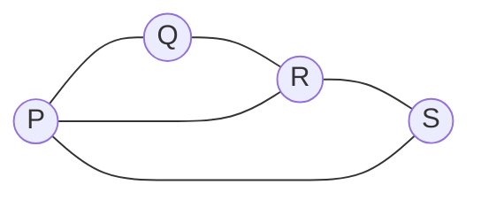
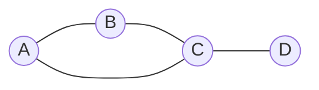

# Every street once

Angles and shapes · Networks

<!-- Speaker note: Students try to drive every street of a made-up suburb once on a board, find that the start matters, and learn the rule: a route exists when a connected network has none or exactly two odd junctions (AC9M10SP02, node 2). About 40 minutes (Opening and Predict 8 min · Run 6 min · Investigate 12 min · Modify 8 min · Practise and Make 6 min). -->

---

## Today

- I can find the degree of every junction and count the odd ones.
- I can say when a route using every street once exists, and where it starts and ends.
- I can change a network by closing a street and say what that does to the degrees.

<!-- Speaker note: Before class: Wattle Grove, the junction names and every number are made up; no real map is used. The one idea: a walk that uses every edge exactly once (an Euler trail) exists in a connected network exactly when the number of odd-degree nodes is 0 or 2. With 2 it starts at one odd node and ends at the other; with 0 it starts anywhere and returns there. Why: each time the route passes through a node it uses two of its edges, so a node in the middle of the route needs an even degree. Only the start and the end can be odd. Students don't need this proof; they meet the rule by trying it, then use it. The Make task and the Modify closures are the practice. Two supporting facts from the last lesson: degrees add to twice the number of edges, so the number of odd nodes is always even. The condition "connected" matters too: the rule only works when you can get from any junction to any other. The Run board is a netgraph board (a new widget). If it doesn't load, the lesson still works on paper from the Mermaid pictures. Teacher: Opening: let them try Wattle Grove with a finger before any rule. Several routes work, and the one start that fails (say, a start at Q) is worth noticing. Teacher: Paper: the four-junction try-one and the Make task are worked on paper first, with a sketch and the degrees written beside each junction. -->

---

## Why it matters

> Every street once, none twice: is that always possible?

<!-- Speaker note: A council sweeper has to do every street in Wattle Grove, a small made-up suburb, and the driver would rather not use any street twice. Here's the suburb drawn as a network: each junction is a node, each street an edge. Run your finger along it. Can you find a way? -->

---

## Wattle Grove



<!-- Speaker note: Wattle Grove, a suburb with four junctions, P, Q, R and S, and five streets. The streets are P to Q, Q to R, R to S, S to P and P to R. -->

---

## The suburb

The streets are P to Q, Q to R, R to S, S to P, and P to R across the middle. Try it with your finger on the diagram: one route that goes down every street once.

---

## Three junctions in a triangle, and one more on a tail



<!-- Speaker note: Four junctions. A, B and C make a triangle, and a fourth junction D hangs off C by one street. -->

---

<span style="background:#dbeafe; color:#1a1a1a; border:1.5px solid #3b82f6; padding:6px 18px; border-radius:8px; font-size:1em; font-weight:500;">💬 Discussion</span>

## Predict

**A sweeper must drive down every street here exactly once, starting at A. What happens?**

- However it goes, it gets stuck with a street left
- It does every street once and ends back at A
- It does every street once and ends at D
- It depends on which street it takes first

<!-- Speaker note: What happens: However it goes, it gets stuck. Try A, B, C, A: it's back at A with the street C to D unused. Try A, B, C, D: it's at D with the street C to A unused. A start at A can't work here. Take two or three predictions before anyone runs it. -->

<!-- Speaker note: Teacher: show of hands before the answer is shown. The triangle with a tail can't be done from A. -->

---

<span style="background:#fef3c7; color:#1a1a1a; border:1.5px solid #f59e0b; padding:6px 18px; border-radius:8px; font-size:1em; font-weight:500;">✍️ Activity</span>

## Try it

{{embed: https://tutorials.learningwaypoints.com/_playground-board/index.html?id=deck%2Fmaths%2Fangles%2Fevery-street-once%2Fstep-3&code=widget%3A+netgraph%0Awords%3A+junction%2C+street%0Anode+A%3A+0%2C+0%0Anode+B%3A+0%2C+4%0Anode+C%3A+3%2C+6%0Anode+D%3A+6%2C+4%0Anode+E%3A+6%2C+0%0Anode+F%3A+3%2C+2%0Aedges%3A+A-B%2C+B-C%2C+C-D%2C+D-E%2C+E-A%2C+B-F%2C+F-D%0A&fresh=1}}

[Open this step in the tutorial](https://tutorials.learningwaypoints.com/maths/angles/every-street-once/?full=step-3#step-3)

<!-- Speaker note: Click a junction to start, then click the next junction (or the street) to drive down it. A street you've driven turns orange. Try A first. Then Start again somewhere else. -->

<!-- Speaker note: Teacher: ask them to try A first, fail, then try another start. Don't give the rule; ask what the numbers on the junctions have in common. -->

<style scoped>pre, marp-pre { font-size: 0.5em; line-height: 1.25; } section { font-size: 25px; }</style>

---

<span style="background:#dcfce7; color:#1a1a1a; border:1.5px solid #22c55e; padding:6px 18px; border-radius:8px; font-size:1em; font-weight:500;">✅ Check</span>

## What happened?

* However it goes, it gets stuck. Try A, B, C, A: it's back at A with the street C to D unused. Try A, B, C, D: it's at D with the street C to A unused. A start at A can't work here.

<!-- Speaker note: Reveal after running. Ask who predicted it, and what made them think so. -->

---

<span style="background:#dcfce7; color:#1a1a1a; border:1.5px solid #22c55e; padding:6px 18px; border-radius:8px; font-size:1em; font-weight:500;">✅ Check</span>

## Count the odd ones

**On the Run board, how many junctions have an odd number of streets?**

* Answer: 2

<!-- Speaker note: B and D have three streets each. A, C, E and F have two. -->

---

<span style="background:#dcfce7; color:#1a1a1a; border:1.5px solid #22c55e; padding:6px 18px; border-radius:8px; font-size:1em; font-weight:500;">✅ Check</span>

## Which suburb?

**Every junction is joined to the rest of the suburb. Which suburb can the sweeper do, using every street once?**

- Junctions with 3, 3, 3 and 3 streets
- Junctions with 1, 1, 1 and 3 streets
- Junctions with 2, 2, 3, 3 and 4 streets
- Junctions with 3, 3, 3, 3, 3 and 3 streets

* Answer: Junctions with 2, 2, 3, 3 and 4 streets

<!-- Speaker note: Exactly two junctions have an odd number of streets (the two with 3). The route starts at one of them and ends at the other. -->

---

<span style="background:#dbeafe; color:#1a1a1a; border:1.5px solid #3b82f6; padding:6px 18px; border-radius:8px; font-size:1em; font-weight:500;">💬 Discussion</span>

## Four junctions, every pair joined

Here's the method on the Run suburb.

Now try one on paper. Junctions 1, 2, 3 and 4 have a street between every pair of them. How many junctions have an odd number of streets? Then type it.

$$\text{degrees: } A\,2, B\,3, C\,2, D\,3, E\,2, F\,2$$

1) $\text{odd junctions: } B \text{ and } D$ — Two junctions have an odd degree.
2) $\text{connected: yes}$ — You can get from any junction to any other.
3) $\text{start at } B, \text{ finish at } D$ — With two odd junctions, the route starts at one and ends at the other.

<!-- Speaker note: Model this live on the board before revealing anything: write each line and say why, pausing to ask the class what comes next. Then click to reveal the lines and compare. Script. Start: write degrees: A2, B3, C2, D3, E2, F2 and say "Count the streets at each junction (its degree)." Line 1: write odd junctions: B and D and say "Two junctions have an odd degree." Line 2: write connected: yes and say "You can get from any junction to any other." Line 3: write start at B, finish at D and say "With two odd junctions, the route starts at one and ends at the other." -->

<style scoped>pre, marp-pre { font-size: 0.5em; line-height: 1.25; } section { font-size: 21px; }</style>

---

<span style="background:#dcfce7; color:#1a1a1a; border:1.5px solid #22c55e; padding:6px 18px; border-radius:8px; font-size:1em; font-weight:500;">✅ Check</span>

## Four junctions, every pair joined

**A suburb has four junctions, and there's a street between every pair of junctions. How many junctions have an odd number of streets? Work it out on paper first, then type it. Could the sweeper do it?**

* Answer: 4

<!-- Speaker note: Each junction has three streets: one to each of the other three. All four are odd. A route can only start and end at odd junctions, so two is the most it can handle: the sweeper can't. -->

---

<span style="background:#dcfce7; color:#1a1a1a; border:1.5px solid #22c55e; padding:6px 18px; border-radius:8px; font-size:1em; font-weight:500;">✅ Check</span>

## Find the mistake

**Sam works out whether the sweeper can do the Run suburb. Click the line where his working goes wrong.**

```
 1  The streets at each junction: A 2, B 3, C 2, D 3, E 2, F 2.
 2  B and D are odd, so there are two odd junctions.
 3  Two odd junctions means the sweeper can start at any junction.
 4  So it can start at A and finish at D.
```

* Answer: line 3

<!-- Speaker note: Line 3: with two odd junctions the route has to start at one of them (B or D) and finish at the other. It can only start anywhere when there are no odd junctions. -->

---

<span style="background:#fef3c7; color:#1a1a1a; border:1.5px solid #f59e0b; padding:6px 18px; border-radius:8px; font-size:1em; font-weight:500;">✍️ Activity</span>

## Close a street


- **Close one street:** Which two junctions would you want to make even? What do you close?
- **Cut one off:** What happens to a junction when its only street closes?
- **One odd junction:** Think back to adding up the degrees.

[Open this step](https://tutorials.learningwaypoints.com/maths/angles/every-street-once/?full=step-5#step-5)

<!-- Speaker note: What this step is for: Closing a street takes one off the degree at each end: closing between two odd junctions fixes two at once; closing the only street at a junction cuts it off; a suburb can never have exactly one odd junction. For students who need more support: Give students the suburb printed large, and have them write the degree on each junction before they try a route. For early finishers: Can a suburb have exactly one odd junction? Use the idea that degrees add to twice the number of streets. The hard part, on purpose: Believing any start works if a route exists. Have them start the Run board at A, then at B, and compare. When students get stuck: A student says the sweeper can start anywhere because there are only two odd junctions. Ask: If it starts at an even junction, where does it have to end? Fix: With two odd junctions the route starts at one of them and finishes at the other. / A student counts the number of streets instead of the number of odd junctions. Ask: How many streets meet at this junction? Is that odd? Fix: Count junctions with an odd degree, not streets. / A student closes a street and says the degrees stay the same. Ask: How many streets does each end of that street have now? Fix: Closing a street takes one off each of its two ends. -->

<!-- Speaker note: Teacher: ask which two junctions they'd want to make even before they click. -->

---

<span style="background:#dcfce7; color:#1a1a1a; border:1.5px solid #22c55e; padding:6px 18px; border-radius:8px; font-size:1em; font-weight:500;">✅ Check</span>

## Can it be done?

**A suburb's junctions have 2, 2, 3, 3, 4 and 2 streets. Can the sweeper use every street once?**

- No: a junction has 4 streets
- Yes: start at one junction with 3 streets and finish at the other
- Yes: start anywhere and finish where it started
- No: two junctions have 3 streets

* Answer: Yes: start at one junction with 3 streets and finish at the other

<!-- Speaker note: Two junctions have an odd number of streets (the two with 3), so the route runs between them. -->

<style scoped>pre, marp-pre { font-size: 0.5em; line-height: 1.25; } section { font-size: 25px; }</style>

---

<span style="background:#dcfce7; color:#1a1a1a; border:1.5px solid #22c55e; padding:6px 18px; border-radius:8px; font-size:1em; font-weight:500;">✅ Check</span>

## No odd junctions

**Every junction in a suburb has an even number of streets. Where can the sweeper start?**

- Nowhere: it can't be done
- Anywhere, but it finishes at a different junction
- Anywhere, and it finishes where it started
- Only at the junction with the most streets

* Answer: Anywhere, and it finishes where it started

<!-- Speaker note: With no odd junctions, a route can start at any junction and comes back to it. -->

---

<span style="background:#dcfce7; color:#1a1a1a; border:1.5px solid #22c55e; padding:6px 18px; border-radius:8px; font-size:1em; font-weight:500;">✅ Check</span>

## One closure

**A suburb has junctions with 3, 3, 3 and 3 streets. What's the fewest streets the council needs to close so the sweeper can do every street once?**

* Answer: 1

<!-- Speaker note: Close one street between two of the junctions. Those two now have 2 streets, and the other two keep 3: two odd junctions. -->

---

<span style="background:#dcfce7; color:#1a1a1a; border:1.5px solid #22c55e; padding:6px 18px; border-radius:8px; font-size:1em; font-weight:500;">✅ Check</span>

## Review

**Review: a suburb has 7 streets. Add up the number of streets at every junction. What do you get?**

* Answer: 14

<!-- Speaker note: Each street has two ends, so the total is 2 × 7 = 14. -->

---

<span style="background:#fef3c7; color:#1a1a1a; border:1.5px solid #f59e0b; padding:6px 18px; border-radius:8px; font-size:1em; font-weight:500;">✍️ Activity</span>

## Make: back to Wattle Grove

Back to Wattle Grove. Work this out on paper first, then type the number of odd junctions after you close the street.

**Also used in**

- **Mail and bin rounds.** A route that passes every street once is the problem a postal worker or bin lorry has too.
- **Cut off by a closure.** A road closed for repairs can leave a suburb in two pieces, which is when the network stops being connected.
- **Next lesson.** Solids drawn as networks, and Euler's rule.

<!-- Speaker note: What this step is for: Coming back to Wattle Grove: the depot at Q is an even junction, so the sweeper can't start there; closing P to R makes every junction even. Hints, in order: Count the streets at each junction first. / Which street joins the two odd junctions? -->

<style scoped>pre, marp-pre { font-size: 0.5em; line-height: 1.25; } section { font-size: 26px; }</style>

---

<span style="background:#dcfce7; color:#1a1a1a; border:1.5px solid #22c55e; padding:6px 18px; border-radius:8px; font-size:1em; font-weight:500;">✅ Check</span>

## Exit ticket

**A connected suburb has four junctions with an odd number of streets. Can the sweeper do every street once?**

* No. A route can only start and finish at odd junctions, so two is the most it can handle.

<!-- Speaker note: Students answer on paper or a mini whiteboard before the reveal. Anyone who cannot answer needs the main idea again next lesson. Where this leads: Continues AC9M10SP02. Where it leads: solids drawn as networks, and Euler's rule for faces, vertices and edges (Euler's rule). -->
