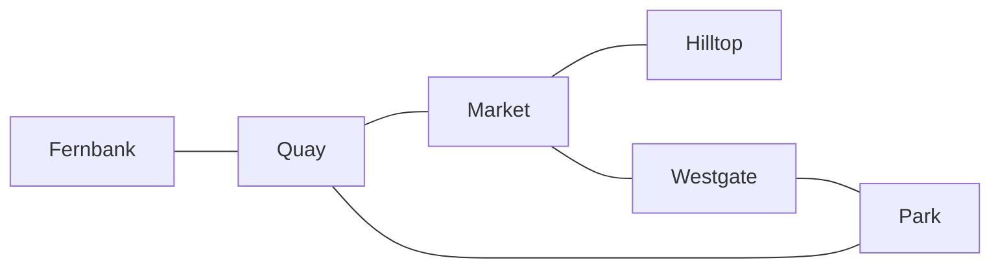

# Nodes and edges

Angles and shapes · Networks

<!-- Speaker note: Students read a made-up train map as a network (nodes, edges, degree), see that the drawn length of a line isn't a distance, and update the counts when a line is added (AC9M10SP02, node 1). About 35 minutes (Opening and Predict 8 min · Investigate 12 min · Modify 6 min · Practise and Make 9 min). -->

---

## Today

- I can name the nodes and edges of a network and say what each one stands for.
- I can find the degree of a node.
- I can say what a network diagram keeps and what it leaves out.

<!-- Speaker note: Before class: The stations (Fernbank, Quay, Market, Hilltop, Westgate, Park), the bus stops and every number are made up. A real city's train map is copyright, so none is used here; if you like, bring one to class and ask the same question of it (what is joined to what, and what the map leaves out). The one idea: a network diagram keeps connections and drops the rest. Nodes are the things (stations), edges are the joins (lines). Degree is the number of edges that meet at a node. The sum of all the degrees is twice the number of edges, because every edge has two ends; this is used in the next lesson. Line length on a diagram like this is just what fits on the page. Mermaid, which draws the map, places boxes by its own layout rules, which is a useful point to make: the same network can be drawn many ways. Wider idea: "connected" means you can follow edges from any node to any other. Marina (degree 0) is the first example of a node that isn't. Edge weights (distances or times) come later. Teacher: Opening: ask which stations they pass on the way from Fernbank to Hilltop before they see Predict. Teacher: Paper: the degree try-one after the worked example and the Make task are worked on paper first. Books out, and look for a sketch with dots and lines. -->

---

## Why it matters

> Pick up a train map and plan a trip. What can you read off it, and what can't you?

<!-- Speaker note: You're at Fernbank and you need to get to Hilltop. The map on the platform wall shows the stations as dots and the tracks as lines. Which stations can you reach without changing trains? -->

---

## A made-up train map



<!-- Speaker note: A train map with six stations. Fernbank is joined to Quay. Quay is joined to Market and to Park. Market is joined to Hilltop and to Westgate. Westgate is joined to Park. -->

---

## A made-up train map

Here's the map. It isn't a real city's: the stations are made up. Each line joins two stations you can ride between with no stop in the middle. Try the trip from Fernbank to Hilltop. Which stations do you pass through?

---

<span style="background:#dbeafe; color:#1a1a1a; border:1.5px solid #3b82f6; padding:6px 18px; border-radius:8px; font-size:1em; font-weight:500;">💬 Discussion</span>

## Predict

**On the map, the line from Market to Hilltop is drawn about three times as long as the line from Fernbank to Quay. In real life, which ride is longer?**

- Market to Hilltop
- Fernbank to Quay
- You can't tell from the map

<!-- Speaker note: What happens: You can't tell. How long a line is drawn is whatever fits on the page. Fernbank to Quay could be 12 km and Market to Hilltop 1 km. The map only tells you which stations are joined. Take two or three predictions before anyone runs it. -->

<!-- Speaker note: Teacher: take a show of hands before the answer is shown. Those who pick Market to Hilltop are reading the line length as a distance. -->

---

<span style="background:#dcfce7; color:#1a1a1a; border:1.5px solid #22c55e; padding:6px 18px; border-radius:8px; font-size:1em; font-weight:500;">✅ Check</span>

## What happened?

* You can't tell. How long a line is drawn is whatever fits on the page. Fernbank to Quay could be 12 km and Market to Hilltop 1 km. The map only tells you which stations are joined.

<!-- Speaker note: Reveal after running. Ask who predicted it, and what made them think so. -->

---

<span style="background:#fef3c7; color:#1a1a1a; border:1.5px solid #f59e0b; padding:6px 18px; border-radius:8px; font-size:1em; font-weight:500;">✍️ Activity</span>

## Try it

Open the lesson at this step and try it together.

[tutorials.learningwaypoints.com/maths/angles/nodes-and-edges/?full=step-3#step-3](https://tutorials.learningwaypoints.com/maths/angles/nodes-and-edges/?full=step-3#step-3)

<!-- Speaker note: Count the lines that meet at Quay. Fernbank, Market and Park are all one ride away. -->

---

<span style="background:#dcfce7; color:#1a1a1a; border:1.5px solid #22c55e; padding:6px 18px; border-radius:8px; font-size:1em; font-weight:500;">✅ Check</span>

## What a line stands for

**On this map, what does one line stand for?**

- The time a train takes
- The distance between two stations
- A track that joins two stations with no stop in between
- A street you can walk along

* Answer: A track that joins two stations with no stop in between

<!-- Speaker note: A line (an edge) says the two stations are joined. That's all this kind of map keeps. -->

---

<span style="background:#dbeafe; color:#1a1a1a; border:1.5px solid #3b82f6; padding:6px 18px; border-radius:8px; font-size:1em; font-weight:500;">💬 Discussion</span>

## Degree

A network is made of **nodes** (the dots, here the stations) and **edges** (the lines between them). The **degree** of a node is the number of edges that meet at it. Here's how to read the map.

Now try one on paper. A bus network has four stops, A, B, C and D. The routes are A to B, B to C, C to D, D to A and B to D. Sketch it, then find the degree of B and type it.

$$6 stations$$

1) $6 lines$ — Each line between two stations is one edge: 6 edges.
2) $\text{degree of Quay} = 3$ — Quay is joined to Fernbank, Market and Park.
3) $\text{degree of Hilltop} = 1$ — Hilltop is joined to Market only.

<!-- Speaker note: Model this live on the board before revealing anything: write each line and say why, pausing to ask the class what comes next. Then click to reveal the lines and compare. Script. Start: write 6 stations and say "Each station is one node: 6 nodes." Line 1: write 6 lines and say "Each line between two stations is one edge: 6 edges." Line 2: write degree of Quay = 3 and say "Quay is joined to Fernbank, Market and Park." Line 3: write degree of Hilltop = 1 and say "Hilltop is joined to Market only." -->

<style scoped>pre, marp-pre { font-size: 0.5em; line-height: 1.25; } section { font-size: 19px; }</style>

---

<span style="background:#dcfce7; color:#1a1a1a; border:1.5px solid #22c55e; padding:6px 18px; border-radius:8px; font-size:1em; font-weight:500;">✅ Check</span>

## Degree

**A bus network has stops A, B, C and D, with routes A to B, B to C, C to D, D to A and B to D. What is the degree of B? Work it out on paper first, then type it.**

* Answer: 3

<!-- Speaker note: B is joined to A, C and D, so its degree is 3. -->

---

<span style="background:#dcfce7; color:#1a1a1a; border:1.5px solid #22c55e; padding:6px 18px; border-radius:8px; font-size:1em; font-weight:500;">✅ Check</span>

## Find the mistake

**Lena says the ride to Hilltop must take longest. Click the line where her working goes wrong.**

```
 1  The map has a line from Market to Hilltop and a line from Fernbank to Quay.
 2  On the page, the Market to Hilltop line is three times as long.
 3  So the ride from Market to Hilltop is three times as long.
 4  So the ride to Hilltop takes longest.
```

* Answer: line 3

<!-- Speaker note: Line 3: the drawn length of a line isn't the length of the ride. The map keeps which stations are joined, not how far apart they are. -->

---

<span style="background:#dcfce7; color:#1a1a1a; border:1.5px solid #22c55e; padding:6px 18px; border-radius:8px; font-size:1em; font-weight:500;">✅ Check</span>

## Add up the degrees

**Add up the degree of every station on the map. What do you get?**

* Answer: 12

<!-- Speaker note: Fernbank 1, Quay 3, Market 3, Hilltop 1, Westgate 2, Park 2: that's 12. It's twice the 6 lines, because each line has two ends. -->

---

<span style="background:#fef3c7; color:#1a1a1a; border:1.5px solid #f59e0b; padding:6px 18px; border-radius:8px; font-size:1em; font-weight:500;">✍️ Activity</span>

## Change the map


- **Lakeside:** Hilltop had one line. What happens to its degree when a new line joins it?
- **A station with no lines:** A station with nothing joined to it is still a station on the map. How many lines meet there?
- **Getting to Marina:** For a trip, you need lines you can follow one after another.

<!-- Speaker note: What this step is for: Adding a station and a line changes degrees by one; a station with no line still counts as a node, with degree 0; and a node you can't reach is not connected to the others. For students who need more support: Give students the map printed with each node coloured in as they count its edges. For early finishers: Draw the same network a different way, with different line lengths. Does anything the map tells you change? The hard part, on purpose: Reading the drawn length of a line as a distance. Ask what the line would look like if the same two stations were drawn on a different page. When students get stuck: A student says Hilltop is the furthest because its line is the longest. Ask: If I redraw the map with that line shorter, did the train get faster? Fix: Length on the page isn't length of the ride. The map only says the stations are joined. / A student gives Quay's degree as 4 (counting Quay itself) or counts the stations. Ask: Count the lines at Quay, not the stations. Fix: Degree is the number of edges that meet there. Quay has three: to Fernbank, Market and Park. / A student says Marina isn't on the map, so it has no degree. Ask: Is Marina a node? Fix: It is a node, with degree 0. -->

<!-- Speaker note: Teacher: ask for Marina's degree before students type it. Zero is an answer. -->

---

<span style="background:#dcfce7; color:#1a1a1a; border:1.5px solid #22c55e; padding:6px 18px; border-radius:8px; font-size:1em; font-weight:500;">✅ Check</span>

## Degree

**In a network, A is joined to B, C and D, B is joined to C, and C is joined to D. What's the degree of C?**

* Answer: 3

<!-- Speaker note: C is joined to A, B and D: degree 3. -->

---

<span style="background:#dcfce7; color:#1a1a1a; border:1.5px solid #22c55e; padding:6px 18px; border-radius:8px; font-size:1em; font-weight:500;">✅ Check</span>

## Ends of edges

**A network has 8 edges. Add up the degrees of all its nodes. What do you get?**

* Answer: 16

<!-- Speaker note: Each edge has two ends, so the degrees add up to 2 × 8 = 16. -->

---

<span style="background:#dcfce7; color:#1a1a1a; border:1.5px solid #22c55e; padding:6px 18px; border-radius:8px; font-size:1em; font-weight:500;">✅ Check</span>

## What the map shows

**Which of these can you work out from a train map like this one?**

- How many kilometres from Quay to Park
- Where the stations really are on a street map
- Which line is quickest
- Which stations you can ride between without changing trains

* Answer: Which stations you can ride between without changing trains

<!-- Speaker note: The map keeps connections only: which stations are joined. -->

---

<span style="background:#dcfce7; color:#1a1a1a; border:1.5px solid #22c55e; padding:6px 18px; border-radius:8px; font-size:1em; font-weight:500;">✅ Check</span>

## Review

**Review: in 3D coordinates, P is (2, 3, 4) and Q is (2, 3, 9). How many units above P is Q?**

* Answer: 5

<!-- Speaker note: Only the up value changes, from 4 to 9: that's 5 units. -->

---

<span style="background:#fef3c7; color:#1a1a1a; border:1.5px solid #f59e0b; padding:6px 18px; border-radius:8px; font-size:1em; font-weight:500;">✍️ Activity</span>

## Make: add a line

Back to the train map. Work this out on paper first, then type the number of lines.

**Also used in**

- **Street maps and journey planners.** Each junction is a node and each street an edge, the idea behind the route you see on a phone.
- **Next lessons.** Following a path along edges (Every street once), then solids drawn as networks (Euler's rule).

<!-- Speaker note: What this step is for: Coming back to the train map and adding a line: updating the counts is easy; saying what the new line doesn't tell you is the idea. Hints, in order: The new line adds one edge. / Each end of the new line adds one to a degree. -->

<style scoped>pre, marp-pre { font-size: 0.5em; line-height: 1.25; } section { font-size: 28px; }</style>

---

<span style="background:#dcfce7; color:#1a1a1a; border:1.5px solid #22c55e; padding:6px 18px; border-radius:8px; font-size:1em; font-weight:500;">✅ Check</span>

## Exit ticket

**A network has 9 edges. What do the degrees of all its nodes add up to?**

* 18.

<!-- Speaker note: Students answer on paper or a mini whiteboard before the reveal. Anyone who cannot answer needs the main idea again next lesson. Where this leads: Starts AC9M10SP02. Where it leads: following paths and asking whether every edge can be used once (Every street once), then polyhedra as networks (Euler's rule). -->
