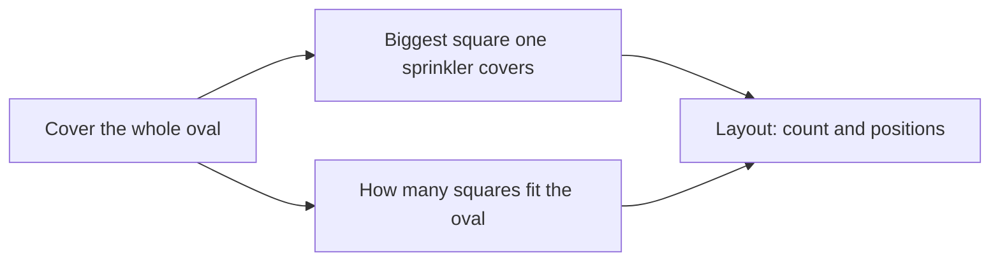

# Pin the problem down

Angles and shapes · Year 10: algorithms

<!-- Speaker note: Students pin down a spatial problem before designing anything: the inputs, the output, what counts as done, what must hold and what is assumed. They split the sprinkler job into two smaller problems and find the biggest square one sprinkler covers (AC9M10SP03, node 1). About 45 minutes (Predict and Run 8 min · Investigate 17 min · Modify 8 min · Practise and Make 12 min). -->

---

## Today

- I can write a spatial problem with exact inputs, output and success criterion.
- I can say what I'm assuming, out loud.
- I can split a job into two smaller problems that fit together.

<!-- Speaker note: Before class: Do the Predict yourself first. Students need Pythagoras (Finding a side) and the Year 9 idea of an algorithm as exact steps. The one idea: a problem has to be exact before an algorithm can solve it. Input, output, 'must be true', aim and assumption are the five pieces on the sort. The same job then splits into two smaller problems: how much one sprinkler covers, and how many of those fit. Hinge node, and a judgement one: there is no smaller step on purpose, because a lead-in would hand students the pieces. Let them argue over the sort, and keep asking what a machine would do with each line. The oval is treated as a rectangle, which is a simplification we name as an assumption. The real, curved school oval is the class project (node 3). The sizes, the sprinkler reach and the senior oval are all made up. Nothing here is a real measurement or needs a source. Teacher: Paper: the 6 m spray try-one and the Make task are worked on paper first, with a sketch of the square and its corner. Teacher: Investigate: for Kai, ask what two ovals of 100 m² you could draw that need different numbers of sprinklers. -->

---

## Why it matters

> "Cover the oval with as few sprinklers as you can." Is that enough for someone to start designing, or is something missing?

<!-- Speaker note: The school is putting new sprinklers on the junior oval, and the caretaker's note says to cover it with as few as you can. Hand that note to two people and you'd probably get two different layouts, and an argument about whose one counts. Before anyone writes steps for a machine, the job has to be **pinned down**: what goes in, what has to come out, and what counts as done. The sizes in this lesson are made up, and we'll treat the oval as a rectangle to begin with, which is itself a choice we'll write down. To warm up, have a guess about one sprinkler on a square patch of grass. -->

---

<span style="background:#dbeafe; color:#1a1a1a; border:1.5px solid #3b82f6; padding:6px 18px; border-radius:8px; font-size:1em; font-weight:500;">💬 Discussion</span>

## Predict

**A sprinkler's spray reaches 8 m in every direction (made up). It sits in the middle of a square patch 16 m on each side. Does the spray reach all of the patch?**

- No: the middle of each side is out of reach
- Yes: it reaches the middle of every side, so it reaches everything inside
- No: the four corners are out of reach

<!-- Speaker note: What happens: No. The middle of each side is exactly 8 m away, but a corner is about 11.3 m from the middle, so the four corners stay dry. Take two or three predictions before anyone runs it. -->

<!-- Speaker note: Teacher: take a show of hands before the check, then ask where the farthest point of a square is. -->

---

<span style="background:#dcfce7; color:#1a1a1a; border:1.5px solid #22c55e; padding:6px 18px; border-radius:8px; font-size:1em; font-weight:500;">✅ Check</span>

## What happened?

* No. The middle of each side is exactly 8 m away, but a corner is about 11.3 m from the middle, so the four corners stay dry.

<!-- Speaker note: Reveal after running. Ask who predicted it, and what made them think so. -->

---

<span style="background:#fef3c7; color:#1a1a1a; border:1.5px solid #f59e0b; padding:6px 18px; border-radius:8px; font-size:1em; font-weight:500;">✍️ Activity</span>

## Try it

Open the lesson at this step and try it together.

[tutorials.learningwaypoints.com/maths/angles/pin-the-problem-down/?full=step-2#step-2](https://tutorials.learningwaypoints.com/maths/angles/pin-the-problem-down/?full=step-2#step-2)

<!-- Speaker note:  -->

---

## Two smaller problems



<!-- Speaker note: The whole job, cover the whole oval, splits into two smaller problems: the biggest square one sprinkler covers, and how many of those squares fit the oval. Both feed into the layout, the count and the positions. -->

---

<span style="background:#dcfce7; color:#1a1a1a; border:1.5px solid #22c55e; padding:6px 18px; border-radius:8px; font-size:1em; font-weight:500;">✅ Check</span>

## Sort the pieces

**Here is the caretaker's job, written out. What kind of piece is each line?**

Groups: Input · Output · Must be true · Aim · Assumption

The oval is 40 m long and 24 m wide · The sprinkler's spray reaches 8 m · The number of sprinklers and where each one goes · Every point of the oval is within 8 m of a sprinkler · Sprinklers can only stand on the oval · Use as few sprinklers as possible · The spray is a full circle on flat ground · There is no wind

* Answer: The oval is 40 m long and 24 m wide → Input; The sprinkler's spray reaches 8 m → Input; The number of sprinklers and where each one goes → Output; Every point of the oval is within 8 m of a sprinkler → Must be true; Sprinklers can only stand on the oval → Must be true; Use as few sprinklers as possible → Aim; The spray is a full circle on flat ground → Assumption; There is no wind → Assumption

<!-- Speaker note: Inputs go in and the output comes out. 'Must be true' lines decide whether a layout counts at all. The aim chooses between layouts that count. Assumptions are things we're taking for granted and ought to say out loud. -->

<!-- Speaker note: Teacher: for the sort, ask a pair to disagree about one line (the aim and the success criterion are the usual tangle). -->

<style scoped>pre, marp-pre { font-size: 0.5em; line-height: 1.25; } section { font-size: 18px; }</style>

---

<span style="background:#dbeafe; color:#1a1a1a; border:1.5px solid #3b82f6; padding:6px 18px; border-radius:8px; font-size:1em; font-weight:500;">💬 Discussion</span>

## Pin it down, line by line

Here is the junior oval pinned down. Each line says what kind of piece it is.

Now try one on paper with the example beside you. Find the side of the biggest square one sprinkler covers when its spray is 6 m, saying why for each line.

$$\text{Oval: } L = 40,\ W = 24;\ \text{spray radius } r = 8$$

1) $\text{Output: the number of sprinklers, and where each goes}$ — What the answer has to say.
2) $\text{Done when every point is within } 8\text{ m of a sprinkler}$ — The success criterion. 'Covered' has to mean something exact.
3) $s \div \sqrt{2} = 8$ — Smaller problem 1. The corner is the furthest point, half a diagonal from the middle of a square with side $s$.
4) $s = 8\sqrt{2} \approx 11.3$ — One sprinkler covers a square about 11.3 m wide.
5) $40 \div 11.3 \approx 3.5,\ 24 \div 11.3 \approx 2.1$ — Smaller problem 2: how many of those squares each side takes. What to do with the part-squares is for the next lesson.

<!-- Speaker note: Model this live on the board before revealing anything: write each line and say why, pausing to ask the class what comes next. Then click to reveal the lines and compare. Script. Start: write Oval: L = 40,W = 24;spray radius r = 8 and say "Inputs, in metres. The oval is treated as a rectangle (an assumption)." Line 1: write Output: the number of sprinklers, and where each goes and say "What the answer has to say." Line 2: write Done when every point is within 8 m of a sprinkler and say "The success criterion. 'Covered' has to mean something exact." Line 3: write s ÷ 2 = 8 and say "Smaller problem 1. The corner is the furthest point, half a diagonal from the middle of a square with side s." Line 4: write s = 82 11.3 and say "One sprinkler covers a square about 11.3 m wide." Line 5: write 40 ÷ 11.3 3.5,24 ÷ 11.3 2.1 and say "Smaller problem 2: how many of those squares each side takes. What to do with the part-squares is for the next lesson." -->

<style scoped>pre, marp-pre { font-size: 0.5em; line-height: 1.25; } section { font-size: 16px; }</style>

---

<span style="background:#dcfce7; color:#1a1a1a; border:1.5px solid #22c55e; padding:6px 18px; border-radius:8px; font-size:1em; font-weight:500;">✅ Check</span>

## Pin it down, line by line

**Sprinklers with a spray of 6 m (made up) replace the old ones. How long is the side of the biggest square one sprinkler covers, to 1 decimal place? Write each step down, with a reason.**

* Answer: The corner is the furthest point from the middle of the square (so the square is covered when its corner is within 6 m); The corner is half a diagonal away: $s \div \sqrt{2} = 6$ (half the diagonal of a square with side $s$ is $s \div \sqrt{2}$); $s = 6\sqrt{2} \approx 8.5$ m (multiply both sides by $\sqrt{2}$)

<!-- Speaker note: The corner is the furthest point, so s ÷ √2 = 6 and s = 6√2 ≈ 8.5 m. -->

<style scoped>pre, marp-pre { font-size: 0.5em; line-height: 1.25; } section { font-size: 28px; }</style>

---

<span style="background:#dcfce7; color:#1a1a1a; border:1.5px solid #22c55e; padding:6px 18px; border-radius:8px; font-size:1em; font-weight:500;">✅ Check</span>

## Find the mistake

**Kai's definition gives the same answer for an oval 10 m by 10 m and one 100 m by 1 m, because both have an area of 100 m². Click the line that makes it unable to tell them apart.**

```
 1  Kai pins down the oval problem.
 2  Input: the oval's area in square metres, and the sprinkler's radius.
 3  Output: the number of sprinklers.
 4  Rule: sprinklers = oval area ÷ the area of one sprinkler's circle.
```

* Answer: line 2

<!-- Speaker note: Line 2: the input is only the area, so the shape is lost. The 10 m by 10 m oval needs one sprinkler and the long thin one needs several. (The rule in line 4 is shaky too, since circles leave gaps, but even a perfect rule couldn't tell the two ovals apart from an area alone.) -->

---

<span style="background:#dcfce7; color:#1a1a1a; border:1.5px solid #22c55e; padding:6px 18px; border-radius:8px; font-size:1em; font-weight:500;">✅ Check</span>

## Break it into two

**Which pair of smaller problems, solved in order, would solve the oval job?**

- How big a square one sprinkler covers, then how many of those squares fit the oval
- How much oval one sprinkler waters, then divide the oval's area by it
- How much water the oval needs, then how many sprinklers the tank can feed
- Put the first sprinkler anywhere, then add more at random until it looks covered

* Answer: How big a square one sprinkler covers, then how many of those squares fit the oval

<!-- Speaker note: The first problem is about one sprinkler and its furthest point. The second is about fitting those squares onto the oval. Together they give the layout. -->

<style scoped>pre, marp-pre { font-size: 0.5em; line-height: 1.25; } section { font-size: 21px; }</style>

---

<span style="background:#fef3c7; color:#1a1a1a; border:1.5px solid #f59e0b; padding:6px 18px; border-radius:8px; font-size:1em; font-weight:500;">✍️ Activity</span>

## Change the job


- **A new rule:** 
- **A smaller spray:** 
- **Smaller than one square:** 

<!-- Speaker note: What this step is for: Changing one piece of the pinned-down problem and seeing which parts move: a new rule, a new radius, and an oval smaller than the biggest square. For students who need more support: A printed frame with five headings (Input, Output, Must be true, Aim, Assumption) and the oval job's sentences to cut up and sort. For early finishers: Pin down a different spatial job, such as the fewest benches along a path with no one more than 20 m from a seat, and split it into two smaller problems. The hard part, on purpose: Saying 'cover the oval' without saying what covered means, or leaving out the shape. Ask: could a machine check your layout for any point? What would it need to be told? When students get stuck: A student puts 'as few as possible' under 'Must be true'. Ask: Does a layout with lots of sprinklers count as covered? Does a layout with dry patches? Fix: Covering is the rule; fewest is only the aim among layouts that cover. / A student gives the side as twice the radius. Ask: Where is the furthest point of the square from the middle? Fix: The corner, not the edge, so work from the half-diagonal. / A student says the area decides how many sprinklers. Ask: What about a 100 m by 1 m strip with the same area as a 10 m square? Fix: Put the lengths in the input, not just the area. -->

<!-- Speaker note: Teacher: before the cricket-pitch rule, ask which of the five kinds of piece it is. -->

---

<span style="background:#dcfce7; color:#1a1a1a; border:1.5px solid #22c55e; padding:6px 18px; border-radius:8px; font-size:1em; font-weight:500;">✅ Check</span>

## Squares along the long side

**The senior oval is 60 m long (made up) and the sprinkler's square is 11.3 m wide. How many squares is the 60 m side, to 1 decimal place?**

* Answer: 5.3

<!-- Speaker note: 60 ÷ 11.3 ≈ 5.31, so about 5.3 squares. -->

---

<span style="background:#dcfce7; color:#1a1a1a; border:1.5px solid #22c55e; padding:6px 18px; border-radius:8px; font-size:1em; font-weight:500;">✅ Check</span>

## Squares along the short side

**The same oval is 30 m wide. How many squares is the 30 m side, to 1 decimal place?**

* Answer: 2.7

<!-- Speaker note: 30 ÷ 11.3 ≈ 2.65, so about 2.7 squares. -->

---

<span style="background:#dcfce7; color:#1a1a1a; border:1.5px solid #22c55e; padding:6px 18px; border-radius:8px; font-size:1em; font-weight:500;">✅ Check</span>

## What counts as covered

**Which of these is an exact success criterion for the sprinkler job?**

- The oval looks green all over
- Every point of the oval is within the spray's reach of a sprinkler
- The sprinklers are spread out evenly
- Most of the oval gets wet

* Answer: Every point of the oval is within the spray's reach of a sprinkler

<!-- Speaker note: You can test it for any point, and a layout either passes or it doesn't. -->

<style scoped>pre, marp-pre { font-size: 0.5em; line-height: 1.25; } section { font-size: 25px; }</style>

---

<span style="background:#dcfce7; color:#1a1a1a; border:1.5px solid #22c55e; padding:6px 18px; border-radius:8px; font-size:1em; font-weight:500;">✅ Check</span>

## Review: a diagonal

**Review: a rectangle is 6 m by 8 m. How long is its diagonal, in metres?**

* Answer: 10

<!-- Speaker note: √(6² + 8²) = √100 = 10 m. -->

---

<span style="background:#fef3c7; color:#1a1a1a; border:1.5px solid #f59e0b; padding:6px 18px; border-radius:8px; font-size:1em; font-weight:500;">✍️ Activity</span>

## Make: back to the caretaker's note


- **Pin down another oval:** Write this on paper first, a line at a time with its reason.
- **The note's gaps:** **Also used in** - **Packing a van.** The inputs are the box sizes and the van's floor, the output is a layout, and done means everything fits. - **Phone masts.

<!-- Speaker note: What this step is for: Returning to the note: pinning down a new job, then answering the first smaller problem for it, and saying what the original note left out. -->

<!-- Speaker note: Teacher: ask what the caretaker would still have to tell you. -->

---

<span style="background:#dcfce7; color:#1a1a1a; border:1.5px solid #22c55e; padding:6px 18px; border-radius:8px; font-size:1em; font-weight:500;">✅ Check</span>

## Exit ticket

**A spray reaches 7 m. Write one thing that must be true of a layout, and find the side of the biggest square one sprinkler covers, to 1 decimal place.**

* Every point of the oval is within 7 m of a sprinkler. The side is 7 × √2 ≈ 9.9 m.

<!-- Speaker note: Students answer on paper or a mini whiteboard before the reveal. Anyone who cannot answer needs the main idea again next lesson. Where this leads: This covers AC9M10SP03 node 1. Where it leads: Write the algorithm (next lesson), which turns the two smaller problems into numbered steps and tests them on two ovals. Testing awkward cases and refining the algorithm (node 3) is the class project. -->
