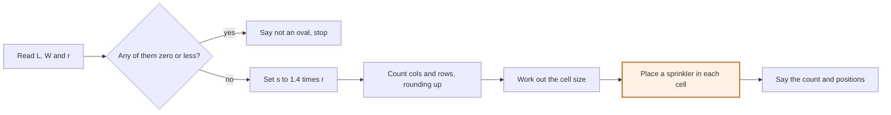

# Write the algorithm

Angles and shapes · Year 10: algorithms

<!-- Speaker note: Students turn the pinned-down sprinkler job into numbered steps with a decision and a loop, run the steps by hand on two ovals, and find a bug where a sprinkler is placed on the edge of its cell instead of the middle (AC9M10SP03, node 2). About 45 minutes (Predict and Run 8 min · Investigate 17 min · Modify 8 min · Practise and Make 12 min). -->

---

## Today

- I can write the steps of an algorithm exactly enough for a machine.
- I can say which steps compute, which decide and which repeat.
- I can run an algorithm by hand on two different inputs.

<!-- Speaker note: Before class: Do the Predict and the senior oval yourself first. Students need Pin the problem down, Pythagoras and the Year 9 idea that an algorithm has computation and decision steps. The one idea: an algorithm is exact steps that work for any input. Here the steps cut the oval into cells no wider than 1.4 × the reach (the biggest square is about 1.41 × the reach, so 1.4 is on the safe side), with a sprinkler in the middle of each cell. A decision guards the input and a loop places one sprinkler in every cell. The steps always cover the oval, but they don't always use the fewest sprinklers: the 11.5 m by 4 m oval in Modify needs two when one would do. That is on purpose, to show the gap. Testing awkward ovals (a curved one, a tree in the middle), finding where the algorithm fails and refining it is node 3, the class project, and isn't covered here. The junior and senior ovals, the reach and the sizes are all made up. A flowchart or pseudocode both work; the numbered steps and the flowchart in the lesson say the same thing. Teacher: Paper: the senior oval and the third oval are worked on paper first, a step at a time, with the steps beside you. -->

---

## Why it matters

> Hand the sprinkler plan to a friend who has never seen the job. Could they follow it step by step and get your answer, with nobody to ask?

<!-- Speaker note: Last time you pinned the sprinkler job down: an oval that's L long and W wide, a spray that reaches r, and every point within r of a sprinkler. Now the plan has to be written so exactly that a machine could follow it. You found that one sprinkler covers a square a bit under 1.41 × r wide, so the plan uses 1.4 × r to stay on the safe side, and the oval is cut into cells that size or smaller with a sprinkler in the middle of each. The tricky part is deciding how many cells fit, so have a guess at that before the steps. -->

---

<span style="background:#dbeafe; color:#1a1a1a; border:1.5px solid #3b82f6; padding:6px 18px; border-radius:8px; font-size:1em; font-weight:500;">💬 Discussion</span>

## Predict

**One sprinkler covers a square about 11.2 m wide (made up). The junior oval is 40 m by 24 m. How many sprinklers does it need to be fully covered?**

- 6 (3 across, 2 down)
- 8 (4 across, 2 down)
- 9 (3 across, 3 down)
- 12 (4 across, 3 down)

<!-- Speaker note: What happens: 12. Across, 40 ÷ 11.2 is about 3.6, so a fourth sprinkler is needed for the last strip. Down, 24 ÷ 11.2 is about 2.1, so a third is needed even though the last strip is thin: 4 × 3 = 12. Take two or three predictions before anyone runs it. -->

<!-- Speaker note: Teacher: take a show of hands. Most will say 6 or 9. Ask a student to say what happens to the leftover strip. -->

---

<span style="background:#dcfce7; color:#1a1a1a; border:1.5px solid #22c55e; padding:6px 18px; border-radius:8px; font-size:1em; font-weight:500;">✅ Check</span>

## What happened?

* 12. Across, 40 ÷ 11.2 is about 3.6, so a fourth sprinkler is needed for the last strip. Down, 24 ÷ 11.2 is about 2.1, so a third is needed even though the last strip is thin: 4 × 3 = 12.

<!-- Speaker note: Reveal after running. Ask who predicted it, and what made them think so. -->

---

<span style="background:#fef3c7; color:#1a1a1a; border:1.5px solid #f59e0b; padding:6px 18px; border-radius:8px; font-size:1em; font-weight:500;">✍️ Activity</span>

## Try it

Open the lesson at this step and try it together.

[tutorials.learningwaypoints.com/maths/angles/write-the-algorithm/?full=step-2#step-2](https://tutorials.learningwaypoints.com/maths/angles/write-the-algorithm/?full=step-2#step-2)

<!-- Speaker note:  -->

---

## The sprinkler algorithm



<!-- Speaker note: A flowchart of the sprinkler algorithm. Read the length, width and reach. A decision asks whether any of them is zero or less: if yes, say not an oval and stop. If no, set s to 1.4 times r, count the columns and rows rounding up, work out the cell size, place one sprinkler in each cell, then say the count and positions. -->

---

<span style="background:#dcfce7; color:#1a1a1a; border:1.5px solid #22c55e; padding:6px 18px; border-radius:8px; font-size:1em; font-weight:500;">✅ Check</span>

## Name each step

**Here is the algorithm, step by step. What does each step do?**

Groups: Computation · Decision · Loop · Output

Step 2: If L, W or r is zero or less, say 'not an oval' and stop · Step 3: Set s = 1.4 × r · Step 4: Set cols = L ÷ s and rows = W ÷ s, each rounded up · Step 5: Set w = L ÷ cols and h = W ÷ rows · Step 6: For each row and each column, put a sprinkler in the middle of the cell · Step 7: Say how many sprinklers, and where each one is

* Answer: Step 2: If L, W or r is zero or less, say 'not an oval' and stop → Decision; Step 3: Set s = 1.4 × r → Computation; Step 4: Set cols = L ÷ s and rows = W ÷ s, each rounded up → Computation; Step 5: Set w = L ÷ cols and h = W ÷ rows → Computation; Step 6: For each row and each column, put a sprinkler in the middle of the cell → Loop; Step 7: Say how many sprinklers, and where each one is → Output

<!-- Speaker note: A computation finds a number. A decision chooses between two paths. A loop repeats a step for every cell. The last step hands the answer back. -->

<!-- Speaker note: Teacher: ask a student to point at the loop and say what would have to be written without it. -->

<style scoped>pre, marp-pre { font-size: 0.5em; line-height: 1.25; } section { font-size: 18px; }</style>

---

<span style="background:#dbeafe; color:#1a1a1a; border:1.5px solid #3b82f6; padding:6px 18px; border-radius:8px; font-size:1em; font-weight:500;">💬 Discussion</span>

## Run it by hand

Here is the whole algorithm run on the junior oval.

Now run it yourself on paper, on the senior oval, with the example beside you. Write each step's result, then pick the reason for rounding up.

$$s = 1.4 \times 8 = 11.2$$

1) $\text{cols} = 40 \div 11.2 \approx 3.57 \to 4$ — Step 4: round up, since a part-cell still needs a sprinkler.
2) $\text{rows} = 24 \div 11.2 \approx 2.14 \to 3$ — Step 4 again.
3) $w = 40 \div 4 = 10,\ h = 24 \div 3 = 8$ — Step 5. The cells come out a little smaller than the biggest square, so they stay covered.
4) $x = 5, 15, 25, 35;\ y = 4, 12, 20$ — Step 6: the middle of each cell is $(i - 0.5) \times w$ across and $(j - 0.5) \times h$ down.
5) $4 \times 3 = 12$ — Step 7.

<!-- Speaker note: Model this live on the board before revealing anything: write each line and say why, pausing to ask the class what comes next. Then click to reveal the lines and compare. Script. Start: write s = 1.4 × 8 = 11.2 and say "Step 3." Line 1: write cols = 40 ÷ 11.2 3.57 4 and say "Step 4: round up, since a part-cell still needs a sprinkler." Line 2: write rows = 24 ÷ 11.2 2.14 3 and say "Step 4 again." Line 3: write w = 40 ÷ 4 = 10,h = 24 ÷ 3 = 8 and say "Step 5. The cells come out a little smaller than the biggest square, so they stay covered." Line 4: write x = 5, 15, 25, 35;y = 4, 12, 20 and say "Step 6: the middle of each cell is (i - 0.5) × w across and (j - 0.5) × h down." Line 5: write 4 × 3 = 12 and say "Step 7." -->

<style scoped>pre, marp-pre { font-size: 0.5em; line-height: 1.25; } section { font-size: 16px; }</style>

---

<span style="background:#dcfce7; color:#1a1a1a; border:1.5px solid #22c55e; padding:6px 18px; border-radius:8px; font-size:1em; font-weight:500;">✅ Check</span>

## Run it by hand

**Run the algorithm by hand on the senior oval: L = 60 m, W = 30 m, r = 8 m (made up). Write each step's result, then how many sprinklers it places.**

* Answer: $s = 1.4 \times 8 = 11.2$ (step 3); $\text{cols} = 60 \div 11.2 \approx 5.36$, rounded up to $6$ (step 4: a part-cell still needs a sprinkler); $\text{rows} = 30 \div 11.2 \approx 2.68$, rounded up to $3$ (step 4); $w = 60 \div 6 = 10$ and $h = 30 \div 3 = 10$ (step 5); $6 \times 3 = 18$ sprinklers (step 7: one in each cell)

<!-- Speaker note: s = 11.2, cols = 6, rows = 3, cells 10 m by 10 m, so 6 × 3 = 18 sprinklers. -->

<style scoped>pre, marp-pre { font-size: 0.5em; line-height: 1.25; } section { font-size: 28px; }</style>

---

<span style="background:#dcfce7; color:#1a1a1a; border:1.5px solid #22c55e; padding:6px 18px; border-radius:8px; font-size:1em; font-weight:500;">✅ Check</span>

## Find the mistake

**Zoe tries her algorithm on the junior oval (w = 10, h = 8) and finds the left end of the oval is out of reach of every sprinkler. Click the line where it goes wrong.**

```
 1  Read the oval's length L, its width W and the spray's reach r.
 2  Set s = 1.4 × r.
 3  Set cols = L ÷ s, rounded up. Set rows = W ÷ s, rounded up.
 4  Set w = L ÷ cols and h = W ÷ rows.
 5  For each row j from 1 to rows and each column i from 1 to cols:
 6      put a sprinkler at x = i × w and y = j × h.
 7  Say how many sprinklers, and where each one is.
```

* Answer: line 6

<!-- Speaker note: Line 6: x = i × w puts the first sprinkler at 10 m, the right-hand edge of its cell, so the cell's far corners are over 12 m away. The middle of the first cell is at x = 5, which is (i − 0.5) × w. -->

<style scoped>pre, marp-pre { font-size: 0.66em; line-height: 1.25; }</style>

---

<span style="background:#dcfce7; color:#1a1a1a; border:1.5px solid #22c55e; padding:6px 18px; border-radius:8px; font-size:1em; font-weight:500;">✅ Check</span>

## What the loop does

**What is the loop in step 6 for?**

- To stop the algorithm when the oval is covered
- To round the counts up
- To place a sprinkler in every cell without writing each position out
- To check that the oval has a sensible size

* Answer: To place a sprinkler in every cell without writing each position out

<!-- Speaker note: The loop repeats one placing step for every row and column, so the same few words handle an oval with 12 cells or 120. -->

<style scoped>pre, marp-pre { font-size: 0.5em; line-height: 1.25; } section { font-size: 27px; }</style>

---

<span style="background:#fef3c7; color:#1a1a1a; border:1.5px solid #f59e0b; padding:6px 18px; border-radius:8px; font-size:1em; font-weight:500;">✍️ Activity</span>

## Change the oval


- **An exact fit:** 
- **Just over one cell:** 
- **Enough, but not the fewest:** 
- **A different spray:** 

<!-- Speaker note: What this step is for: Running the algorithm on an oval with an exact fit, on one that is just over, and with a different spray, to see what changes and what the algorithm does when the answer isn't the fewest. For students who need more support: A printed copy of the seven steps and a blank table with columns for s, cols, rows, w, h and the count. For early finishers: Write the same algorithm in pseudocode with a loop that reads a list of ovals and prints each count, then try a staggered layout, where every second row is shifted half a cell, and see whether it needs fewer sprinklers. The hard part, on purpose: Rounding a count down, and putting a sprinkler on the edge of its cell. Ask: what is left over if you round down? Where is the middle of the first cell? When students get stuck: A student rounds 3.57 to 4 for one side and 2.14 to 2 for the other. Ask: What happens to the last strip on the short side? Fix: Round both counts up: any part-cell still needs a sprinkler. / A student sets the cell size to s, not to L ÷ cols. Ask: Do the cells fill the oval exactly? Fix: Divide each side by the rounded count, so the cells fit with no gaps. / A student puts the sprinkler at x = i × w. Ask: Where is the middle of the first cell? Fix: Half a cell in: (i − 0.5) × w. -->

<!-- Speaker note: Teacher: before 11.5 m by 4 m, ask whether the algorithm will place one or two. -->

---

<span style="background:#dcfce7; color:#1a1a1a; border:1.5px solid #22c55e; padding:6px 18px; border-radius:8px; font-size:1em; font-weight:500;">✅ Check</span>

## A new oval

**Run the algorithm on an oval 50 m long and 20 m wide (r = 8, so s = 11.2). How many sprinklers does it place?**

* Answer: 10

<!-- Speaker note: 50 ÷ 11.2 ≈ 4.46 rounds up to 5 columns. 20 ÷ 11.2 ≈ 1.79 rounds up to 2 rows. 5 × 2 = 10. -->

---

<span style="background:#dcfce7; color:#1a1a1a; border:1.5px solid #22c55e; padding:6px 18px; border-radius:8px; font-size:1em; font-weight:500;">✅ Check</span>

## Where the first one goes

**On that oval each cell is 10 m wide. How far along the 50 m side is the middle of the first cell, in metres?**

* Answer: 5

<!-- Speaker note: (1 − 0.5) × 10 = 5 m. -->

---

<span style="background:#dcfce7; color:#1a1a1a; border:1.5px solid #22c55e; padding:6px 18px; border-radius:8px; font-size:1em; font-weight:500;">✅ Check</span>

## A boundary case

**Which of these is a boundary case for the algorithm when s = 11.2?**

- An oval 40 m by 24 m
- An oval 30 m by 20 m
- An oval exactly 11.2 m long
- An oval 100 m by 50 m

* Answer: An oval exactly 11.2 m long

<!-- Speaker note: A boundary case sits right on the edge where the answer changes. At exactly 11.2 m the count is 1, and a hair over gives 2. -->

---

<span style="background:#dcfce7; color:#1a1a1a; border:1.5px solid #22c55e; padding:6px 18px; border-radius:8px; font-size:1em; font-weight:500;">✅ Check</span>

## Review: corner to middle

**Review: a cell is 6 m wide and 8 m tall, with the sprinkler in the middle. How far is the sprinkler from a corner, in metres?**

* Answer: 5

<!-- Speaker note: The corner is 3 m across and 4 m along from the middle: √(3² + 4²) = 5 m. -->

---

<span style="background:#fef3c7; color:#1a1a1a; border:1.5px solid #f59e0b; padding:6px 18px; border-radius:8px; font-size:1em; font-weight:500;">✍️ Activity</span>

## Make: the other oval


- **Run it on the third oval:** Write this on paper first, a step at a time.
- **Check the criterion:** **Also used in** - **Packing a van.** A loop places one box after another, a decision rejects a box that's too big, and the steps are exact enough for a program

<!-- Speaker note: What this step is for: Returning to the sprinkler job: running the whole algorithm on a new oval, then checking the answer against the success criterion. -->

<!-- Speaker note: Teacher: ask whether the answer meets the success criterion, and how they know. -->

---

<span style="background:#dcfce7; color:#1a1a1a; border:1.5px solid #22c55e; padding:6px 18px; border-radius:8px; font-size:1em; font-weight:500;">✅ Check</span>

## Exit ticket

**A sprinkler reaches 8 m (s = 11.2). Run the algorithm on an oval 25 m long and 14 m wide. How many sprinklers does it place?**

* 25 ÷ 11.2 ≈ 2.23 rounds up to 3 columns. 14 ÷ 11.2 = 1.25 rounds up to 2 rows. 3 × 2 = 6 sprinklers.

<!-- Speaker note: Students answer on paper or a mini whiteboard before the reveal. Anyone who cannot answer needs the main idea again next lesson. Where this leads: This covers AC9M10SP03 node 2. Node 3 (testing, refining and justifying) is left to class: the project is to test this algorithm on the school's own oval, find where it fails, and refine it. Where it leads: the same habit of pinning down, then writing steps, then testing, for any spatial job. -->
