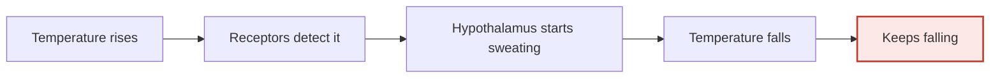

# How does your body stay at 37 °C?

Year 9 Biology · Coordination and control

<!-- Speaker note: Students operate a body-temperature negative feedback loop, explain why it is negative, and apply the pattern to blood sugar (AC9S9U01, node 5, a hinge node). About 22 minutes (Engage and Explore 9 min · Explain 7 min · Evaluate 3 min · Typical adds 2 min, Wider about 4 min). -->

---

## Today

**We are learning to** homeostasis keeps internal conditions near a set point by negative feedback: a change away from the set point is detected, and the response reverses it. Body temperature is controlled by the hypothalamus through sweating, shivering and blood flow.

- I can explain homeostasis as keeping conditions near a set point.
- I can describe how negative feedback corrects body temperature in both directions.
- I can apply the same loop to blood sugar.

<!-- Speaker note: Before class: A concept tutorial for introducing or revising the idea. Set the width with `?width=minimum`, `typical` (default) or `wider`. The hinge misconceptions are that body temperature is simply constant, and that "negative" means harmful. Board notes: a toy model. Body temperature drifts towards the air temperature and the body's own heat; the effectors respond to how far it is from 37 °C, with a short lag, so it wobbles and settles. A recovery counts once the body comes back within 0.3 °C after being more than 0.6 °C away. The numbers are not a real body's: real core temperature moves much less. The wider tier's break buttons switch off the receptors, the control centre or the effectors. -->

---

## Why it matters

> On a 45 °C day in Marble Bar or a frosty morning in Canberra, your body stays within about half a degree of 37 °C. Something is constantly correcting it.

<!-- Speaker note: Responses follow a pathway. This lesson: a pathway whose response feeds back to switch off its own stimulus. -->

---

💬 Discussion

## Engage: predict

**You walk from air-conditioning into a 42 °C day. What happens to your body temperature?**

- It stays exactly 37 °C because that's your temperature
- It starts to rise, the body detects it and responds, and it comes back near 37 °C
- It rises to 42 °C
- It drops

<!-- Speaker note: What happens: It starts to rise, receptors detect it, the hypothalamus switches on sweating and sends more blood to the skin, and it comes back near 37 °C. It is corrected, not fixed. Take two or three predictions before anyone runs it. -->

<!-- Speaker note: Teacher: count how many chose 'exactly 37'. -->

---

✍️ Activity

## Explore it

{{embed: https://tutorials.learningwaypoints.com/_playground-board/index.html?id=deck%2Fscience%2Fbiology-9%2Ffeedback%2Fstep-2&code=widget%3A+coordination%0Amode%3A+feedback%0A&fresh=1}}

[Open this step in the tutorial](https://tutorials.learningwaypoints.com/science/biology-9/feedback/?full=step-2#step-2)

<!-- Speaker note: Drag the **Air** slider far up or down. Watch the body temperature on the graph, and the message under the loop saying which corrective response is on. When the body has recovered, push it the other way. -->

<!-- Speaker note: Teacher: ask students to describe what the effectors do as the temperature comes back. -->

---

✅ Check

## What happened?

* It starts to rise, receptors detect it, the hypothalamus switches on sweating and sends more blood to the skin, and it comes back near 37 °C. It is corrected, not fixed.

<!-- Speaker note: Reveal after running. Ask who predicted it, and what made them think so. -->

---

## Negative feedback: the response reverses the change

```mermaid
flowchart LR
  accTitle: Negative feedback: the response reverses the change
  accDescr: A negative feedback loop for getting too hot. Body temperature rises above 37 °C. Receptors in the skin detect it. The hypothalamus compares it with the set point, 37 °C. Effectors respond: sweat glands sweat and skin blood vessels widen. Temperature falls back. Receptors keep checking, and once it is near 37 °C the response switches off.
  D[Temperature rises above 37 °C] --> R[Skin receptors detect it]
  R --> H[Hypothalamus compares with 37 °C]
  H --> E[Sweat, skin vessels widen]
  E --> C[Temperature falls back]
  C -- receptors keep checking --> R
  C -- near 37 °C --> O[Response switches off]
  class C new
  classDef new fill:#fff1e3,stroke:#c2570a,stroke-width:2px
```

<!-- Speaker note: A negative feedback loop for getting too hot. Body temperature rises above 37 °C. Receptors in the skin detect it. The hypothalamus compares it with the set point, 37 °C. Effectors respond: sweat glands sweat and skin blood vessels widen. Temperature falls back. Receptors keep checking, and once it is near 37 °C the response switches off. -->

---

✅ Check

## Hot or cold

**Too hot or too cold: which responses switch on?**

Groups: Too hot · Too cold

Sweating · Shivering · Blood vessels near the skin widen (skin flushes) · Blood vessels near the skin narrow (skin goes pale) · Hairs stand up (goosebumps)

* Answer: Sweating → Too hot; Shivering → Too cold; Blood vessels near the skin widen (skin flushes) → Too hot; Blood vessels near the skin narrow (skin goes pale) → Too cold; Hairs stand up (goosebumps) → Too cold

<!-- Speaker note:  -->

<!-- Speaker note: Teacher: 'why negative' is the checkpoint. -->

---

✅ Check

## Negative

**Why is it called negative feedback?**

- The receptors stop working
- It makes the temperature go down only
- It is bad for the body
- The response reverses the change: a rise causes a fall, a fall causes a rise

* Answer: The response reverses the change: a rise causes a fall, a fall causes a rise

<!-- Speaker note:  -->

---

💬 Discussion

## One student drew the loop like this: what is missing?

<!-- Speaker note: A student's drawing. Body temperature rises. Receptors detect it. The hypothalamus starts sweating. Temperature falls, and keeps falling. Nothing checks the temperature again or switches the sweating off. This drawing has a mistake in it on purpose: ask what is wrong before anyone says. -->

---

✅ Check

## Switching off

**On the board, what happens to sweating once body temperature is back at 37 °C?**

- It turns into shivering
- It keeps going all day
- It gets stronger
- It switches off, because the stimulus (too hot) has gone

* Answer: It switches off, because the stimulus (too hot) has gone

<!-- Speaker note:  -->

---

✅ Check

## Four parts

**Match each part of a negative feedback loop to what it is in body temperature control.**

| | |
|---|---|
| `Set point` | A. What the effectors do to reverse the change, such as sweating |
| `Deviation` | B. A change away from the set point, such as body temperature rising on a hot day |
| `Corrective response` | C. Receptors sense the temperature is back near 37 °C, so the response switches off |
| `Return detection` | D. The value the body keeps conditions near: about 37 °C |

* Answer: Set point → D. The value the body keeps conditions near: about 37 °C; Deviation → B. A change away from the set point, such as body temperature rising on a hot day; Corrective response → A. What the effectors do to reverse the change, such as sweating; Return detection → C. Receptors sense the temperature is back near 37 °C, so the response switches off

<!-- Speaker note:  -->

---

✅ Check

## Elaborate: blood sugar

**Order the steps when blood sugar rises after lunch.**

Groups: 1st · 2nd · 3rd · 4th

Blood sugar rises above the set point · Cells in the pancreas detect it and release insulin · Liver and muscle cells take up glucose · Blood sugar falls, so the pancreas releases less insulin

* Answer: Blood sugar rises above the set point → 1st; Cells in the pancreas detect it and release insulin → 2nd; Liver and muscle cells take up glucose → 3rd; Blood sugar falls, so the pancreas releases less insulin → 4th

<!-- Speaker note: What this step is for: The same loop with a hormone as the message shows negative feedback is a pattern. -->

---

✍️ Activity

## Elaborate: break the loop

{{embed: https://tutorials.learningwaypoints.com/_playground-board/index.html?id=deck%2Fscience%2Fbiology-9%2Ffeedback%2Fstep-5&code=widget%3A+coordination%0Amode%3A+feedback%0Abreak%3A+on%0A&fresh=1}}

[Open this step in the tutorial](https://tutorials.learningwaypoints.com/science/biology-9/feedback/?full=step-5#step-5)

<!-- Speaker note: What this step is for: Breaking one part of the loop and watching control fail shows every part is needed. -->

---

✅ Check

## Real failure

**If the sweat glands couldn't work (as in some burns patients), what would happen on a hot day?**

- The body couldn't cool down enough and could overheat, even though the brain detects the rise
- Nothing: the brain would fix it
- The body would get cold

* Answer: The body couldn't cool down enough and could overheat, even though the brain detects the rise

<!-- Speaker note:  -->

---

## Evaluate: look back

Write one sentence: "At first I thought… Now I think… because…"

**Revision summary**

- **Homeostasis:** keeping internal conditions (temperature, blood sugar, water) near a **set point**.
- **Negative feedback** has four parts around a **set point**: a **deviation** (a change away from it) is detected; a **corrective response** reverses it; **return detection** (receptors sensing it is back near the set point) switches the response off. "Negative" means it opposes the change.
- Too hot: sweating, skin blood vessels widen. Too cold: shivering, skin blood vessels narrow, goosebumps. The **hypothalamus** is the control centre.

---

✅ Check

## Exit ticket

**Describe what happens when your body temperature rises above 37 °C.**

* Temperature receptors detect it; the hypothalamus sends impulses to the sweat glands and skin blood vessels; sweating and widened vessels cool the body; once it is back near 37 °C, they switch off.

<!-- Speaker note: Students answer on paper or a mini whiteboard before the reveal. Anyone who cannot answer needs the main idea again next lesson. Where this leads: Next unit: reproduction (AC9S9U02). Later: blood sugar and diabetes as a context in Health. In class: measure skin temperature before and after exercise; a thermostat as a model (and where it breaks: the body has many effectors working together). -->
