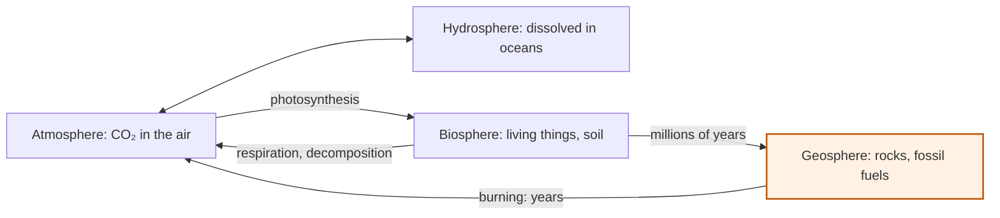

# What does burning fossil fuels do to the carbon cycle?

Year 9 Earth and space · The carbon cycle

<!-- Speaker note: Students explain that burning fossil fuels moves carbon from the geosphere to the atmosphere and why this is a net addition to the air's carbon store (AC9S9U03, node 4). About 22 minutes (Engage and Explore 9 min · Explain 7 min · Evaluate 3 min · Typical adds 3 min, Wider about 1 min). -->

---

## Today

- I can explain where the carbon in fossil fuels comes from.
- I can explain why burning them raises CO₂ in the air even though natural flows are bigger.
- I can describe where the extra carbon goes.

<!-- Speaker note: Before class: A concept tutorial for introducing or revising the idea. Set the width with `?width=minimum`, `typical` (default) or `wider`. The common reasoning error is comparing human emissions (about 10 GtC a year) with gross natural flows (about 120) and concluding they can't matter; the board shows the natural flows balance, so the extra accumulates. Board notes: the model starts balanced at 280 ppm (or at 420 ppm with `start: today`, burning at 10). Oceans and plants take up extra CO₂ in proportion to how far the air is above 280 ppm, so in the model about 60% of what is burned stays in the air over 50 years (about 45% in the real world). Numbers are rounded; the model leaves out land-use change and slow rock processes. The typical tier asks for a burning rate that holds today's CO₂ steady (about 4 GtC a year in the model: well under half of today's emissions, and the uptake would shrink over time in reality). The wider step's "cool burn" is used as a general fire-management term. If the class wants to know about cultural burning, use First Nations-led sources, for example Firesticks Alliance Indigenous Corporation (https://www.oric.gov.au/spotlight/cool-burning-country-and-community), rather than explaining it ourselves (roadmap/rules.md T1). -->

---

## Why it matters

> Coal is a forest from 300 million years ago. Burning it takes seconds.

<!-- Speaker note: Photosynthesis and respiration keep carbon flowing in and out of the air in balance, so what happens when a brand-new flow joins in? -->

---

💬 Discussion

## Engage: predict

**Plants take about 120 billion tonnes of carbon out of the air each year. Burning fossil fuels adds about 10. What do you predict happens to the CO₂ in the air?**

- It falls
- It rises: the natural flows balance each other, so the extra 10 builds up
- Nothing: 10 is tiny next to 120
- It rises by exactly 10 every year

<!-- Speaker note: What happens: It rises. The 120 out is matched by about 120 back in, so the extra 10 has nowhere to go except partly into the oceans and plants. Roughly half stays in the air. Take two or three predictions before anyone runs it. -->

<!-- Speaker note: Teacher: count how many chose 'nothing: 10 is tiny'. -->

---

✍️ Activity

## Explore it

{{embed: https://tutorials.learningwaypoints.com/_playground-board/index.html?id=deck%2Fscience%2Fearth-9%2Ffossil-fuels%2Fstep-2&code=widget%3A+carbon%0Amode%3A+cycle%0Acombustion%3A+on%0A&fresh=1}}

[Open this step in the tutorial](https://tutorials.learningwaypoints.com/science/earth-9/fossil-fuels/?full=step-2#step-2)

<!-- Speaker note: Set **Burning** to about today's rate (10), then **Run 50 years**. Watch the fossil fuel store, the air, and the oceans and living things. -->

<!-- Speaker note: Teacher: ask where the burned carbon went (the stores show it). -->

---

✅ Check

## What happened?

* It rises. The 120 out is matched by about 120 back in, so the extra 10 has nowhere to go except partly into the oceans and plants. Roughly half stays in the air.

<!-- Speaker note: Reveal after running. Ask who predicted it, and what made them think so. -->

---

✅ Check

## Where it was

**Where is the carbon in coal, oil and gas stored before it is burned?**

- Nowhere: burning creates carbon
- In the atmosphere
- In the geosphere, in long-buried living things
- In the oceans

* Answer: In the geosphere, in long-buried living things

<!-- Speaker note: Coal, oil and gas formed from plants and tiny sea creatures buried millions of years ago, so their carbon sits in the geosphere. -->

<!-- Speaker note: Teacher: the 'why it adds up' question is the checkpoint. -->

---

✅ Check

## Why it adds up

**Why does burning fossil fuels raise CO₂ in the air, when natural flows are so much bigger?**

- Fossil fuel carbon is a different kind of carbon
- It adds extra carbon to flows that were balanced
- It doesn't: the rise is natural
- It stops photosynthesis

* Answer: It adds extra carbon to flows that were balanced

<!-- Speaker note: Burning releases in years carbon that took millions of years to store. The natural flows were already balanced, so the extra builds up in the air. -->

---

✅ Check

## Where it went

**On the board, how much of the carbon you burned stayed in the air?**

- Most at first, then less as oceans and plants took more
- Exactly half, every time
- All of it: nothing else took any up
- None of it: the oceans and plants took it all

* Answer: Most at first, then less as oceans and plants took more

<!-- Speaker note: In the model, about nine tenths stays in the air in the first ten years and about three quarters after fifty, because the oceans and plants take up more as the CO₂ in the air rises. In the real world, about 45% of each year's emissions stays in the air. -->

---

✅ Check

## Why it matters

**Why does more CO₂ in the air matter for Earth's temperature?**

- CO₂ comes out of chimneys hot, and that heat warms the air
- CO₂ thins the ozone layer, letting in more sunlight
- More CO₂ blocks sunlight, so Earth cools
- It absorbs heat Earth gives off, slowing its escape

* Answer: It absorbs heat Earth gives off, slowing its escape

<!-- Speaker note: CO₂ is a greenhouse gas: it absorbs some of the heat Earth gives off, so more CO₂ slows heat escaping to space and Earth warms. -->

---

✍️ Activity

## Elaborate: starting from today

{{embed: https://tutorials.learningwaypoints.com/_playground-board/index.html?id=deck%2Fscience%2Fearth-9%2Ffossil-fuels%2Fstep-4&code=widget%3A+carbon%0Amode%3A+cycle%0Acombustion%3A+on%0Astart%3A+today%0A&fresh=1}}

[Open this step in the tutorial](https://tutorials.learningwaypoints.com/science/earth-9/fossil-fuels/?full=step-4#step-4)

<!-- Speaker note: What this step is for: Trying lower burning rates from today's 420 ppm shows what would steady the air's CO₂. -->

---

✅ Check

## What it took

**What did you have to do to keep the air's CO₂ steady?**

- Nothing
- Cut burning to only what the oceans and plants can take up: much less than today
- Stop burning completely: any burning at all makes CO₂ rise
- Burn more

* Answer: Cut burning to only what the oceans and plants can take up: much less than today

<!-- Speaker note:  -->

---

✅ Check

## Elaborate: a cool burn and a coal fire

**A cool burn of grassland and burning coal both release CO₂. Why do they affect the carbon cycle differently over decades?**

- There's no difference: CO₂ is CO₂
- Coal smoke is thicker, so it stays in the air longer
- Grass smoke has no carbon in it
- Grass regrows and takes its carbon back; coal's doesn't

* Answer: Grass regrows and takes its carbon back; coal's doesn't

<!-- Speaker note: Grass regrows within a year or two, taking the carbon back out of the air. Coal's carbon was locked away for millions of years and won't return to the rock soon, so it is a net addition. What this step is for: Comparing a fire whose carbon regrows with one whose carbon was locked away for millions of years sharpens the idea of a net addition. -->

---

## The carbon cycle: burning short-cuts the slow route

<!-- Speaker note: The carbon cycle. Four stores: atmosphere, hydrosphere, biosphere and geosphere. Photosynthesis moves carbon from the air into living things, and respiration and decomposition move it back. Carbon moves between the air and the oceans. Buried living things become fossil fuels over millions of years. New in this lesson: burning fossil fuels returns that carbon to the air in years. -->

---

## Evaluate: look back

Write one sentence: "At first I thought… Now I think… because…"

**Revision summary**

- **Fossil fuels** are carbon stored in the **geosphere** over millions of years.
- **Combustion** moves it to the **atmosphere** in years: a new flow added to a balanced cycle.
- Oceans and plants take up part of it (in the real world a bit over half); the rest builds up, so **CO₂ in the air rises** (280 ppm before 1800, about 420 ppm today).

---

✅ Check

## Exit ticket

**Plants and the oceans take up about half of the CO₂ we add each year. Why does CO₂ in the air still keep rising?**

* Burning moves carbon stored in the geosphere over millions of years into the air in years. The natural flows were balanced, so the half that plants and oceans don't take up builds up, year after year.

<!-- Speaker note: Students answer on paper or a mini whiteboard before the reveal. Anyone who cannot answer needs the main idea again next lesson. Where this leads: Next: Year 10, the greenhouse effect and climate change (AC9S10U04). -->
