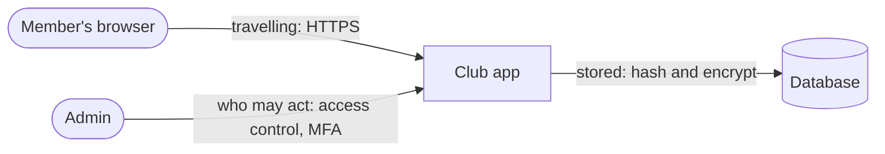

# Threat models

Cyber safety and privacy · Secure the system

<!-- Speaker note: Students use a data-flow diagram of the club app to name a risk and a defence at each point where data travels, is stored or is changed, then threat-model two new features (AC9TDI10P13 node 1). Defensive and conceptual. A 5E mission lesson. About 45 minutes (Engage and Explore 12 min · Explain 8 min · Elaborate 18 min · Evaluate 7 min). -->

---

## Today

- I can follow data through a system on a data-flow diagram.
- I can name what could go wrong where data travels, is stored or is changed.
- I can match a defence to each point.

<!-- Speaker note: Before class: AI step (wider, added 18 Oct 2026): prompt injection as a new point on the data-flow diagram; the defence is limiting what the AI can do (access control and a person approving actions). Source (checked 18 Oct 2026, AI society research brief claim 55): UK NCSC, 8 Dec 2025, "prompt injection will never be properly mitigated in the same way" as SQL injection. https://www.ncsc.gov.uk/blog-post/prompt-injection-is-not-sql-injection. Conceptual only: no attack practice (the course rule). Try the board yourself. The club app is made up. The one idea: follow the data; each point (travelling, stored, who may act) has its own risk and its own defence. Typical width: have students draw the data-flow diagram for an app they know (the school canteen, a game) on paper first, then mark the points. Teacher: Evaluate: compare answers for the canteen app. -->

---

## Why it matters

> The club app has HTTPS: the padlock is showing. Is it secure?

<!-- Speaker note: **Your mission:** before the club app launches, map where members' data goes and name a defence for every point where it could go wrong. -->

---

<span style="background:#dbeafe; color:#1a1a1a; border:1.5px solid #3b82f6; padding:6px 18px; border-radius:8px; font-size:1em; font-weight:500;">💬 Discussion</span>

## Think, pair, share

**What is the club app protecting, and from whom?**

- Who would want it?
- What might they try?

<!-- Speaker note: A threat model asks what matters, who might want it and how they could get it. Keep it to the made-up club app. Give 30 seconds alone, 2 minutes in pairs, then take answers from both sides. There is no single right answer: ask for a reason, and let students change their minds. -->

---

<span style="background:#dbeafe; color:#1a1a1a; border:1.5px solid #3b82f6; padding:6px 18px; border-radius:8px; font-size:1em; font-weight:500;">💬 Discussion</span>

## Engage: predict

**The club app uses HTTPS (the padlock). Which data does that protect?**

- Everything: the stored passwords and the admin page too
- Only data travelling between the browser and the app
- Only the photos
- Nothing: the padlock is decoration

<!-- Speaker note: What happens: Only data on the way. Stored passwords and who may use the admin page need their own defences. Take two or three predictions before anyone runs it. -->

<!-- Speaker note: Teacher: ask what the padlock actually means. -->

---

<span style="background:#fef3c7; color:#1a1a1a; border:1.5px solid #f59e0b; padding:6px 18px; border-radius:8px; font-size:1em; font-weight:500;">✍️ Activity</span>

## What matters most? <span style="font-size:.6em;color:#64748b">(5 min)</span>

Pairs list what the club app holds, then rank it from most to least damaging if it leaked.

<!-- Speaker note: Rankings differ; the point is naming what matters and why. -->

---

<span style="background:#fef3c7; color:#1a1a1a; border:1.5px solid #f59e0b; padding:6px 18px; border-radius:8px; font-size:1em; font-weight:500;">✍️ Activity</span>

## Try it

{{embed: https://tutorials.learningwaypoints.com/_playground-board/index.html?id=deck%2Fsystems%2Fcyber%2Fthreats%2Fstep-2&code=widget%3A+cyber%0Amode%3A+threat%0Aset%3A+login%0A&fresh=1}}

[Open this step in the tutorial](https://tutorials.learningwaypoints.com/systems/cyber/threats/?full=step-2#step-2)

<!-- Speaker note: Was your prediction right? -->

<!-- Speaker note: Teacher: ask which point they defended wrongly first, and why. -->

<style scoped>pre, marp-pre { font-size: 0.5em; line-height: 1.25; } section { font-size: 25px; }</style>

---

<span style="background:#dcfce7; color:#1a1a1a; border:1.5px solid #22c55e; padding:6px 18px; border-radius:8px; font-size:1em; font-weight:500;">✅ Check</span>

## What happened?

* Only data on the way. Stored passwords and who may use the admin page need their own defences.

<!-- Speaker note: Reveal after running. Ask who predicted it, and what made them think so. -->

---

## The club app as a data-flow diagram



<!-- Speaker note: A data-flow diagram of the club app. The member's browser sends data to the club app: travelling, so protect it with HTTPS. The app keeps data in a database: stored, so hash passwords and encrypt the rest. The admin can change things in the app: who may act, so use access control and MFA. -->

---

<span style="background:#dcfce7; color:#1a1a1a; border:1.5px solid #22c55e; padding:6px 18px; border-radius:8px; font-size:1em; font-weight:500;">✅ Check</span>

## Explain: follow the data

**Sam secures the club app. Click the line where it first goes wrong.**

```
 1  The club app has three points where data is at risk.
 2  At sign-in, passwords travel from the browser to the app.
 3  Sam turns on HTTPS, which encrypts data on the way.
 4  So all three points are now safe.
```

* Answer: line 4

<!-- Speaker note: Line 4: HTTPS only protects data while it travels. The stored passwords and the admin page are still open. What this step is for: The teacher models the threat-model questions on one point. Sam trusts HTTPS for everything, the misconception planted after the method. -->

<!-- Speaker note: Teacher: model the three questions on the admin page. -->

---

<span style="background:#dbeafe; color:#1a1a1a; border:1.5px solid #3b82f6; padding:6px 18px; border-radius:8px; font-size:1em; font-weight:500;">💬 Discussion</span>

## Defence for each <span style="font-size:.6em;color:#64748b">(4 min)</span>

Pick the top item and name one defence that fits it.

<!-- Speaker note: Match the defence to the threat, not the other way round. -->

---

<span style="background:#dcfce7; color:#1a1a1a; border:1.5px solid #22c55e; padding:6px 18px; border-radius:8px; font-size:1em; font-weight:500;">✅ Check</span>

## What does HTTPS protect?

**The club app uses HTTPS. What does that protect?**

- Data on its way
- Stored passwords
- Who may use the admin page
- All of the app

* Answer: Data on its way

<!-- Speaker note: Only data in transit; stored data and permissions need their own defences. Ask on mini whiteboards or by show of hands before the reveal. -->

---

<span style="background:#fef3c7; color:#1a1a1a; border:1.5px solid #f59e0b; padding:6px 18px; border-radius:8px; font-size:1em; font-weight:500;">✍️ Activity</span>

## Elaborate: photos

{{embed: https://tutorials.learningwaypoints.com/_playground-board/index.html?id=deck%2Fsystems%2Fcyber%2Fthreats%2Fstep-4&code=widget%3A+cyber%0Amode%3A+threat%0Aset%3A+photos%0A&fresh=1}}

[Open this step in the tutorial](https://tutorials.learningwaypoints.com/systems/cyber/threats/?full=step-4#step-4)

<!-- Speaker note: What this step is for: One change: a new feature adds two points to the diagram, one travelling and one about who may see. -->

<!-- Speaker note: Teacher: ask what the photos feature added to the diagram. -->

<style scoped>pre, marp-pre { font-size: 0.5em; line-height: 1.25; } section { font-size: 25px; }</style>

---

<span style="background:#fef3c7; color:#1a1a1a; border:1.5px solid #f59e0b; padding:6px 18px; border-radius:8px; font-size:1em; font-weight:500;">✍️ Activity</span>

## Make: Elaborate: messages


[Open this step](https://tutorials.learningwaypoints.com/systems/cyber/threats/?full=step-5#step-5)

<!-- Speaker note: What this step is for: Applying the model to a feature on their own: students place each point and its defence without the earlier diagram. Hints, in order: Is the message travelling, stored, or being opened by someone? / Who should be allowed to read a conversation? For students who need more support: A card with the three questions: travelling? stored? who may act? For early finishers: Draw the diagram for the canteen app with three actors (parent, school, bank) and defend every arrow. The hard part, on purpose: Students pick HTTPS for everything. Ask: is this data travelling right now, or sitting in the database? When students get stuck: A student thinks HTTPS covers everything (Sam's mistake). Ask: Where is the data at this point: on the network, or in the database? Fix: Each place needs its own defence. / A student confuses hashing with HTTPS. Ask: Is the password moving or stored? Fix: HTTPS on the way, hashing in storage. -->

---

<span style="background:#fef3c7; color:#1a1a1a; border:1.5px solid #f59e0b; padding:6px 18px; border-radius:8px; font-size:1em; font-weight:500;">✍️ Activity</span>

## Make: Elaborate: an AI helper reads the messages

An AI helper that **reads text from anyone** and **can act** adds a new point to the diagram. Text it reads can contain instructions (this is called **prompt injection**), and AI models can't reliably tell the difference between your instructions and the text they're reading.

The UK's National Cyber Security Centre says this can't be fully fixed like older attacks, so the defence is **access control for the AI**: give it only what it needs, and make a person approve anything that sends, deletes or shares.

<!-- Speaker note: What this step is for: A new point on the diagram: an AI helper that reads untrusted text and can act. The defence is to limit what it can do. -->

---

<span style="background:#dcfce7; color:#1a1a1a; border:1.5px solid #22c55e; padding:6px 18px; border-radius:8px; font-size:1em; font-weight:500;">✅ Check</span>

## Exit ticket

**Name two points in a web app where data is at risk, and the defence for each.**

* Travelling between browser and server (HTTPS); stored passwords (salted hashes); the admin page (access control and MFA).

<!-- Speaker note: Students answer on paper or a mini whiteboard before the reveal. Anyone who cannot answer needs the main idea again next lesson. Where this leads: Next: Kinds of weakness. -->
